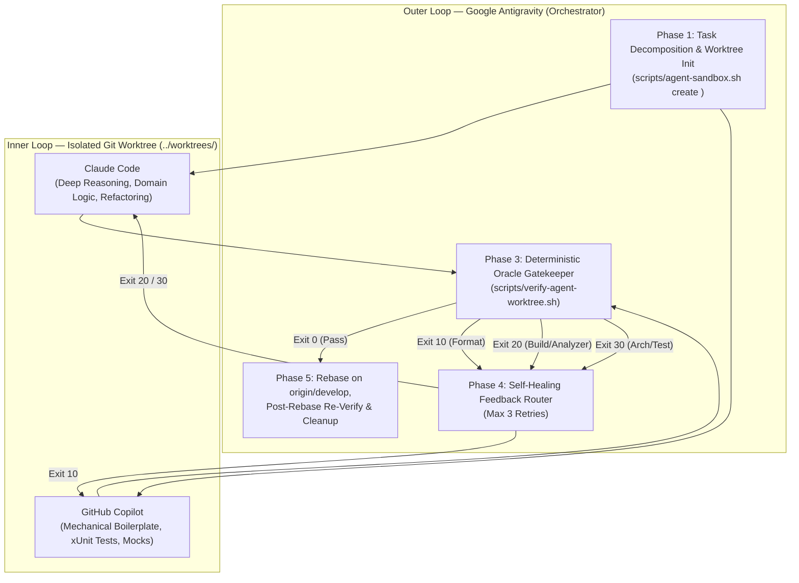

# GeoAssets — Tri-Planar Multi-Agent Orchestration Blueprint

This directory contains the declarative workflow specification ([`code-gen-dag.json`](code-gen-dag.json)) for **Google Antigravity** acting as the Outer-Loop DAG Orchestrator over **Claude Code** and **GitHub Copilot**. It is Antigravity's own concrete implementation of the agent-neutral protocol defined in [`.agents/skills/code-gen-dag/SKILL.md`](../../.agents/skills/code-gen-dag/SKILL.md) — the same `/code-gen-dag` orchestration can also be run natively from [Claude Code](../../.claude/skills/code-gen-dag/SKILL.md) or [GitHub Copilot](../../.github/skills/code-gen-dag/SKILL.md).

## Architectural Model

## Phase Reference

1. **Phase 1 — Task Decomposition & Worktree Initialization**:
   - Validates Jira dependencies (`Blocks` links + prose `"Depends on"` references).
   - Creates an isolated worktree at `../worktrees/<task-id>` forked strictly from `origin/develop` (`main` is hard-blocked).
2. **Phase 2 — Parallel Dispatch**:
   - **Claude Code** implements core domain invariants, spatial/topology algorithms, and architectural wiring per `CLAUDE.md` and `.claude/skills/*`.
   - **GitHub Copilot** scaffolds DTOs, test builders, mocks, and xUnit tests per `.github/copilot-instructions.md`.
3. **Phase 3 — Deterministic Oracle (`scripts/verify-agent-worktree.sh`)**:
   - Stage 1 (`Exit 10`): `dotnet format --verify-no-changes`
   - Stage 2 (`Exit 20`): `dotnet build --no-incremental /warnaserror` (Roslyn `latest-all`, `AsyncFixer`, `Meziantou.Analyzer`, `BannedApiAnalyzers` with `BannedSymbols.txt`)
   - Stage 3 (`Exit 30`): `dotnet test --no-build` (Architecture & invariant tests)
4. **Phase 4 — Feedback Self-Healing Loop**:
   - Routes targeted diagnostic summaries back to Copilot (`Exit 10`) or Claude Code (`Exit 20` / `Exit 30`) for up to 3 bounded repair cycles without permitting `#pragma warning disable` or `<NoWarn>`.
5. **Phase 5 — Worktree Cleanup & Merge Preparation**:
   - Rebases onto `origin/develop`, re-runs the Oracle post-rebase, prepares the PR targeting `develop` with `(TICKET-KEY)` commit suffixes, and destroys the sandbox via `./scripts/agent-sandbox.sh destroy <task-id>` once merged.

