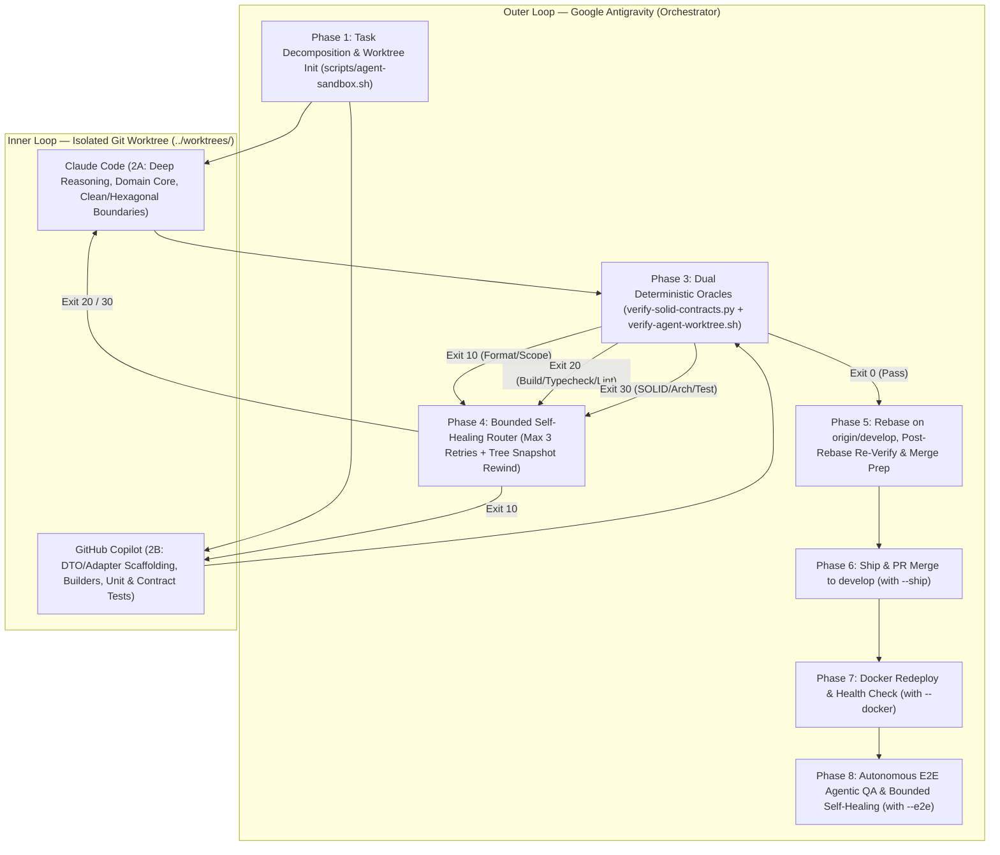

# Tri-Planar Multi-Agent Code Generation Blueprint (`/code-gen-dag`)

Declarative workflow specification ([`code-gen-dag.json`](code-gen-dag.json)) for **Google Antigravity** acting as the Outer-Loop DAG Orchestrator over **Claude Code** and **GitHub Copilot** across any programming stack configured in [`.harness/harness.env`](../../.harness/harness.env).

This is Google Antigravity's own concrete implementation of the agent-neutral ControlPlane-OuterLoop protocol defined in [`.agents/skills/code-gen-dag/SKILL.md`](../../.agents/skills/code-gen-dag/SKILL.md); Claude Code and GitHub Copilot each run their own native adaptation of that same protocol from `.claude/skills/code-gen-dag/SKILL.md` and `.github/skills/code-gen-dag/SKILL.md` respectively.

## Invocation & Deterministic `taskId` Resolution

```text
/code-gen-dag [taskId | "<prompt>"] [description | prompt] [--base origin/develop] [--retries 3] [--ship] [--docker] [--e2e[=scope]] [--e2e-retries 2]
```

- **Prompt-Only Execution (Optional `taskId`)**: The command can be executed with only a natural language prompt without an explicit `taskId`.
- **Resolution Strategy**:
  - If a Jira ticket key is detected in the prompt (e.g. `XD01-179`), derives `<TICKET-KEY>-<slug>`.
  - If no ticket key is supplied, generates a kebab slug plus a 6-character collision-free hex hash: `task-<slug>-<short-hash>` (e.g. `task-member-pagination-a7f3b2`).
  - Prints `[ORCHESTRATOR] Resolved taskId: <taskId>` during Phase 1.


