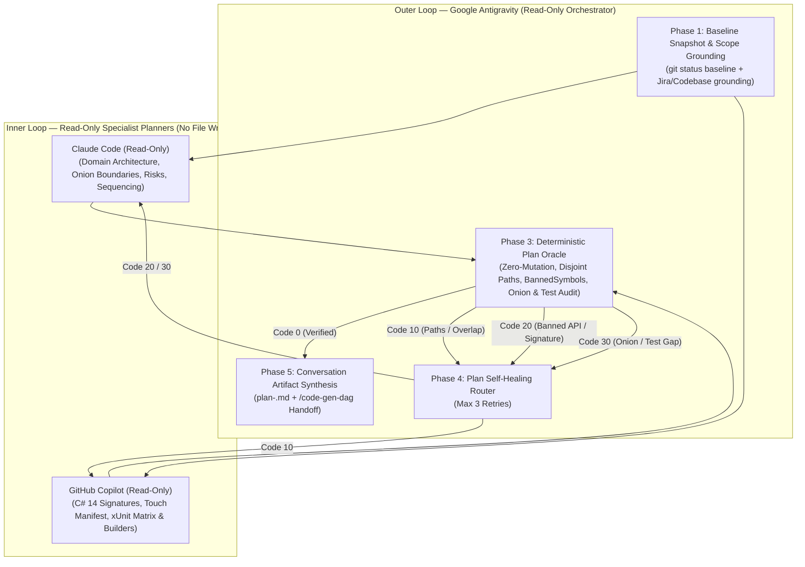

# GeoAssets — Tri-Planar Multi-Agent Planning Blueprint (Read-Only)

This directory contains the declarative planning workflow specification ([`plan-gen-dag.json`](plan-gen-dag.json)) for **Google Antigravity** acting as the **Read-Only Outer-Loop Planning DAG Orchestrator** over **Claude Code** and **GitHub Copilot**—producing an execution-ready implementation plan **without modifying any repository code**.

## Architectural Model

## Phase Reference

1. **Phase 1 — Read-Only Baseline Snapshot & Scope Grounding**:
   - Captures `git status --porcelain` baseline (no worktrees, branches, or commits created).
   - Validates Jira dependencies (`Blocks` links + prose `"Depends on"` references) and locates real target projects/types in `GeoAssets.sln`.
2. **Phase 2 — Parallel Read-Only Specialist Dispatch**:
   - **Claude Code (Read-Only)** drafts domain architecture, Onion layer boundaries (`core/` isolation), RFC 7946 spatial invariants, observability impacts, risk trade-offs, and the `coreLogicSpec` file slice using `CLAUDE.md`, `.claude/agents/{arch-designer,feat-analyzer,task-planner}.md`, and `.claude/skills/*`.
   - **GitHub Copilot (Read-Only)** drafts concrete C# 14 / .NET 10 type/interface contracts, the `[NEW]`/`[MODIFY]` touch manifest, `DomainTestDataBuilders`, and a 100%-branch xUnit `[Fact]`/`[Theory]` test matrix using `.github/copilot-instructions.md` and `.claude/agents/test-agent.md`.
3. **Phase 3 — Deterministic Plan Oracle**:
   - **Code 2 (Fatal)**: Working tree mutated (`git status --porcelain` differs from Phase 1 baseline).
   - **Code 10 (Stage 1)**: Non-existent `[MODIFY]` paths, missing `.razor` + `.razor.cs` pairs, or overlapping file ownership between Branch `2A` and Branch `2B`.
   - **Code 20 (Stage 2)**: Proposed signatures/snippets violate `BannedSymbols.txt` (`DateTime.Now`/`UtcNow`, `.Result`, `.Wait()`, `Thread.Sleep`) or use `#pragma warning disable` / `<NoWarn>`.
   - **Code 30 (Stage 3)**: Onion Architecture leakage (`core/` referencing EF Core/Npgsql/PostGIS), RFC 7946 coordinate-array violations, or missing xUnit branch coverage.
4. **Phase 4 — Plan Self-Healing Feedback Loop**:
   - Routes `Code 10` findings to Copilot and `Code 20` / `Code 30` findings to Claude Code for up to 3 bounded refinement cycles.
5. **Phase 5 — Conversation Artifact Synthesis & `/code-gen-dag` Handoff**:
   - Publishes the verified plan as an interactive Antigravity conversation artifact (`plan-<task-id>.md`) with zero repository file edits (unless `--out <path>` is explicitly passed), ending with a ready-to-run `/code-gen-dag <task-id>` command.
