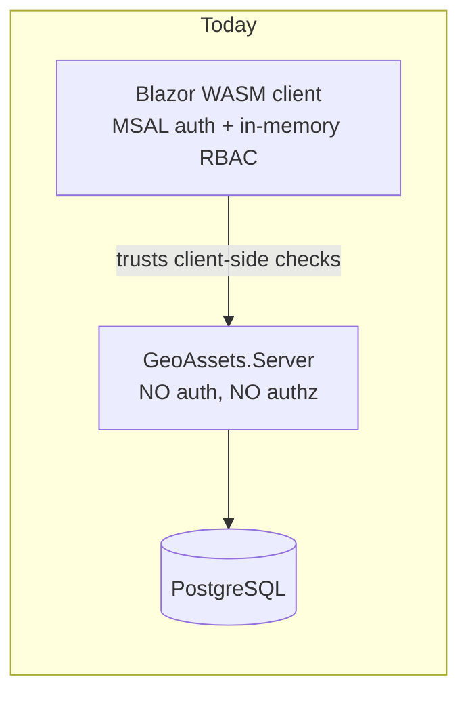
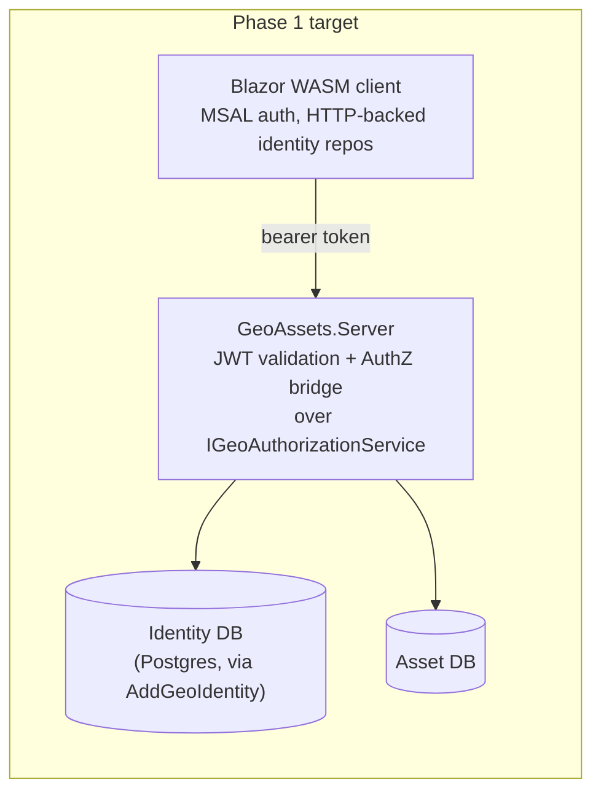

# Role & Organization-Scoped Authorization — Design Reference

This document captures the design for closing GeoAssets' authorization gap and
evolving it toward organization-scoped, multi-identity-provider access control. It
covers the current state (what's built vs. what's only enforced client-side), the
validated security gap, the server-side enforcement plan, the organization/cross-org
resource model, federated authentication, the Entra ID role-governance alternative,
and how all of it maps to Jira tracking.

Everything here is **design**, not yet built, except where explicitly marked
Implemented — most of the work is tracked as Jira epic **XD01-11** and its children.
See `ServiceOrder.md` for the Service Order workflow module's own domain model and
authorization engine (`ServiceOrderRules`), which this document treats as prior art
and extends rather than duplicates.

---

## 1. Current state — what's built vs. what's actually enforced

### The good news: a mature RBAC+ABAC stack already exists

`core/GeoAssets.Identity` has a full model, not a stub:

| Concept | Type |
|---|---|
| User | `AppUser` (linked to the external IdP via `ExternalObjectId`, JIT-provisioned) |
| Role | `AppRole` → `UserRole` (many-to-many; optionally scoped to another organization — §4, XD01-325) |
| Permission | `AppPermission` (`resource:action` codes) → `RolePermission` |
| Attribute claim | `UserClaim` (e.g. `zone=north`, `department=operations`) |
| Group | `AppGroup` → `UserGroup` |
| Tenant | `Organization` (users belong to exactly one) |
| Policy | `AppPolicy` + `PolicyRequirement` (Role \| Claim \| Permission, All/Any) |
| Evaluator | `GeoAuthorizationService` (`IsInRoleAsync`, `HasPermissionAsync`, `EvaluatePolicyAsync`, `GetAuthorizationContextAsync`) |

A second, independent authorization engine exists for the Service Order workflow
module: `ServiceOrderRules` (`core/GeoAssets.Workflow/Rules`) — a deny-overrides rule
chain over `WorkflowPrincipal`, deliberately decoupled from `GeoAssets.Identity` so
the workflow core has no dependency on any specific identity system. See
`ServiceOrder.md` §5.

### The validated gap: none of it is enforced server-side

`apps/GeoAssets.Server` (the real API — REST features/asset-types, WFS, WMS over
PostgreSQL) has **no authentication or authorization at all**. Only CORS is
configured, which restricts browser JS callers but not a direct HTTP client (curl,
Postman, a script). Meanwhile:

- `AddGeoIdentityWasm()` wires **in-memory, client-side** identity repositories into
  the Blazor WASM app (`apps/GeoAssets.Web/Extensions/GeoIdentityWasmExtensions.cs`),
  seeded on startup via `IdentitySeeder`. Roles/permissions/policies live only in
  browser memory.
- The EF Core identity backend (`GeoAssets.Identity.EFCore.AddGeoIdentity()`,
  Postgres-backed) is fully implemented but **no host registers it**.
- `ServiceOrderRules` only ever runs against the in-memory workflow store inside the
  WASM client (`AddWorkflowInMemory()` in `apps/GeoAssets.Web/Program.cs`).

**Net effect**: today's entire RBAC/ABAC model is UX polish (hides/disables UI
elements) — not a security boundary. Anyone calling `GeoAssets.Server` directly
bypasses all of it.



---

## 2. Roadmap

| Phase | Goal | Status |
|---|---|---|
| **Phase 1** | Turn `GeoAssets.Server` into a real resource server enforcing the existing role/permission/policy model | Designed — Jira XD01-12…18 |
| **Org-scoped resources** | Resources carry an owning `Organization`; actions require role AND same-org, with explicit cross-org grants | Designed — Jira XD01-20…22 |
| **Federated auth** | Support Google, Microsoft-personal, and org-owned identity, all landing in one GeoAssets tenant | Designed — Jira XD01-12, XD01-23 |
| **Phase 2 (backlog)** | Move coarse role *assignment* into Entra ID App Roles, keep fine-grained model local | Designed — Jira XD01-19, explicitly sequenced after Phase 1 |
| **Dispatch-recipient AND-composition** | Prototype of the "(relationship) AND (role)" pattern, in the workflow engine | **Implemented** — XD01-4, commit `16d9912` |

---

## 3. Phase 1 — server-side enforcement

Reuses what's already built instead of inventing a new authorization model.

- **AuthN**: `Microsoft.Identity.Web` validates the Azure AD access token as a JWT
  bearer on every request to `GeoAssets.Server`. The WASM client attaches its MSAL
  token to outgoing calls via the existing REST provider (`AddGeoAssetsRest()`).
  Neither vendor SDK is called directly at either composition root anymore
  (**XD01-48, Implemented**): `GeoAssets.Server`/`GeoAssets.Web` each depend on
  `IGeoAuthenticationProvider` (`GeoAssets.Identity.Authentication`), which
  `AddGeoAssetsAuthentication`/`AddGeoAssetsWasmAuthentication` default to an
  `EntraCiam*AuthenticationProvider` implementation unless a different one is
  passed in — the authentication-layer analog of how the AuthZ bridge below already
  decouples authorization from any specific backend. `ClaimsPrincipalCurrentUserAccessor`/
  `BlazorWasmCurrentUserAccessor` likewise no longer hardcode Entra claim-type
  strings, delegating to a configurable `ClaimMapping` (default: `ClaimMapping.EntraDefault`).
  Actually swapping to a different CIAM vendor remains out of scope — this only
  removes the hardcoding.
- **AuthZ bridge**: a custom `IAuthorizationPolicyProvider` + `IAuthorizationHandler`
  that resolves ASP.NET Core policy names to `AppPolicy` lookups and delegates
  evaluation to the *existing* `IGeoAuthorizationService.EvaluatePolicyAsync` /
  `HasPermissionAsync` — so `.RequireAuthorization("CanEditFeatures")` on a minimal
  API endpoint gets the same evaluation logic the Blazor UI already uses. One source
  of truth for policy definitions, shared by client and server.
- **Identity backend**: `AddGeoIdentity()` (EF Core, already written) gets registered
  in `GeoAssets.Server` against Postgres, with server-side seed data.
- **Endpoints**: REST/WFS/WMS endpoints get `.RequireAuthorization(...)` mapped to
  the existing `AppPermission` catalogue (`features:read`, `features:edit`, etc.).
- **Workflow**: `ServiceOrderRules` gets evaluated server-side, with `WorkflowPrincipal`
  built from real JWT claims via an extended `WorkflowPrincipalFactory`.
- **WASM identity repos**: the in-memory repos get replaced with HTTP-backed repos
  calling new `/api/identity/*` read endpoints, so the client's view of "what can I
  do" matches what the server will actually allow — no more split-brain state.



**This phase is a prerequisite for everything below** — org-scoping and cross-org
grants are moot until something server-side actually checks a token.

---

## 4. Organization-scoped resource authorization

### The requirement

- One GeoAssets identity tenant (users don't need their own separate Entra
  directories).
- **Resources**, not just users, carry an owning `Organization` — e.g. a
  `GeoFeature` or `ServiceOrder` belongs to Org X.
- Authorization is evaluated **against the specific resource**: role AND
  same-org-as-the-resource, not just "does this user have role R" in the abstract.
- **Cross-org exceptions**: a user in O1 can be explicitly granted access to O2's
  resources. Decided granularity: **org-to-org** (not per-user, not per-resource) —
  "everyone in O1 with role X may do action Y on O2's resources," the simplest shape
  that covers the driving use case (a contractor firm servicing a utility's whole
  network).

### Why the existing policy engine can't express this

`AppPolicy`/`GeoAuthorizationService.HasPermissionAsync`/`EvaluatePolicyAsync` are
**subject-only** — "can this user do X," with no notion of which resource X targets.
None of those methods take a resource parameter.

The closest existing prior art is `ServiceOrderRules`, which already evaluates
`(principal, action, order)` as a triple and already resolves an `OrgMember`
relationship (see §6 below for a concrete, already-implemented example of exactly
this AND-composition pattern).

### Design

**1. Resource ownership** — add `OrganizationId` to `GeoFeature`/`AssetType` and to
`ServiceOrder` (neither carries an owning org today; `ServiceOrder` only has
dispatch-*recipient* org matching, a different concept).

**2. A resource-aware authorization primitive** — ASP.NET Core's native
resource-based authorization (`IAuthorizationService.AuthorizeAsync(user, resource,
policy)`, `AuthorizationHandler<TRequirement, TResource>`), not a bespoke mechanism:

```
CanAsync(actionCode, resource):
    if !context.HasPermission(actionCode): return false        // base RBAC gate
    if user.OrganizationId == resource.OrganizationId: return true
    return grants.Any(g =>
        g.IsActive &&
        g.GranteeOrganizationId == user.OrganizationId &&
        g.ResourceOrganizationId == resource.OrganizationId &&
        (g.ResourceType is null || g.ResourceType == resource.Kind) &&
        (g.ScopeId is null || (resource is IScopeableResource s && s.ScopeId == g.ScopeId)) &&
        g.AllowedActions.Contains(actionCode) &&
        (g.RequiredRole is null || context.HasRole(g.RequiredRole)) &&
        (g.ExpiresAt is null || g.ExpiresAt > now))
```

**`ScopeId` narrowing** (added XD01-174, not in the original design above): a grant can
additionally carry a `ScopeId`, restricting it to one named subset of `ResourceType`
instead of all of it — e.g. one município's worth of a Distribuidora's `GeoFeature`s,
not everything the Distribuidora owns. Only resources implementing the new
`IScopeableResource` marker interface (`GeoFeature`, `ServiceOrder` — both via a
well-known key in their existing attribute dictionary, no schema change) can satisfy a
scoped grant; a resource type that doesn't implement it can never match one. Null
`ScopeId` (every grant predating this field) is ungated, exactly as before. **Known gap,
deliberately out of scope for XD01-174 — since closed** (`CrossOrgGrantRule` has matched
`ScopeId` since XD01-250, and the XD01-332 organization gate shares its matcher; the rest of
this paragraph is kept as the record of the original state): `ServiceOrder` cross-org access in practice is
enforced by a *separate* path — `CrossOrgGrantRule` in `ServiceOrderRules.cs`, consulting
pre-resolved `WorkflowOrgGrant` records (see §4's second integration point below) — which
does not carry or check `ScopeId` at all. A scoped grant is honored by
`OrgResourceAuthorizationHandler` for any `IOrgOwnedResource` passed through it (including
a `ServiceOrder`, since it implements `IScopeableResource` too), but **not** by
`ServiceOrderRules`'s own cross-org check — closing that second path, if ever needed, is
follow-up work, not part of this change.

**Unowned-resource exception** (added during XD01-21 implementation, not in the
original design above): every `GeoFeature`/`AssetType` created before XD01-20
shipped defaults to `OrganizationId = Guid.Empty` (that model's own "no
organization assigned" sentinel). Treating `Guid.Empty` as "belongs to no one, so
no one may access it" would have mass-locked out all pre-existing data the moment
this handler shipped — instead, `resource.OrganizationId == Guid.Empty` short-circuits
straight to "allowed" (after the base RBAC gate), same as if same-org matched.

**3. `OrganizationGrant`** — new entity:

```csharp
public sealed class OrganizationGrant
{
    public Guid    Id                     { get; set; }
    public Guid    GranteeOrganizationId  { get; set; }  // O1 — whose members receive access
    public Guid    ResourceOrganizationId { get; set; }  // O2 — whose resources are shared
    public string? ResourceType           { get; set; }  // null = all types, or "ServiceOrder" / "Feature"
    public string? ScopeId                { get; set; }  // null = all of ResourceType; else IScopeableResource match (XD01-174)
    public List<string> AllowedActions    { get; set; }  // permission codes
    public string? RequiredRole           { get; set; }  // optional extra gate
    public DateTime? ExpiresAt            { get; set; }
    public string?  GrantedBy             { get; set; }
    public DateTime GrantedAt             { get; set; }
    public bool     IsActive              { get; set; }
}
```

Index on `(GranteeOrganizationId, ResourceOrganizationId)` — the hot lookup path.

**4. Two integration points**:

| Resource | Mechanism |
|---|---|
| `GeoFeature` / `AssetType` | New `AuthorizationHandler<OrgResourceRequirement, IOrgOwnedResource>`, wired alongside the subject-only checks on REST endpoints (**Implemented — XD01-21**) |
| `ServiceOrder` | New `CrossOrgGrantRule` added to the existing `ServiceOrderRules` deny-overrides chain — an allow-contributor that abstains when no grant applies, same pattern as the other built-in rules (**Implemented — XD01-22**; see `ServiceOrder.md` §5/§16) — and, since **XD01-332**, a mandatory organization gate evaluated before that chain (below) |

**5. The two mandatory gates, side by side** (XD01-332). `GeoFeature`/`AssetType` have
had a same-organization-or-grant gate since XD01-21; `ServiceOrder` now has its
counterpart inside `ServiceOrderRules` (`ServiceOrder.md` §5). They are the same idea
with deliberate differences:

| | `OrgResourceAuthorizationHandler` (`GeoFeature`, `AssetType`; XD01-21) | `ServiceOrderRules` organization gate (`ServiceOrder`; XD01-332) |
|---|---|---|
| Where | ASP.NET Core resource handler, called per endpoint | In the rule engine (`OrderOrganizationGate`), so every caller of `Evaluate` — server routes, the selection service, agent executors, the Blazor client — gets it |
| Passes when | Same organization, or a grant listing **the action asked for** | Same organization, or a grant **covering the order** (any `serviceorders:` action), or **dispatch recipient** (user, group, organization) |
| Passing means | Access granted | Nothing yet — the rule chain then decides the action |
| Grant matching | Resource organization, type, `ScopeId`, `RequiredRole`, expiry, action | The same fields except the action (`CrossOrgGrantMatcher`, shared with `CrossOrgGrantRule`, which does check the action) |
| No organization (`Guid.Empty`) | Always allowed (unowned-resource exception above) | Allowed by default; `ServiceOrderRulesOptions.AllowOrdersWithoutOrganization = false` restricts such orders to their dispatch recipients |
| Refused caller gets | `403` | `404`, identical to an unknown order id, so the refusal does not confirm the id; `403` only for a caller inside the gate whom the rules decline |
| Ownership after creation | — | `OrganizationId` cannot change (`ServiceOrderOrganization`) |

A `ServiceOrder` passed through `OrgResourceAuthorizationHandler` directly (the ISP
tenant portal's attachment-request and dispute routes do this) is still held to the
left-hand column, including its `403`.

### Organization-scoped role assignments (XD01-325, first slice of XD01-324)

`OrganizationGrant` is organization-to-organization. XD01-324 adds a second layer for the
individual: a user, who still belongs to exactly one organization, can hold a role **on another
organization**. This slice ships the data model and the read API only — **no authorization
decision reads it yet** (`OrgResourceAuthorizationHandler`, `CrossOrgGrantRule` and
`OrganizationGrant` are untouched; that is XD01-326).

- `UserRole.OrganizationId` (nullable). `null` = held in the user's home organization (the only
  meaning before, and the value of every pre-existing row); a value = held on that organization.
  `UserRole` now has a surrogate `Id` key; one assignment per (user, role, scope) is enforced by
  two unique indexes — `(UserId, RoleId) WHERE "OrganizationId" IS NULL` for the home scope and
  `(UserId, RoleId, OrganizationId)` for organization scopes. Deleting the role or the
  organization cascades to its scoped assignments.
- `IUserRepository`: `AssignRoleOnOrganizationAsync` / `RemoveRoleOnOrganizationAsync`,
  `GetScopedRoleAssignmentsAsync(userId)`, `GetRoleAssignmentsOnOrganizationAsync(organizationId)`.
  The pre-existing `AssignRoleAsync`/`RemoveRoleAsync`/`GetRolesAsync`/`GetEffectivePermissionsAsync`/
  `GetByRoleAsync` stay home-scoped.
- `AuthorizationContext.RolesOn(org)` / `PermissionsOn(org)` / `HasRoleOn` / `HasPermissionOn`
  (and `IGeoAuthorizationService.IsInRoleOnAsync` / `HasPermissionOnAsync`): the home set for the
  user's own organization, otherwise only what is assigned on that organization. `Roles`/
  `Permissions`/`HasRole`/`HasPermission` never include a scoped assignment.
- Home roles keep coming from the identity provider's roles claim (§7); scoped assignments are
  local-only and are the one thing `GeoAuthorizationService` reads from the `UserRole` table.
  They are not pushed through `IRoleAssignmentProvider`, and `GET /api/identity/me`
  (`AuthorizationContextDto`) does not carry them yet, so the REST-backed clients see none.

### Scoped-role and order-type-restricted grants (XD01-326, second slice of XD01-324)

Two opt-in fields on `OrganizationGrant` (migration `AddOrganizationGrantScopedRoleAndOrderTypes`;
every existing grant migrates as `false` / `[]` and behaves exactly as before):

- `RequiresScopedRole` (default `false`). `false`: the organization-wide semantics above — the
  caller's **home** permission, `RequiredRole` against home roles. `true`: the grant is usable only
  through what the caller holds **on the resource organization** (`HasPermissionOn(O)`); home roles
  and permissions count for nothing, and `RequiredRole` is matched against the roles held on O.
  The grant's `AllowedActions` stays the ceiling: an action must be listed *and* held on O.
- `OrderTypeIds` (default empty = every order type), compared with `IServiceOrder.OrderTypeId`
  ignoring case. Accepted by `PUT /api/identity/organization-grants` only with
  `resourceType = "ServiceOrder"`; `OrgResourceAuthorizationHandler` never matches a grant that
  lists order types (its resources have none).

Both evaluation paths implement it:

| | `OrgResourceAuthorizationHandler` | `ServiceOrderRules` |
|---|---|---|
| Scoped grant qualifies when | listed action held on O (`AuthorizationContext.HasPermissionOn`) | same, through `WorkflowPrincipal.HasPermissionOn` (`CrossOrgGrantMatcher`) |
| Gate | — | a scoped grant covers the order only if the caller holds on O at least one `serviceorders:` action it lists |
| Rest of the decision | — | a caller reaching the order **only** through scoped grants (not a member, not a dispatch recipient, no organization-wide grant covering it) must have the action covered by such a grant (else `NoRuleGranted`, `ServiceOrderRules.NotGrantedOnOrganizationReason`), and the chain then sees it with its roles/permissions **on O** (`WorkflowPrincipal.OnOrganization`), so the order type's `ActionPermissions` still apply. Otherwise unchanged |

`GeoAssets.Workflow` still references no Identity assembly: `WorkflowOrgGrant` gains
`RequiresScopedRole`/`OrderTypeIds`, and `WorkflowPrincipal` gains `ScopedRoleNames`/
`ScopedPermissionCodes` (keyed by organization id) with `RoleNamesOn`/`PermissionCodesOn`/
`HasRoleOn`/`HasPermissionOn`. Both principal factories (`ServerWorkflowPrincipalFactory`, the
client's `WorkflowPrincipalFactory`) copy them from `AuthorizationContext`, and
`OwnOrganizationGrantDto` (`GET …/organization-grants/me`) carries both grant fields, so a vertical
host or client never reads a scoped grant as organization-wide. Wherever the context carries no
scoped permissions (the REST-backed clients and the vertical hosts, until XD01-329 exposes them), a
scoped grant opens nothing. Routes keep their home-permission route policies (`features:read`,
`serviceorders:read`) in front of these checks.

### Administering scoped roles (XD01-327, third slice of XD01-324)

An organization's administrator gives and takes away roles on it for named users of the organizations it has
contracted (`OrganizationScopedRolesRestApiExtensions`, under `/api/identity`):

| Route | Policy | Answers |
|---|---|---|
| `GET organizations/{orgId}/scoped-roles` | `users:read` | the assignments on `orgId`: user, user's home organization, role, assigned by, assigned at |
| `POST organizations/{orgId}/scoped-roles` `{ userId, roleId }` | `users:edit` | `201` the assignment (`200` if it already existed) |
| `DELETE organizations/{orgId}/scoped-roles/{assignmentId}` | `users:edit` | `204`; the holder loses it on their next request (the context is built per request) |
| `GET organizations/{orgId}/contracted-users` | `users:read` | the active users of the organizations holding an active, unexpired grant from `orgId` (never the caller) |
| `GET organizations/{orgId}/issued-grants` | `users:read` | those grants (`OrganizationGrantDto`, with `RequiresScopedRole`/`OrderTypeIds`) |
| `GET users/{id}/scoped-roles` | `users:read` | the roles the user holds on other organizations: all of them to the user's own organization and to a platform administrator, otherwise only those held on the caller's organization |

Rules, enforced by the server whatever the client sends:

- **Who administers `orgId`**: a caller whose home organization is `orgId`, or a **platform administrator** — the home
  permission `organizations:manage-all`, seeded but in no built-in role (every organization's administrator holds
  `Administrator`, so it cannot carry it). Anyone else gets `403` (`code: scoped-role.forbidden`). Both are home
  permissions: a role held *on* `orgId`, even `Administrator`, never makes its holder an administrator of `orgId`.
- **Who may be assigned**: an active user whose organization — not `orgId` — holds an active, unexpired grant from `orgId`
  (any grant; `RequiresScopedRole` only decides whether the grant then needs such a role). Otherwise `409`
  (`scoped-role.not-contracted`). Naming yourself is `400` (`scoped-role.self-assignment`).
- `AssignedBy` (the caller's email) and `AssignedAt` (`TimeProvider`) are the server's; the organization is the route's.

The refusal codes are `ScopedRoleAssignmentProblems`; the Web client is `IScopedRoleAdministrationClient`
(`RestScopedRoleAdministrationClient`). In the admin UI, *Organizations* shows a **Contractor access** panel under the
selected organization (`ContractorAccessPanel`: the issued grants read-only, the assignments with revoke, and
`AssignScopedRoleDialog`), and `UserDetail` lists *Roles on other organizations* apart from the home roles. Creating or
editing a grant from the UI is not part of this slice: grants are still provisioned by the vertical hosts through
`PUT organization-grants` (§4 above).

### Cross-organization mobile sync in FieldService (XD01-328, fourth slice of XD01-324)

`GeoAssets.FieldService.Server` has no identity database, so it decides the XD01-326 rule over
two local mirrors, fed by the kernel the way grants already were (XD01-290):

| Mirror (FieldService `ServiceOrderDbContext`) | Kernel feed | Written by |
|---|---|---|
| `OrganizationGrantMirror` — now with `AllowedActionsJson`, `RequiredRole`, `RequiresScopedRole`, `OrderTypeIdsJson` | `GET /api/identity/organization-grants/sync` (`organizations:read`), from `OrganizationGrantSyncOutbox`, which now carries those fields | `OrganizationGrantSyncWorker` |
| `ScopedRoleAssignmentMirror` — one row per (user, resource organization): the user's `oid`, role names, permission codes | `GET /api/identity/scoped-role-assignments/sync` (`users:read`), from `ScopedRoleAssignmentSyncOutbox` | `ScopedRoleAssignmentSyncWorker` |

- **Scoped role feed.** `GeoIdentityDbContext` records, in the same save, every (user,
  organization) pair a change may affect (`ScopedRoleAssignmentChangeCapture`): a scoped
  `UserRole` added or removed, a role's permission granted or revoked, a role renamed or deleted,
  an organization deleted, a user deleted or its `ExternalObjectId`/home organization changed. The
  feed (`EFScopedRoleAssignmentSyncFeed`) resolves each row to what the user holds there **when the
  batch is read**, exactly as `AuthorizationContext.ScopedRoles`/`ScopedPermissions` resolve it; a
  pair holding nothing is a **tombstone** (`isActive: false`), and the mirror drops the row.
- **Grant feed.** The `AddOrganizationGrantSyncRuleFields` migration re-records every existing
  grant, so each consumer's next poll fills the new mirror columns; a grant mirrored before that
  opens nothing (its `AllowedActions` reads `[]`).
- **Principal.** `FieldServiceCrossOrganizationAccess` builds a `WorkflowPrincipal` from the token
  (`oid` as user id, organization, roles) and the mirrors (`EFMirroredCrossOrganizationEntitlements`:
  the organization's active, unexpired grants, and the caller's scoped roles/permissions by `oid`).
  This host has no role-to-permission table, so home `PermissionCodes` are empty: a scoped grant is
  decided by the mirrored permissions on the resource organization, an organization-wide one by the
  actions it lists.
- **Pull** (`GET /api/field-service/sync/service-orders`): own-tenant orders as before, plus the
  orders of the organizations the caller's grants name, read through
  `EFServiceOrderRepository.GetOfOtherOrganizationsAsync` — an explicit path past the tenant query
  filter for those organizations only; the filter stays on for every other read and row-level
  security is untouched (the session is still the caller's organization, so the database returns
  only rows a mirrored grant opens to it) — each kept only if `ServiceOrderRules.Evaluate` allows
  `View`. Each order carries its `OrganizationId`; the MAUI field-work page names the owner of an
  order that is not the technician's organization.
- **Push** (`POST …/sync/service-orders`): own-tenant orders as before; another organization's only
  when the rule allows the pushed action on the stored order **and** on the pushed copy (so a push
  cannot change the order type or scope out of the grant). The action is the order type's
  `TriggerAction` for the status move (`Complete`, `Accept`, …), `Complete`/`Cancel` into
  `Completed`/`Cancelled` for a type without a graph, else `Execute` (an execution update). A refusal
  is still "ServiceOrder not found." Idempotency keys (XD01-236) are unchanged.
- **Staleness bound.** Both workers use `OrganizationGrantSync:*`: a grant or a role revoked in the
  kernel still counts in FieldService for about one `PollInterval` (15 s by default) after the
  change is recorded, plus the time to drain a backlog. The RLS policy reads none of the new
  columns: the database stays an organization-level backstop; per-user, per-order-type decisions are
  the rule's.

### Client entitlements (XD01-329, fifth slice of XD01-324)

`GET /api/identity/me/cross-org-entitlements` (`CrossOrgEntitlementsRestApiExtensions`, kernel only) is where the scoped
roles leave the server; `GET /api/identity/me` stays home-only (its `roles`/`permissions` are `AuthorizationContext.Roles`/
`Permissions`). Authenticated only (fallback policy), derived from the caller's own context, never another user's data;
always 200. Shape (`CrossOrgEntitlementsDto`, `GeoAssets.Identity`, shared by producer and consumers):

```json
{
  "grants": [ { "resourceOrganizationId": "…", "resourceOrganizationName": "COELBA", "resourceType": "ServiceOrder",
                "scopeId": "municipio-123", "orderTypeIds": ["cut"], "allowedActions": ["serviceorders:view", "serviceorders:execute"],
                "requiredRole": null, "requiresScopedRole": true, "expiresAt": null } ],
  "scopedRoles": [ { "organizationId": "…", "organizationName": "COELBA", "roles": ["Contractor C1"],
                     "permissions": ["serviceorders:view", "serviceorders:execute"] } ]
}
```

`grants` are the caller's organization's active, unexpired grants (every resource type, not only `ServiceOrder`), the
ones `ServerWorkflowPrincipalFactory` reads; `scopedRoles` are `AuthorizationContext.ScopedRoles`/`ScopedPermissions`.
The client reads it through `ICrossOrgEntitlementsService` (`GeoAssets.Identity`; Web: `RestCrossOrgEntitlementsService`,
MAUI: `NoCrossOrgEntitlementsService`): fetched with the authorization context at sign-in, again by `RefreshAsync` (the
Service Orders page does so whenever its list reloads), kept in memory only. The Web `RestGeoAuthorizationService` fills
`OrganizationGrants`/`ScopedRoles`/`ScopedPermissions` from it (it no longer calls `organization-grants/me`), so the
unchanged client `WorkflowPrincipalFactory` builds the kernel's principal and the action buttons follow the same
`ServiceOrderRules` answer — proven row by row by one matrix compiled into both suites
(`tests/GeoAssets.Server.Tests/CrossOrgEntitlements/CrossOrgEntitlementsParityMatrix.cs`). A non-success answer yields
no entitlement (offer less, never more). The Service Order list and detail name the owning organization of an order
whose organization the entitlements name.

Not yet: the vertical hosts (`KernelGeoAuthorizationService`, `AddKernelIdentity`) still read `/me` only, so on an order
a vertical host serves a scoped grant still opens nothing there — the client may then offer an action that host refuses
(the existing error path shows it). The MAUI app has no entitlement source (XD01-328 covers the mobile flow).

### Reference features of another organization (XD01-330, sixth slice of XD01-324)

A contractor may see the resource organization's assets on the map as a restricted reference — geometry and a
label, nothing else — through `GET /api/geoassets/organizations/{organizationId}/reference-features?bbox=minLon,minLat,maxLon,maxLat[&assetTypeId=]`
(`ReferenceFeaturesRestApiExtensions`).

- **Permission** `features:reference` (seeded, Administrator). A grant from the resource organization with
  `ResourceType = "GeoFeature"` (or none) must list it; the caller holds it at home for an organization-wide grant, or
  through a role on that organization for a `RequiresScopedRole` grant — the XD01-326 rule above.
- **Decided before any data is read**, from the organization alone: `OrganizationResourceAccess` is that rule, factored
  out of `OrgResourceAuthorizationHandler` (which now applies its answer to the resource it is handed). Its answer is
  *none*, *all*, or the set of the qualifying grants' `ScopeId`s; with a set, only features whose `scopeId` is in it are
  returned. The route requires an authenticated caller and nothing else — **not** the home `features:read`, unlike the
  other feature routes. A refused caller gets `403` with the same body whether or not the organization exists or has data.
- **Five fields** (`ReferenceFeature`): `id`, `geometry` (GeoJSON), `label` (the name), `assetTypeId`, `assetTypeName`.
  No attributes, topology, organization ids or audit fields. Only features the organization owns (not the shared ones),
  intersecting the mandatory `bbox` (`400` without one), at most `MaxBoundsFeatureCount` (10 000) by ordinal id, like
  `GET /features/bounds`. `Cache-Control: private`.
- **The read** goes through the `IReferenceFeatureQuery` port: PostGIS (`PostgresReferenceFeatureQuery`, registered by
  the `postgres-spatial` module) opens a short-lived context whose tenant is set to the resource organization for that
  query only — global query filter, `TenantTransactionInterceptor`'s transaction-local stamp (what the `geo_entity` RLS
  policy reads) and an explicit predicate, none of them relaxed; the request's own `ITenantContext` is never changed.
  Without the module, `OrganizationCatalogReferenceFeatureQuery` answers from the organization's catalog.
- Out of scope: rendering (XD01-331), WMS/WFS exposure, and any write, selection, export or topology traversal.

### Reference layer on the map (XD01-331, seventh slice of XD01-324)

The Web map shows those reference features as a labelled, non-interactive layer per organization
(`GeoAssets.Shared/Services/ReferenceLayers/`).

- **Which organizations are offered** (`ReferenceLayerOffer`): exactly those for which `OrganizationResourceAccess`
  would open the route, decided from the same inputs — the `/me` home context and the XD01-329 entitlements. Another
  organization (never the caller's own) is offered when one of its active, unexpired grants covers `GeoFeature` (or no
  resource type — a grant for `"Feature"` or any other type opens nothing), lists no order type, lists
  `features:reference`, and the caller qualifies: organization-wide through the home permission (and the named role at
  home), `RequiresScopedRole` through the permission (and the named role) held on that organization. One matrix compiled
  into both suites proves it row by row (`tests/GeoAssets.Server.Tests/ReferenceFeatures/ReferenceLayerOfferParityMatrix.cs`).
  A caller with no candidate grant gets no toggle, and no request is made.
- **Toggle** "Reference: COELBA" per organization in the layers panel (`ReferenceLayerToggles`), off by default, kept
  for the session by the scoped `ReferenceLayerService`.
- **Data flow**: `OnViewportChangedFromJs` → `ReferenceLayerService.OnViewportChangedAsync`, which supersedes every
  load in flight at once and, 300 ms later (injected `TimeProvider`), asks `IReferenceFeatureClient`
  (`RestReferenceFeatureClient`, the `GeoAssetsServer` client at `/api/geoassets/`) per switched-on organization. The
  viewport is normalized first (`ReferenceViewport`: latitudes clamped, a wrapped view moved back into ±180, a view across
  the antimeridian or a full turn wide asks for every longitude). The body goes to the map unparsed. Reference features
  never touch `IAssetProvider`, so they are absent from the feature list, auto-save, selection, export and the project
  session.
- **Rendering** (`IMapInterop.SetReferenceLayerAsync`/`ClearReferenceLayerAsync`/`GetViewBoundsAsync`,
  `geoassets.js`): SVG in a pane of its own below the user's features (z 350, labels 390), muted dashed style from
  theme tokens, labels as permanent tooltips (text nodes, never HTML) from zoom 16 up; `interactive: false`,
  `pmIgnore`, `snapIgnore`, outside every feature registry — no click, context menu, popup, Geoman editing or
  snapping, and no draw or selection tool sees them.
- **Revocation**: a `403` clears that layer and withdraws its toggle for the session, without an error. Other failures
  are logged and leave the layer as it was.
- The MAUI app has no entitlement source (`NoCrossOrgEntitlementsService`) and no REST client for the route
  (`UnavailableReferenceFeatureClient`), so its map is unchanged.

---

## 5. Federated authentication

### The requirement

Users must authenticate via Google, Microsoft personal accounts (Outlook/Live), or
a customer organization's own IdP/SSO — all landing in the one GeoAssets tenant from
§4. Today's config (`apps/GeoAssets.Web/wwwroot/appsettings.json`) hardcodes a single
tenant GUID as `Authority` — plain single-tenant Entra ID (`AzureADMyOrg`), which
cannot federate external/social identities.

### Design: Microsoft Entra External ID (CIAM)

One GeoAssets-owned CIAM tenant, configured with:

- **Google** and **Microsoft personal account** as social identity providers.
- **Direct Federation** (SAML/OIDC) connections per customer organization that has
  its own IdP.

All of it still issues one token type from one issuer — server-side JWT validation
(§3) barely changes; what changes is the tenant *type* and its configured providers,
largely a platform/config decision rather than app code.
`ClaimsPrincipalCurrentUserAccessor` already reads the `roles` JWT claim, so no
change needed there for role sourcing.

`Organization` membership becomes something JIT provisioning has to resolve — e.g.
from which federation connection the user authenticated through (deterministic for
org-SSO logins), or an admin assigns it post-signup for social logins where there's
no natural org signal in the token. **Open question** (not yet decided): does a
social-login user land with no organization until an admin assigns one, or is there
a self-service "join an organization" flow?

---

## 6. Worked example / prior art: dispatch-recipient AND-composition (Implemented)

Before designing the generic resource-aware mechanism in §4, the same
"(relationship) AND (role)" gap was found and fixed in the Service Order workflow
engine — **XD01-4, commit `16d9912`, already on `develop`**. It's the concrete
template §4's `OrganizationGrant.RequiredRole` and §4's `AuthorizationHandler`
follow.

**Problem**: `DispatchRecipientRule` only ever granted `View`/`Annotate` to
org/group/direct dispatch recipients — never `Assign`/`Dispatch`/`Execute`/`Reject`.
Granting those required a *global* role grant (`RoleBasedActionRule`), over-broad
because it would apply to every order, not just ones dispatched to that recipient.

**Fix**: `DispatchRecipientRule` now takes an optional `recipientRoleGrants` map
(`IReadOnlyDictionary<string role, IReadOnlySet<OrderActionType>>`), plumbed through
`ServiceOrderRules`'s constructor and `ServiceOrderRulesOptions.RecipientRoleGrants`.
A role only unlocks an action on orders **actually dispatched** to the principal:

```csharp
public bool? Evaluate(OrderActionType action, RuleEvaluationContext ctx)
{
    if ((ctx.Relationship & _recipientFlags) == 0) return null;

    switch (action)
    {
        case OrderActionType.View:
        case OrderActionType.Annotate:
        case OrderActionType.Accept:
            return true;
    }

    foreach (var (role, actions) in _roleGrants)
        if (actions.Contains(action) && ctx.Principal.HasRole(role))
            return true;

    return null;
}
```

Also added: `OrderActionType.Accept` — a first-class "I am claiming this order" verb,
distinct from `Assign` (done *to* someone else), granted unconditionally to any
recipient alongside `View`/`Annotate`.

Tests (`ServiceOrderRulesTests.cs`) include explicit non-leakage proofs: a matching
role without the dispatch relationship is denied, and a grant on one order doesn't
leak to a different order not dispatched to the same principal — the same proof
shape §4's `OrganizationGrant` design should be tested against.

---

## 7. Phase 2 (backlog) — Entra ID role governance

Explicitly sequenced after Phase 1 ships (role source only matters once something
server-side checks it). Captured here so the analysis isn't lost.

**Migration steps 3–4 below are Implemented (XD01-19)**, generalized to be
provider-agnostic per that ticket's 2026-08-18 rewrite: `GetAuthorizationContextAsync`
sources `Roles` from `CurrentUser.ExternalRoles` (the token's roles claim, read through
the XD01-48 `IGeoAuthenticationProvider`/`ClaimMapping` seam — not an Entra-specific
API), and `UserProvisioningService` no longer grants a default role. The rest of this
section (Entra manifest/App Roles registration, the Graph backfill tooling, admin UX,
eventually dropping `UserRole`) remains backlog — XD01-19's shipped scope was role
*sourcing* only, not the admin-management tooling around it, and stayed deliberately
silent on federated/social sign-in (§5's Organization-resolution open question is
still unresolved).

### What moves to Entra vs. what stays local

| Element | Fate |
|---|---|
| `UserRole` (assignment join table, `AssignRoleAsync`) | Home-scoped rows: eliminated — assignment lives in Entra `appRoleAssignments`. Organization-scoped rows (XD01-325, §4) stay local |
| `AppRole` | Becomes a shadow lookup (name → permission set), no longer an assignment target |
| `RolePermission`, `AppPermission` | Unchanged — pure app taxonomy, Entra has no concept of `serviceorders:complete` |
| `AppPolicy`/`PolicyRequirement` | Unchanged — the whole policy engine is untouched |
| `UserClaim` (zone/department) | Stays local — operational data, faster-changing than identity role |
| `AppGroup`/`UserGroup`/`Organization` | Stays local — dispatch/tenancy concept, not access-governance; also avoids Entra's 200-group JWT claim overage |

### Migration

1. Register `appRoles` in the Entra manifest (`Administrator`, `Supervisor`,
   `FieldTechnician`, `ReadOnly`).
2. **Backfill script** (one-time, not an ongoing sync job): a C# console tool using
   `Azure.Identity` + `Microsoft.Graph`, reading source-of-truth via
   `GeoIdentityDbContext`. Assigns **every** current role per user (not just the
   highest — the model already supports multi-role users) via
   `POST /users/{id}/appRoleAssignments`, using a dedicated, temporary,
   high-privilege (`AppRoleAssignment.ReadWrite.All`) app registration deleted right
   after use. Modes: `--dry-run` (default), `--only <ids>` for a pilot rollout,
   `--verify` to diff Entra assignments against expected DB state — required to show
   zero mismatches before the code cutover ships.
3. **(Implemented — XD01-19)** Switch `GeoAuthorizationService.GetAuthorizationContextAsync`
   to source `Roles` from `current.ExternalRoles` (the token) instead of the `UserRole`
   DB join — permissions for each role name still resolve against the local
   `AppRole`/`RolePermission` tables via `IRoleRepository`. `UserRole`/`AssignRoleAsync`
   are kept, unused by this path, as the rollback path this step already called for.
4. **(Implemented — XD01-19)** Drop the JIT default-role grant in
   `UserProvisioningService` — a user with no external role assignment naturally
   gets an empty `Roles` list, already treated as a safe no-permissions default.
5. Retire in-app role-assignment write paths; replace with the admin-UX design below.
6. Drop `UserRole` once confident.

### Admin UX for role assignment

No in-app "manage user roles" UI exists today — only the repository surface
(`AssignRoleAsync`, `CanManageUsers` policy). Recommended: build one now, Graph-native
from the start, rather than building it against the soon-to-be-eliminated `UserRole`
table:

- New `GeoAssets.Server` endpoints (`GET /api/admin/users`,
  `PUT /api/admin/users/{id}/roles`), gated by the existing `CanManageUsers` policy
  via the §3 AuthZ bridge.
- The server implements them with **its own app-only Graph credentials**
  (client-credentials flow) — never the calling admin's delegated browser token.
  `AppRoleAssignment.ReadWrite.All` must never reach the WASM client; the server
  verifies the caller is an Administrator via the policy engine, then makes the
  privileged Graph call on their behalf.

### Trade-offs

**Gains**: centralizes role governance in Entra (composable with Conditional
Access/Access Reviews if licensed); deletes a write path currently reachable from
app code; the JIT "auto-grant ReadOnly" default — a likely audit finding —
disappears; pairs naturally with Phase 1 (the `roles` claim is already in the
validated JWT). Entra App Roles also support `allowedMemberTypes: ["Application"]`,
a good conceptual fit for `WorkflowPrincipal.Kind = ActorKind.Agent` (AI-agent
principals, `ServiceOrder.md` §9) — an automation agent could become a real governed
Entra service principal.

**Costs**: role changes need Entra admin access or Graph automation instead of an
in-app flow (mitigated by the admin-UX design above); dynamic/group-based assignment
and Access Reviews need Entra ID P1/P2 licensing; local dev loses the
zero-dependency `IdentitySeeder` role-switching convenience; doesn't address the
existing "roles are global, not per-organization" limitation on `Organization` — §4
solves that independently, at the resource layer, not the role layer.

---

## 8. Jira tracking

Epic: **[XD01-11](https://xdicor.atlassian.net/browse/XD01-11)** — Role &
Authorization Hardening.

| Ticket | Title | Status |
|---|---|---|
| XD01-4 | Dynamic actor / organization-based dispatch routing — authorization rule gap | **Done** |
| XD01-12 | AuthN: validate Azure AD JWT bearer tokens in `GeoAssets.Server` (CIAM) | **Done** |
| XD01-13 | AuthZ bridge: `IAuthorizationPolicyProvider`/`Handler` over `IGeoAuthorizationService` | To Do |
| XD01-14 | Wire EF Core identity backend into `GeoAssets.Server` + Postgres | To Do |
| XD01-15 | Protect REST/WFS/WMS endpoints with permission policies | To Do |
| XD01-16 | Enforce `ServiceOrderRules` server-side | To Do |
| XD01-17 | WASM client: attach MSAL access token to `HttpClient` calls | To Do |
| XD01-18 | Replace WASM in-memory identity repos with HTTP-backed repos | To Do |
| XD01-19 | [Phase 2 — backlog] Migrate coarse role assignment to Entra ID App Roles | To Do |
| XD01-20 | Data model: `OrganizationId` on owned resources + `OrganizationGrant` | To Do |
| XD01-21 | Resource-aware authorization: `AuthorizationHandler` for features/asset-types | To Do |
| XD01-22 | `ServiceOrderRules`: `CrossOrgGrantRule` for cross-org service order access | To Do |
| XD01-23 | Federated authentication: Google/Microsoft-personal/org-SSO + `Organization` resolution | **Done** — merged into XD01-19, later split back out as XD01-49, resolved Done-without-implementing (see §9) |
| XD01-24 | Wire `GeoAssets.Workflow` into `GeoAssets.MAUI` (unrelated gap, surfaced while auditing XD01-5) | To Do |

Statuses as of 2026-08-04 — check Jira for current state before relying on this table.

---

## 9. Open questions

- ~~**JIT org resolution for social logins** (§5): no organization assigned by
  default, or self-service join flow? Blocks finalizing XD01-23.~~ **Resolved
  2026-08-25 (XD01-49):** moot, not answered — registration in GeoAssets is
  permanently invitation-only (self-service sign-up is disabled server-side,
  XD01-65), so there is no social/federated self-registration surface for this
  question to apply to. `PendingInvitation` carries no org/role field by design
  (XD01-66); org/role assignment happens post-first-login via the existing
  admin UI (XD01-63). The narrower, still-real gap this uncovered — the Rest
  backend never persisted a JIT-provisioned `AppUser` at all — is tracked as
  XD01-88, independent of federation or org resolution.
- **`OrganizationGrant` admin UI**: not yet ticketed — flag if wanted before XD01-20
  ships.
- **BFF/token-handler pattern**: considered as a stronger alternative to §3 (removes
  bearer tokens from the browser entirely), not tracked as a ticket yet — worth
  revisiting once Phase 1 ships, especially if the app ends up handling data with
  compliance requirements.
