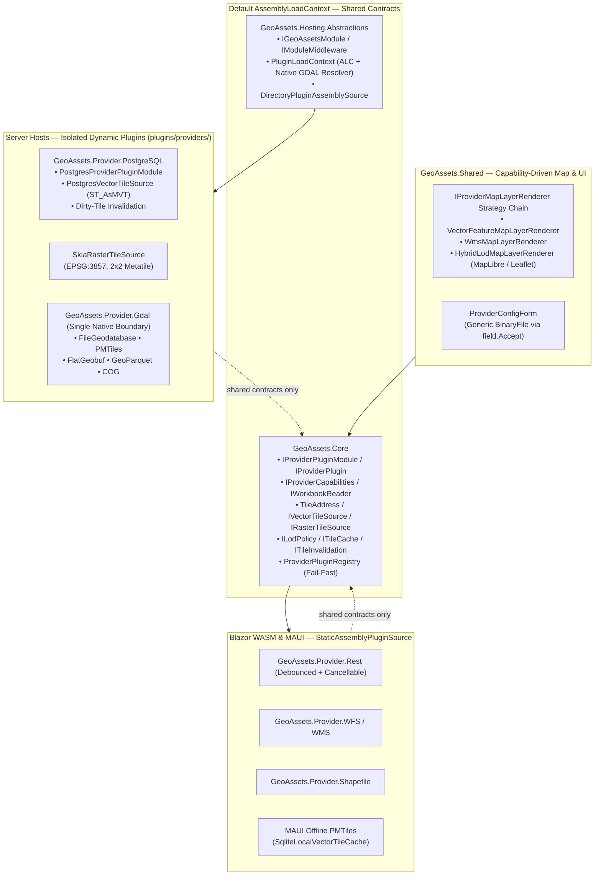

# ADR-002 — Provider Plugin Architecture, Hybrid Assembly Discovery & Hybrid LOD GIS Stack

| | |
|---|---|
| **Status** | Accepted (2026-11-26) — tracked by Jira epics **XD01-413 … XD01-419** (child tasks **XD01-420 … XD01-439**, labels `adr-002`, `provider-plugins-lod`). |
| **Scope** | `core/GeoAssets.Core`, `core/GeoAssets.Hosting.Abstractions`, `providers/GeoAssets.Provider.*`, `apps/GeoAssets.Server`, `apps/GeoAssets.Web`, `apps/GeoAssets.MAUI`, `apps/GeoAssets.Shared`, `apps/GeoAssets.FieldService.Server`, `apps/GeoAssets.IpBilling.Server`, `tools/GeoAssets.Bench.Render` |
| **Extends** | [ADR-001 — GeoAssets.Server Domain Decoupling](ADR-001-server-domain-decoupling.md) (Phase 4 Spatial Plane & Provider Pool) |
| **Supersedes** | — |

### Decisions Recorded

| # | Decision | Track / Epic |
|---|---|---|
| D1 | **Modular Plugin Entry Point (`IProviderPluginModule`)**: Provider assemblies expose an `IProviderPluginModule` (`PluginId`, `SupportedHosts`, `RegisterServices`) discovered and executed *before* `IServiceProvider` is built — supporting full MS.DI constructor injection and multi-port registration (`IProviderPlugin`, `IVectorTileSource`, `IRasterTileSource`, `IAssetExporter`). MEF (`System.ComponentModel.Composition`) is **not** used for providers. | Track 1–2 (`XD01-414`, `XD01-415`) |
| D2 | **Hybrid Assembly Discovery**: Server hosts discover external plugins from a configurable directory (`plugins/providers/`) via isolated `PluginLoadContext : AssemblyLoadContext` + `AssemblyDependencyResolver` (including `LoadUnmanagedDll`). Blazor WASM and MAUI use trimming-safe `StaticAssemblyPluginSource` over bundled assemblies. | Track 2 (`XD01-415`) |
| D3 | **Shared-Contract Boundary in `GeoAssets.Core`**: Every port crossing plugin boundaries (`IAssetProvider`, `IProviderPlugin`, `IProviderPluginModule`, `IProviderCapabilities`, `IWorkbookReader`, `TileAddress`, `IVectorTileSource`, `IRasterTileSource`, `ILodPolicy`, `ITileCache`, `ITileInvalidation`) lives in `GeoAssets.Core` (`AssemblyLoadContext.Default`) so composite providers (e.g., Hybrid LOD) never hit cross-ALC `InvalidCastException`. | Track 1, 4 (`XD01-414`, `XD01-417`) |
| D4 | **Capability-Driven Map Rendering**: Replace all 7 `is IWmsProvider` runtime type-switches with `IProviderCapabilities` (resolved through `UnwrapToConcrete()`) and an extensible `IProviderMapLayerRenderer` strategy chain so WMS, MVT, PMTiles, COG, and Hybrid LOD layers plug in without editing `GeoAssets.Shared` UI components. | Track 1, 5 (`XD01-414`, `XD01-418`) |
| D5 | **Single Native GDAL Boundary**: Consolidate all GDAL-backed formats (`FileGeodatabase`, `PMTiles`, `FlatGeobuf`, `GeoParquet`, `COG`) under one `GeoAssets.Provider.Gdal` plugin boundary with a single `GdalBase.ConfigureAll()` initializer inside one `PluginLoadContext`. | Track 6 (`XD01-419`) |
| D6 | **Server-Side Tiling & 3-Tier Hybrid LOD**: Evolve map rendering from viewport GeoJSON dumps to PostGIS `ST_AsMVT` vector tiles (`geom_3857` GiST) + `SkiaRasterTileSource` (EPSG:3857, 2×2 metatile) driven by one style source (`LayerResolver`), density-calibrated `ILodPolicy` (`Aggregate → Raster → Vector MVT` + `Editable GeoJSON` overlay), authenticated immutable tile caching `(orgScope, grantScopeHash, layerVersion)`, and `MapRenderMode.MapLibre` behind `IMapInterop`. | Track 4–6 (`XD01-417`…`XD01-419`) |
| D7 | **Fail-Fast vs. Host-Skip Semantics**: Incompatible `SupportedHosts` skip cleanly; broken loads (`ReflectionTypeLoadException`), duplicate `PluginId`, or invalid `LodPolicy` thresholds fail fast at startup. Tile endpoints bypass full-catalog `WarmCacheAsync`. | Track 1, 2, 4, 6 |

---

## Context

Following the completion of ADR-001 (`XD01-385`), `core/`, `verticals/`, `workflow/`, `ipbilling/`, `projects/`, and `apps/GeoAssets.Shared/` achieved zero `<ProjectReference>` links and zero `using GeoAssets.Provider.*` directives. However, two converging architectural audits revealed critical limitations:

1. **Provider Coupling Audit**: While `IProviderPlugin` and `ProviderPluginRegistry` exist, all host composition roots (`GeoAssets.Server`, `GeoAssets.Web`, `GeoAssets.MAUI`, `GeoAssets.FieldService.Server`, `GeoAssets.IpBilling.Server`, `GeoAssets.NeutralOperator.Server`) statically link provider `.csproj` files and call `AddGeoAssets*()` manually. Several SOLID smells remain (`IWorkbookReader` owned by `GeoAssets.Provider.Xlsx`, 7 `is IWmsProvider` branches in `GeoAssets.Shared` bypassing `UnwrapToConcrete()`, `.zip`-hardcoded `INativeFilePicker`, mixed plugin/tool registrations in `Shapefile`, and silent `FirstOrDefault` ID collisions in `ProviderPluginRegistry`).
2. **GIS Storage & Map Rendering Review**: PostGIS storage is sound, but retrieval and rendering operate as unthrottled viewport GeoJSON dumps with client-side zoom filtering, live uncached EPSG:4326 WMS rendering, and per-feature Leaflet SVG/Canvas layers. Moving to state-of-the-art MVT + Raster Hybrid LOD + Cloud-Native formats (`PMTiles`, `FlatGeobuf`, `GeoParquet`, `COG`) requires providers to contribute multiple optional ports (`IVectorTileSource`, `IRasterTileSource`, `ITileInvalidation`, `ILodPolicy`) and native GDAL drivers cleanly.

---

## Part 1 — Target Architecture

### Non-Negotiable Invariants
- **Core Database Encapsulation (Invariant 1)**: `ProviderPostgreSqlReferenceTests` remains green. Only `GeoAssets.Server` loads `GeoAssets.Provider.PostgreSQL`.
- **Zero Non-Composition-Root Provider Imports**: No endpoint, UI, or domain project may contain `using GeoAssets.Provider.*`.
- **Zero `is IWmsProvider` in UI/Map Components**: All render dispatch uses `IProviderCapabilities` (via `UnwrapToConcrete()`) and `IProviderMapLayerRenderer`.
- **Single Native GDAL Boundary**: `GdalBase.ConfigureAll()` initializes once in one `PluginLoadContext`.
- **No Full-Catalog Warmup for Tile Requests**: Tile endpoints never invoke `PostgresAssetProvider.WarmCacheAsync`.

---

## Part 2 — Code Smells & Evidence (Pre-Implementation Audit)

1. **Compile-Time Composition Root Coupling (OCP)**: `apps/GeoAssets.Web/Program.cs:162-165` manually calls `AddGeoAssetsRest/Wfs/Wms/Shapefile()`; `apps/GeoAssets.Server/Modules/ServerModules.cs:22-23` hardcodes built-in module instances; `apps/GeoAssets.MAUI/MauiProgram.cs:183` registers `IGeoCoreClient` without `ProviderPluginRegistry`.
2. **DIP Violation (`IWorkbookReader`)**: `apps/GeoAssets.IpBilling.Server/IpBilling{Fiscalizacao,Levantamento,Oficio}RestApiExtensions.cs:3-4` import `using GeoAssets.Provider.Xlsx;` solely to inject `IWorkbookReader` because the interface lives in the concrete provider project.
3. **OCP/LSP Type-Switching (`is IWmsProvider`) + Decorator Bug**: Repeated across 7 call sites (`ProviderPoolPanel.razor:66`, `ProviderPoolPanel.razor.cs:114,124,184,284`, `MapContainer.razor.cs:172,360`, `ProviderConnectionMapRenderer.cs:49`) without `UnwrapToConcrete()`. GeoJSON Import/Export buttons in `ProviderPoolPanel.razor:63-79` lack raster guards.
4. **Leaky Abstraction (`BinaryFile` → `.zip`)**: `ProviderConfigForm.razor:55` defaults `accept` to `.zip` and `ProviderConfigForm.razor.cs:62-65` unconditionally calls `INativeFilePicker.PickZipArchiveAsync()`, blocking `.pmtiles`, `.fgb`, `.parquet`, and `.tif`.
5. **Conflated Responsibilities in `providers/`**: `AddGeoAssetsShapefile()` (`ShapefileServiceExtensions.cs:12-18`) registers `IProviderPlugin` alongside `IShapefileExportService` and `IBdgdPonnotImportService` (side-effect in `FieldService.Server`).
6. **Silent Duplicate-ID Shadowing**: `ProviderPluginRegistry.Find` (`ProviderPluginRegistry.cs:16-17`) uses `FirstOrDefault` instead of failing fast on duplicate `Id`.
7. **GIS Retrieval & Rendering Bottlenecks**: No zoom parameter reaches the server (`RenderQueryOptions`), full-table `WarmCacheAsync` per org runs even for WMS tiles, uncached EPSG:4326 SkiaSharp PNGs, uncancelled/undebounced `moveend`/`zoomend` fetches in `RestAssetProvider.cs:115`, culture-sensitive bbox URLs (`RestAssetProvider.cs:103,114,189`), and `styleMap` dropped on raw-JSON pan (`MapInteropService.cs:117-123`).

---

## Part 3 — Unified 7-Track Roadmap & Jira Traceability

| Track | Epic | Child Tasks | Scope Summary |
|---|---|---|---|
| **Track 0** | [XD01-413](https://xdicor.atlassian.net/browse/XD01-413) | [XD01-420](https://xdicor.atlassian.net/browse/XD01-420) | `tools/GeoAssets.Bench.Render` 200k-feature PostGIS benchmark; record `z8`/`z12`/`z16` baseline in `docs/perf/render-baseline.md`. |
| **Track 1** | [XD01-414](https://xdicor.atlassian.net/browse/XD01-414) | [XD01-421](https://xdicor.atlassian.net/browse/XD01-421), [XD01-422](https://xdicor.atlassian.net/browse/XD01-422), [XD01-423](https://xdicor.atlassian.net/browse/XD01-423), [XD01-424](https://xdicor.atlassian.net/browse/XD01-424) | `IProviderPluginModule` + `ProviderHostTargets` + fail-fast `ProviderPluginRegistry`; `IProviderCapabilities` + `IProviderMapLayerRenderer` eliminating `is IWmsProvider`; move `IWorkbookReader` to `GeoAssets.Core`; generalize `INativeFilePicker`/`ProviderConfigForm`; split `ShapefileServiceExtensions` + architecture guardrails. |
| **Track 2** | [XD01-415](https://xdicor.atlassian.net/browse/XD01-415) | [XD01-425](https://xdicor.atlassian.net/browse/XD01-425), [XD01-426](https://xdicor.atlassian.net/browse/XD01-426), [XD01-427](https://xdicor.atlassian.net/browse/XD01-427), [XD01-428](https://xdicor.atlassian.net/browse/XD01-428) | `IProviderPluginModule` across Rest/WFS/WMS/Shapefile/PostgreSQL; `StaticAssemblyPluginSource` + `AddDiscoveredProviderPlugins` (WASM/MAUI trimming-safe); `PluginLoadContext` (ALC + `LoadUnmanagedDll`) + `DirectoryPluginAssemblySource`; host migrations (`Web`, `MAUI`, `Server`) + dynamic packaging. |
| **Track 3** | [XD01-416](https://xdicor.atlassian.net/browse/XD01-416) | [XD01-429](https://xdicor.atlassian.net/browse/XD01-429), [XD01-430](https://xdicor.atlassian.net/browse/XD01-430) | Existing-path quick wins: 150ms debounce, cancellable REST fetches, diff render, `styleMap`/culture fixes; SQL `MinZoom`/`MaxZoom` + `LIMIT`, compact JSON + compression, NTS `Multi*` & `JsonSerializerOptions` fixes. |
| **Track 4** | [XD01-417](https://xdicor.atlassian.net/browse/XD01-417) | [XD01-431](https://xdicor.atlassian.net/browse/XD01-431), [XD01-432](https://xdicor.atlassian.net/browse/XD01-432), [XD01-433](https://xdicor.atlassian.net/browse/XD01-433), [XD01-434](https://xdicor.atlassian.net/browse/XD01-434) | Shared tile/LOD contracts in `GeoAssets.Core`; PostGIS `geom_3857` GiST migration + `PostgresVectorTileSource` (`ST_AsMVT`) + after-commit dirty-tile invalidation; `SkiaRasterTileSource` (3857, 2×2 metatile); authenticated `/tiles/{layer}/{v}/{z}/{x}/{y}.mvt|.png` & `/tiles/style.json` with immutable caching. |
| **Track 5** | [XD01-418](https://xdicor.atlassian.net/browse/XD01-418) | [XD01-435](https://xdicor.atlassian.net/browse/XD01-435), [XD01-436](https://xdicor.atlassian.net/browse/XD01-436) | `MapRenderMode.MapLibre` (`geoassets.maplibre.js`, bearer `transformRequest`, `terra-draw`, GPU hit-testing); `HybridLodMapLayerRenderer` strategy, GeoJSON edit overlay with MVT ID hide, interim Leaflet raster/vector split. |
| **Track 6** | [XD01-419](https://xdicor.atlassian.net/browse/XD01-419) | [XD01-437](https://xdicor.atlassian.net/browse/XD01-437), [XD01-438](https://xdicor.atlassian.net/browse/XD01-438), [XD01-439](https://xdicor.atlassian.net/browse/XD01-439) | Unified `GeoAssets.Provider.Gdal` plugin (`FileGeodatabase`, `PMTiles`, `FlatGeobuf`, `GeoParquet`, `COG`) with single native initializer; MAUI offline PMTiles packs via `SqliteLocalVectorTileCache`; per-`(org, assetType)` density LOD calibration job + fail-fast `LodPolicy` startup validation. |

### As built — directory plugin loader (XD01-427)

`core/GeoAssets.Hosting.Abstractions/Plugins/` (namespace `GeoAssets.Hosting.Abstractions.Plugins`; the project now references `GeoAssets.Core`):

- **`PluginLoadContext : AssemblyLoadContext`** (one per plugin, not collectible) resolves the plugin's private dependencies from its folder through its `.deps.json` (`AssemblyDependencyResolver`). **Sharing rule (D3)**: an assembly the host has (its trusted platform assemblies, or already loaded in `AssemblyLoadContext.Default`) comes from the host — always for the shared contracts (`GeoAssets.Core`, `GeoAssets.Identity`, `GeoAssets.Hosting.Abstractions`, `Microsoft.Extensions.*`), whatever version the plugin asks for; for any other assembly only when the host's version is at least the requested one, else the plugin's copy. An assembly the host doesn't have comes from the plugin's folder. **Native libraries** (`LoadUnmanagedDll`): the `.deps.json` native assets for the running RID first (`runtimes/<rid>/native/*`), then — for a library it doesn't list — the plugin folder, then `runtimes/<rid>/native/` for the running RID and its portable `<os>-<arch>`, trying the platform's file names (`gdal` → `gdal.so`/`libgdal.so`, `.dylib`, `gdal.dll`); otherwise the runtime's default probing.
- **`DirectoryPluginAssemblySource : IPluginAssemblySource, IPluginLoadContextRegistry`** reads `GeoAssets:ProviderPlugins:Directory` (default `plugins/providers`, relative to the host's base directory): every subfolder `<PluginName>/<PluginName>.dll` (except `runtimes` and dot-folders), then — only when the host sets `GeoAssets:ProviderPlugins:FlatFilePattern` (e.g. `GeoAssets.Provider.*.dll`; the provider naming stays in the host's configuration, not in `core/`) — every matching `.dll` directly in the root, each in its own context, once. Fails fast (D7) on a missing directory, a folder without its entry assembly, two plugins with one name, an unloadable entry assembly, unreadable types, or an entry assembly with no public `IProviderPluginModule`.
- **`AddProviderPluginsFromDirectory(services, configuration, hostTarget|options, params additionalSources)`** runs one `AddDiscoveredProviderPlugins` over the additional sources (e.g. a `StaticAssemblyPluginSource`) plus the directory and registers the directory as the `IPluginLoadContextRegistry` singleton. A configured directory must exist; the unconfigured default is skipped when absent.
- **Packaging a plugin** (XD01-428): build it with `<EnableDynamicLoading>true</EnableDynamicLoading>` and reference the shared contracts with `<Private>false</Private><ExcludeAssets>runtime;native</ExcludeAssets>` (so neither they nor their packages' native files are copied); copy its whole build output, `.deps.json` and `runtimes/` included, to `plugins/providers/<EntryAssemblyName>/`. Fixtures: `tests/GeoAssets.PluginFixtures.*`.

### As built — host migrations & packaging (XD01-428)

- **`GeoAssets.Web`** (`ProviderHostTargets.Browser`): `AddWebProviderPlugins` (`apps/GeoAssets.Web/Extensions/WebProviderPluginExtensions.cs`) runs `AddDiscoveredProviderPlugins` over `StaticAssemblyPluginSource().Add<Rest…>().Add<Wfs…>().Add<Wms…>().Add<Shapefile…>()` and keeps `AddGeoAssetsShapefileTools()` (the Shapefile module registers only the plugin); the hand-written `AddGeoAssets*()` calls and `AddSingleton<ProviderPluginRegistry>()` are gone. Same plugins (`rest`, `shapefile`, `wfs`, `wms`) and tools as before.
- **`GeoAssets.MAUI`** (`ProviderHostTargets.MobileDesktop`): `AddDiscoveredProviderPlugins` over `StaticAssemblyPluginSource().Add<RestProviderPluginModule>()` — the one provider it bundles — so it now has the `rest` plugin and a `ProviderPluginRegistry` too.
- **`GeoAssets.Server`** (`ProviderHostTargets.Server`): `Program.cs` calls `AddProviderPluginsFromDirectory` right after `AddServerCatalogPool`; PostgreSQL stays static (Invariant 1): the `postgres-spatial` module registers it through `PostgresProviderPluginModule` (`AddDiscoveredProviderPlugins` with a static source) instead of `AddGeoAssetsPostgres()`, so it is registered once, still only while the module is enabled (invariant I5), and a drop-in plugin claiming `postgres` fails the startup. No provider is directory-loaded yet, and the published output has no `plugins/providers/` (an absent default directory is skipped).
- **Packaging** (opt-in): `build/GeoAssets.ProviderPlugins.targets`, imported at the end of `GeoAssets.Server.csproj`. A `<ProviderPlugin Include="…csproj" />` item is built before the host but not referenced (`ReferenceOutputAssembly="false"`, kept out of the host's `.deps.json`), and its whole build output is copied to `$(ProviderPluginsDirectory)/<EntryAssemblyName>/` (default `plugins/providers`) of the build output (`CopyProviderPluginsToOutputDirectory`) and of the publish output (`AddProviderPluginsToPublish`, as `ResolvedFileToPublish`) — so of the Docker image too, whose restore layer copies the targets file. The build fails when a listed plugin isn't built with `EnableDynamicLoading` (no `.runtimeconfig.json`), has no `.deps.json`, or copies a shared contract (`GeoAssets.Core`/`Identity`/`Hosting.Abstractions`). `ProviderPostgreSqlReferenceTests` also counts `ProviderPlugin` items, so the PostgreSQL provider can't be shipped as one by another host.

---

## Part 4 — Verification Gates

- **Performance**: `z8` viewport bytes down by $\ge 10\times$, server p95 per tile $< 50\text{ ms}$, zero full-map clears on pan (recorded in `docs/perf/render-baseline.md`).
- **Build & Tests**: `dotnet build GeoAssets.sln` (`TreatWarningsAsErrors=true`), full xUnit suites including `PostgresFact` integration tests and `Category=Architecture` guardrails (`ProviderPostgreSqlReferenceTests`, `ServerProviderReferenceTests`, zero `using GeoAssets.Provider.*` in `IpBilling.Server`, zero `is IWmsProvider` in `GeoAssets.Shared/Components`).
- **SOLID & Worktree Gate**: `python3 scripts/verify-solid-contracts.py --target .` and `./scripts/verify-agent-worktree.sh .` exit `0`.
