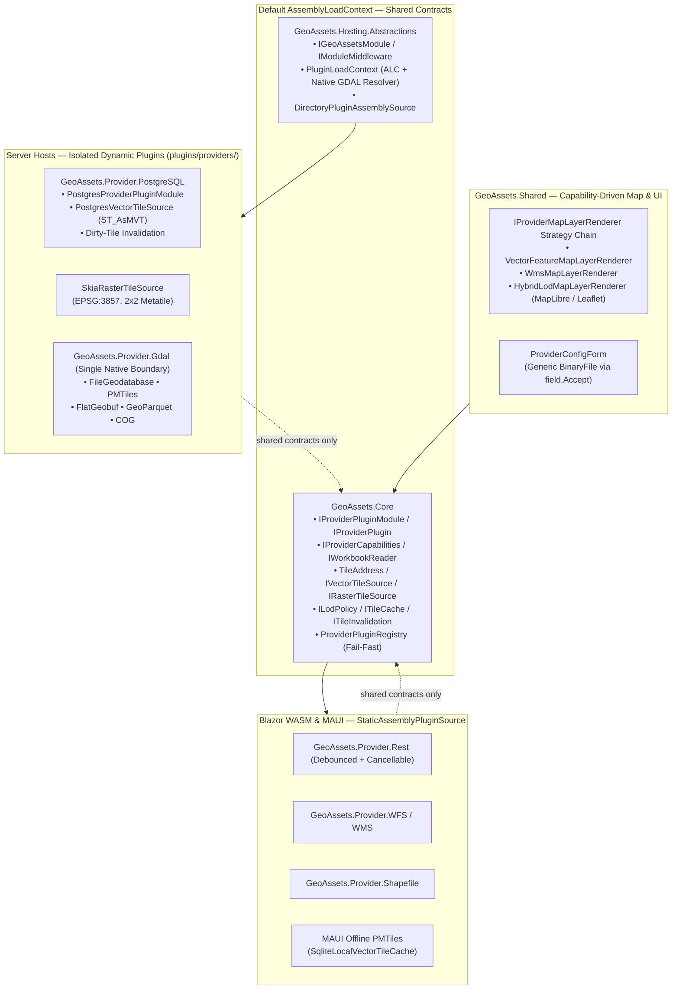

# ADR-002 — Provider Plugin Architecture, Hybrid Assembly Discovery & Hybrid LOD GIS Stack

| | |
|---|---|
| **Status** | Accepted (2026-11-26) — tracked by Jira epics **XD01-413 … XD01-419** (child tasks **XD01-420 … XD01-439**, labels `adr-002`, `provider-plugins-lod`). |
| **Scope** | `core/GeoAssets.Core`, `core/GeoAssets.Hosting.Abstractions`, `providers/GeoAssets.Provider.*`, `apps/GeoAssets.Server`, `apps/GeoAssets.Web`, `apps/GeoAssets.MAUI`, `apps/GeoAssets.Shared`, `apps/GeoAssets.FieldService.Server`, `apps/GeoAssets.IpBilling.Server`, `tools/GeoAssets.Bench.Render` |
| **Extends** | [ADR-001 — GeoAssets.Server Domain Decoupling](ADR-001-server-domain-decoupling.md) (Phase 4 Spatial Plane & Provider Pool) |
| **Supersedes** | — |

### Decisions Recorded

| # | Decision | Track / Epic |
|---|---|---|
| D1 | **Modular Plugin Entry Point (`IProviderPluginModule`)**: Provider assemblies expose an `IProviderPluginModule` (`PluginId`, `SupportedHosts`, `RegisterServices`) discovered and executed *before* `IServiceProvider` is built — supporting full MS.DI constructor injection and multi-port registration (`IProviderPlugin`, `IVectorTileSource`, `IRasterTileSource`, `IAssetExporter`). MEF (`System.ComponentModel.Composition`) is **not** used for providers. | Track 1–2 (`XD01-414`, `XD01-415`) |
| D2 | **Hybrid Assembly Discovery**: Server hosts discover external plugins from a configurable directory (`plugins/providers/`) via isolated `PluginLoadContext : AssemblyLoadContext` + `AssemblyDependencyResolver` (including `LoadUnmanagedDll`). Blazor WASM and MAUI use trimming-safe `StaticAssemblyPluginSource` over bundled assemblies. | Track 2 (`XD01-415`) |
| D3 | **Shared-Contract Boundary in `GeoAssets.Core`**: Every port crossing plugin boundaries (`IAssetProvider`, `IProviderPlugin`, `IProviderPluginModule`, `IProviderCapabilities`, `IWorkbookReader`, `TileAddress`, `IVectorTileSource`, `IRasterTileSource`, `ILodPolicy`, `ITileCache`, `ITileInvalidation`) lives in `GeoAssets.Core` (`AssemblyLoadContext.Default`) so composite providers (e.g., Hybrid LOD) never hit cross-ALC `InvalidCastException`. | Track 1, 4 (`XD01-414`, `XD01-417`) |
| D4 | **Capability-Driven Map Rendering**: Replace all 7 `is IWmsProvider` runtime type-switches with `IProviderCapabilities` (resolved through `UnwrapToConcrete()`) and an extensible `IProviderMapLayerRenderer` strategy chain so WMS, MVT, PMTiles, COG, and Hybrid LOD layers plug in without editing `GeoAssets.Shared` UI components. | Track 1, 5 (`XD01-414`, `XD01-418`) |
| D5 | **Single Native GDAL Boundary**: Consolidate all GDAL-backed formats (`FileGeodatabase`, `PMTiles`, `FlatGeobuf`, `GeoParquet`, `COG`) under one `GeoAssets.Provider.Gdal` plugin boundary with a single `GdalBase.ConfigureAll()` initializer inside one `PluginLoadContext`. | Track 6 (`XD01-419`) |
| D6 | **Server-Side Tiling & 3-Tier Hybrid LOD**: Evolve map rendering from viewport GeoJSON dumps to PostGIS `ST_AsMVT` vector tiles (`geom_3857` GiST) + `SkiaRasterTileSource` (EPSG:3857, 2×2 metatile) driven by one style source (`LayerResolver`), density-calibrated `ILodPolicy` (`Aggregate → Raster → Vector MVT` + `Editable GeoJSON` overlay), authenticated immutable tile caching `(orgScope, grantScopeHash, layerVersion)`, and `MapRenderMode.MapLibre` behind `IMapInterop`. | Track 4–6 (`XD01-417`…`XD01-419`) |
| D7 | **Fail-Fast vs. Host-Skip Semantics**: Incompatible `SupportedHosts` skip cleanly; broken loads (`ReflectionTypeLoadException`), duplicate `PluginId`, or invalid `LodPolicy` thresholds fail fast at startup. Tile endpoints bypass full-catalog `WarmCacheAsync`. | Track 1, 2, 4, 6 |

---

## Context

Following the completion of ADR-001 (`XD01-385`), `core/`, `verticals/`, `workflow/`, `ipbilling/`, `projects/`, and `apps/GeoAssets.Shared/` achieved zero `<ProjectReference>` links and zero `using GeoAssets.Provider.*` directives. However, two converging architectural audits revealed critical limitations:

1. **Provider Coupling Audit**: While `IProviderPlugin` and `ProviderPluginRegistry` exist, all host composition roots (`GeoAssets.Server`, `GeoAssets.Web`, `GeoAssets.MAUI`, `GeoAssets.FieldService.Server`, `GeoAssets.IpBilling.Server`, `GeoAssets.NeutralOperator.Server`) statically link provider `.csproj` files and call `AddGeoAssets*()` manually. Several SOLID smells remain (`IWorkbookReader` owned by `GeoAssets.Provider.Xlsx`, 7 `is IWmsProvider` branches in `GeoAssets.Shared` bypassing `UnwrapToConcrete()`, `.zip`-hardcoded `INativeFilePicker`, mixed plugin/tool registrations in `Shapefile`, and silent `FirstOrDefault` ID collisions in `ProviderPluginRegistry`).
2. **GIS Storage & Map Rendering Review**: PostGIS storage is sound, but retrieval and rendering operate as unthrottled viewport GeoJSON dumps with client-side zoom filtering, live uncached EPSG:4326 WMS rendering, and per-feature Leaflet SVG/Canvas layers. Moving to state-of-the-art MVT + Raster Hybrid LOD + Cloud-Native formats (`PMTiles`, `FlatGeobuf`, `GeoParquet`, `COG`) requires providers to contribute multiple optional ports (`IVectorTileSource`, `IRasterTileSource`, `ITileInvalidation`, `ILodPolicy`) and native GDAL drivers cleanly.

---

## Part 1 — Target Architecture

### Non-Negotiable Invariants
- **Core Database Encapsulation (Invariant 1)**: `ProviderPostgreSqlReferenceTests` remains green. Only `GeoAssets.Server` loads `GeoAssets.Provider.PostgreSQL`.
- **Zero Non-Composition-Root Provider Imports**: No endpoint, UI, or domain project may contain `using GeoAssets.Provider.*`.
- **Zero `is IWmsProvider` in UI/Map Components**: All render dispatch uses `IProviderCapabilities` (via `UnwrapToConcrete()`) and `IProviderMapLayerRenderer`.
- **Single Native GDAL Boundary**: `GdalBase.ConfigureAll()` initializes once in one `PluginLoadContext`.
- **No Full-Catalog Warmup for Tile Requests**: Tile endpoints never invoke `PostgresAssetProvider.WarmCacheAsync`.

---

## Part 2 — Code Smells & Evidence (Pre-Implementation Audit)

1. **Compile-Time Composition Root Coupling (OCP)**: `apps/GeoAssets.Web/Program.cs:162-165` manually calls `AddGeoAssetsRest/Wfs/Wms/Shapefile()`; `apps/GeoAssets.Server/Modules/ServerModules.cs:22-23` hardcodes built-in module instances; `apps/GeoAssets.MAUI/MauiProgram.cs:183` registers `IGeoCoreClient` without `ProviderPluginRegistry`.
2. **DIP Violation (`IWorkbookReader`)**: `apps/GeoAssets.IpBilling.Server/IpBilling{Fiscalizacao,Levantamento,Oficio}RestApiExtensions.cs:3-4` import `using GeoAssets.Provider.Xlsx;` solely to inject `IWorkbookReader` because the interface lives in the concrete provider project.
3. **OCP/LSP Type-Switching (`is IWmsProvider`) + Decorator Bug**: Repeated across 7 call sites (`ProviderPoolPanel.razor:66`, `ProviderPoolPanel.razor.cs:114,124,184,284`, `MapContainer.razor.cs:172,360`, `ProviderConnectionMapRenderer.cs:49`) without `UnwrapToConcrete()`. GeoJSON Import/Export buttons in `ProviderPoolPanel.razor:63-79` lack raster guards.
4. **Leaky Abstraction (`BinaryFile` → `.zip`)**: `ProviderConfigForm.razor:55` defaults `accept` to `.zip` and `ProviderConfigForm.razor.cs:62-65` unconditionally calls `INativeFilePicker.PickZipArchiveAsync()`, blocking `.pmtiles`, `.fgb`, `.parquet`, and `.tif`.
5. **Conflated Responsibilities in `providers/`**: `AddGeoAssetsShapefile()` (`ShapefileServiceExtensions.cs:12-18`) registers `IProviderPlugin` alongside `IShapefileExportService` and `IBdgdPonnotImportService` (side-effect in `FieldService.Server`).
6. **Silent Duplicate-ID Shadowing**: `ProviderPluginRegistry.Find` (`ProviderPluginRegistry.cs:16-17`) uses `FirstOrDefault` instead of failing fast on duplicate `Id`.
7. **GIS Retrieval & Rendering Bottlenecks**: No zoom parameter reaches the server (`RenderQueryOptions`), full-table `WarmCacheAsync` per org runs even for WMS tiles, uncached EPSG:4326 SkiaSharp PNGs, uncancelled/undebounced `moveend`/`zoomend` fetches in `RestAssetProvider.cs:115`, culture-sensitive bbox URLs (`RestAssetProvider.cs:103,114,189`), and `styleMap` dropped on raw-JSON pan (`MapInteropService.cs:117-123`).

---

## Part 3 — Unified 7-Track Roadmap & Jira Traceability

| Track | Epic | Child Tasks | Scope Summary |
|---|---|---|---|
| **Track 0** | [XD01-413](https://xdicor.atlassian.net/browse/XD01-413) | [XD01-420](https://xdicor.atlassian.net/browse/XD01-420) | `tools/GeoAssets.Bench.Render` 200k-feature PostGIS benchmark; record `z8`/`z12`/`z16` baseline in `docs/perf/render-baseline.md`. |
| **Track 1** | [XD01-414](https://xdicor.atlassian.net/browse/XD01-414) | [XD01-421](https://xdicor.atlassian.net/browse/XD01-421), [XD01-422](https://xdicor.atlassian.net/browse/XD01-422), [XD01-423](https://xdicor.atlassian.net/browse/XD01-423), [XD01-424](https://xdicor.atlassian.net/browse/XD01-424) | `IProviderPluginModule` + `ProviderHostTargets` + fail-fast `ProviderPluginRegistry`; `IProviderCapabilities` + `IProviderMapLayerRenderer` eliminating `is IWmsProvider`; move `IWorkbookReader` to `GeoAssets.Core`; generalize `INativeFilePicker`/`ProviderConfigForm`; split `ShapefileServiceExtensions` + architecture guardrails. |
| **Track 2** | [XD01-415](https://xdicor.atlassian.net/browse/XD01-415) | [XD01-425](https://xdicor.atlassian.net/browse/XD01-425), [XD01-426](https://xdicor.atlassian.net/browse/XD01-426), [XD01-427](https://xdicor.atlassian.net/browse/XD01-427), [XD01-428](https://xdicor.atlassian.net/browse/XD01-428) | `IProviderPluginModule` across Rest/WFS/WMS/Shapefile/PostgreSQL; `StaticAssemblyPluginSource` + `AddDiscoveredProviderPlugins` (WASM/MAUI trimming-safe); `PluginLoadContext` (ALC + `LoadUnmanagedDll`) + `DirectoryPluginAssemblySource`; host migrations (`Web`, `MAUI`, `Server`) + dynamic packaging. |
| **Track 3** | [XD01-416](https://xdicor.atlassian.net/browse/XD01-416) | [XD01-429](https://xdicor.atlassian.net/browse/XD01-429), [XD01-430](https://xdicor.atlassian.net/browse/XD01-430) | Existing-path quick wins: 150ms debounce, cancellable REST fetches, diff render, `styleMap`/culture fixes; SQL `MinZoom`/`MaxZoom` + `LIMIT`, compact JSON + compression, NTS `Multi*` & `JsonSerializerOptions` fixes. |
| **Track 4** | [XD01-417](https://xdicor.atlassian.net/browse/XD01-417) | [XD01-431](https://xdicor.atlassian.net/browse/XD01-431), [XD01-432](https://xdicor.atlassian.net/browse/XD01-432), [XD01-433](https://xdicor.atlassian.net/browse/XD01-433), [XD01-434](https://xdicor.atlassian.net/browse/XD01-434) | Shared tile/LOD contracts in `GeoAssets.Core`; PostGIS `geom_3857` GiST migration + `PostgresVectorTileSource` (`ST_AsMVT`) + after-commit dirty-tile invalidation; `SkiaRasterTileSource` (3857, 2×2 metatile); authenticated `/tiles/{layer}/{v}/{z}/{x}/{y}.mvt|.png` & `/tiles/style.json` with immutable caching. |
| **Track 5** | [XD01-418](https://xdicor.atlassian.net/browse/XD01-418) | [XD01-435](https://xdicor.atlassian.net/browse/XD01-435), [XD01-436](https://xdicor.atlassian.net/browse/XD01-436) | `MapRenderMode.MapLibre` (`geoassets.maplibre.js`, bearer `transformRequest`, `terra-draw`, GPU hit-testing); `HybridLodMapLayerRenderer` strategy, GeoJSON edit overlay with MVT ID hide, interim Leaflet raster/vector split. |
| **Track 6** | [XD01-419](https://xdicor.atlassian.net/browse/XD01-419) | [XD01-437](https://xdicor.atlassian.net/browse/XD01-437), [XD01-438](https://xdicor.atlassian.net/browse/XD01-438), [XD01-439](https://xdicor.atlassian.net/browse/XD01-439) | Unified `GeoAssets.Provider.Gdal` plugin (`FileGeodatabase`, `PMTiles`, `FlatGeobuf`, `GeoParquet`, `COG`) with single native initializer; MAUI offline PMTiles packs via `SqliteLocalVectorTileCache`; per-`(org, assetType)` density LOD calibration job + fail-fast `LodPolicy` startup validation. |

### As built — directory plugin loader (XD01-427)

`core/GeoAssets.Hosting.Abstractions/Plugins/` (namespace `GeoAssets.Hosting.Abstractions.Plugins`; the project now references `GeoAssets.Core`):

- **`PluginLoadContext : AssemblyLoadContext`** (one per plugin, not collectible) resolves the plugin's private dependencies from its folder through its `.deps.json` (`AssemblyDependencyResolver`). **Sharing rule (D3)**: an assembly the host has (its trusted platform assemblies, or already loaded in `AssemblyLoadContext.Default`) comes from the host — always for the shared contracts (`GeoAssets.Core`, `GeoAssets.Identity`, `GeoAssets.Hosting.Abstractions`, `Microsoft.Extensions.*`), whatever version the plugin asks for; for any other assembly only when the host's version is at least the requested one, else the plugin's copy. An assembly the host doesn't have comes from the plugin's folder. **Native libraries** (`LoadUnmanagedDll`): the `.deps.json` native assets for the running RID first (`runtimes/<rid>/native/*`), then — for a library it doesn't list — the plugin folder, then `runtimes/<rid>/native/` for the running RID and its portable `<os>-<arch>`, trying the platform's file names (`gdal` → `gdal.so`/`libgdal.so`, `.dylib`, `gdal.dll`); otherwise the runtime's default probing.
- **`DirectoryPluginAssemblySource : IPluginAssemblySource, IPluginLoadContextRegistry`** reads `GeoAssets:ProviderPlugins:Directory` (default `plugins/providers`, relative to the host's base directory): every subfolder `<PluginName>/<PluginName>.dll` (except `runtimes` and dot-folders), then — only when the host sets `GeoAssets:ProviderPlugins:FlatFilePattern` (e.g. `GeoAssets.Provider.*.dll`; the provider naming stays in the host's configuration, not in `core/`) — every matching `.dll` directly in the root, each in its own context, once. Fails fast (D7) on a missing directory, a folder without its entry assembly, two plugins with one name, an unloadable entry assembly, unreadable types, or an entry assembly with no public `IProviderPluginModule`.
- **`AddProviderPluginsFromDirectory(services, configuration, hostTarget|options, params additionalSources)`** runs one `AddDiscoveredProviderPlugins` over the additional sources (e.g. a `StaticAssemblyPluginSource`) plus the directory and registers the directory as the `IPluginLoadContextRegistry` singleton. A configured directory must exist; the unconfigured default is skipped when absent.
- **Packaging a plugin** (XD01-428): build it with `<EnableDynamicLoading>true</EnableDynamicLoading>` and reference the shared contracts with `<Private>false</Private><ExcludeAssets>runtime;native</ExcludeAssets>` (so neither they nor their packages' native files are copied); copy its whole build output, `.deps.json` and `runtimes/` included, to `plugins/providers/<EntryAssemblyName>/`. Fixtures: `tests/GeoAssets.PluginFixtures.*`.

### As built — host migrations & packaging (XD01-428)

- **`GeoAssets.Web`** (`ProviderHostTargets.Browser`): `AddWebProviderPlugins` (`apps/GeoAssets.Web/Extensions/WebProviderPluginExtensions.cs`) runs `AddDiscoveredProviderPlugins` over `StaticAssemblyPluginSource().Add<Rest…>().Add<Wfs…>().Add<Wms…>().Add<Shapefile…>()` and keeps `AddGeoAssetsShapefileTools()` (the Shapefile module registers only the plugin); the hand-written `AddGeoAssets*()` calls and `AddSingleton<ProviderPluginRegistry>()` are gone. Same plugins (`rest`, `shapefile`, `wfs`, `wms`) and tools as before.
- **`GeoAssets.MAUI`** (`ProviderHostTargets.MobileDesktop`): `AddDiscoveredProviderPlugins` over `StaticAssemblyPluginSource().Add<RestProviderPluginModule>()` — the one provider it bundles — so it now has the `rest` plugin and a `ProviderPluginRegistry` too. Since XD01-438 the source also adds `PMTilesProviderPluginModule` (offline map packs, `pmtiles`).
- **`GeoAssets.Server`** (`ProviderHostTargets.Server`): `Program.cs` calls `AddProviderPluginsFromDirectory` right after `AddServerCatalogPool`; PostgreSQL stays static (Invariant 1): the `postgres-spatial` module registers it through `PostgresProviderPluginModule` (`AddDiscoveredProviderPlugins` with a static source) instead of `AddGeoAssetsPostgres()`, so it is registered once, still only while the module is enabled (invariant I5), and a drop-in plugin claiming `postgres` fails the startup. No provider is directory-loaded yet, and the published output has no `plugins/providers/` (an absent default directory is skipped).
- **Packaging** (opt-in): `build/GeoAssets.ProviderPlugins.targets`, imported at the end of `GeoAssets.Server.csproj`. A `<ProviderPlugin Include="…csproj" />` item is built before the host but not referenced (`ReferenceOutputAssembly="false"`, kept out of the host's `.deps.json`), and its whole build output is copied to `$(ProviderPluginsDirectory)/<EntryAssemblyName>/` (default `plugins/providers`) of the build output (`CopyProviderPluginsToOutputDirectory`) and of the publish output (`AddProviderPluginsToPublish`, as `ResolvedFileToPublish`) — so of the Docker image too, whose restore layer copies the targets file. The build fails when a listed plugin isn't built with `EnableDynamicLoading` (no `.runtimeconfig.json`), has no `.deps.json`, or copies a shared contract (`GeoAssets.Core`/`Identity`/`Hosting.Abstractions`). `ProviderPostgreSqlReferenceTests` also counts `ProviderPlugin` items, so the PostgreSQL provider can't be shipped as one by another host.

### As built — PostGIS vector tiles & dirty-tile invalidation (XD01-432)

`providers/GeoAssets.Provider.PostgreSQL`:

- **Migration `AddGeoEntityGeom3857`** (`GeoAssetsDbContext`, applied by the kernel at startup like the rest of its chain): `geom` becomes `geometry(Geometry,4326)` — existing rows without an SRID take 4326, rows of another SRID are reprojected; from then on PostGIS refuses a write of another SRID and gives an SRID-less one 4326. `geom_3857 geometry(Geometry,3857)` is a stored generated `ST_Transform(geom, 3857)` (clipped to ±85.0511287798066° first; a geometry wholly beyond is empty), backfilled by the migration and kept by PostgreSQL on every write, with the GiST index `IX_geo_entity_geom_3857`. EF Core does not map `geom_3857`.
- **`PostgresVectorTileSource : IVectorTileSource`** (scoped, `AddPostgresVectorTileSource`, registered by the kernel's `PostgresSpatialModule`): one statement per tile — `ST_TileEnvelope` (margin = buffer) over `geom_3857`, `ST_SimplifyPreserveTopology` (one tile unit), `ST_AsMVTGeom` (extent 4096, buffer 64), `ST_AsMVT` per layer concatenated in the request's order. A layer id is an asset type id. A layer the `ILodPolicy` (the host's, else vector everywhere) calls `Hidden` is left out, and the asset types' own `MinZoom`/`MaxZoom` hide their features in the SQL; an `Aggregate` layer is a 64×64 grid of points with `count` (each feature counted once per zoom, at its centroid). Properties: `id`, `name`, `assetTypeId`, `layerId` (override, when set) and the custom attributes the type's layer rules read (never shadowing those four); aggregates carry `assetTypeId` and `count`. At most `MaxFeaturesPerTile` (default 10 000) discrete features, by layer then ordinal id. Scoped like `PostgresAssetRenderQuery` (tenant-stamped transaction, the caller's organization's rows and the shared ones). A cancelled request throws before the database; a started read runs under its own 30 s timeout.
- **After-commit invalidation**: with an `ITileInvalidation` (resolved from the container; none registered = nothing tracked), `PostgresAssetProvider`'s writes (`Add`, `Update`, `AddRange`, `Delete`, `Clear`, `LoadAll`), `PostgresAssetMutationBatchApplier`'s batches and `PostgresFeatureBulkImporter`'s chunks and replacing completions hand it, once and only after their commit, a `DirtyTileRegion` per distinct box the written features had before or have after the write (one region of their union beyond 256). Inside a caller's transaction the provider keeps the regions and the batch applier publishes them after its commit — never for a batch that rolled back or was already applied. A failing invalidation is logged and counted (`geoassets.tiles.invalidations`, tags `writer`, `outcome=published|failed`), never thrown; the provider's synchronous writes don't wait for it.

### As built — SkiaSharp raster tiles (XD01-433)

`apps/GeoAssets.Server/Rendering/` (namespace `GeoAssets.Server.Rendering`; SkiaSharp stays out of `GeoAssets.Core`):

- **`SkiaFeaturePainter`** is the WMS GetMap painter, extracted from `WmsEndpointExtensions`: it draws `RenderableFeature`s in the color their render query resolved (`RenderStyle` → `LayerResolver`) through a **`PixelTransform`** — `LonLat(box, width, height)` for WMS (EPSG:4326, the same arithmetic as before) or `WebMercator(originX, originY, metersPerPixel)` for tiles. Polygons, then lines, then points; a point is a 5 px circle, so nothing reaches more than `MaxSymbolOverhang` (5.75 px) past its geometry. GetMap's image is pixel-identical to the pre-extraction renderer (`WmsRenderingRegressionTests`).
- **`SkiaRasterTileSource : IRasterTileSource`** (scoped; `AddSkiaRasterTileSource()`, called by the kernel's `Program.cs` next to the generic `IAssetRenderQuery`, `TryAdd` — a module's own raster source wins) draws 256 × 256 PNG tiles over whichever `IAssetRenderQuery` the request resolves (the PostGIS pushdown under `postgres-spatial`), in its tenant scope. A tile is cut from its `MetatileSpan` × `MetatileSpan` metatile (`TileAddress.Metatile`, 2 × 2 by default): one read per layer and one drawing for the block, read and drawn `SymbolBuffer` (8 px) past its edge so a symbol on or near a metatile edge is whole on both sides; `GetMetatileAsync` answers every tile of the block from that one drawing (for a cache to keep the neighbours). A layer id is an asset type id; layers are drawn bottom first, each read with `RenderQueryOptions { AssetTypeId, Zoom = z, MaxCount = what the earlier layers left }` of `MaxFeatures` (default 10 000 per metatile), so the asset types' own zoom ranges hide their features; a layer the `ILodPolicy` (the host's, else none hidden) calls `Hidden` is not read, and any other tier is drawn as its features. A tile with no pixel drawn is `TilePayload.Empty("image/png")` (the endpoint decides between `204` and a transparent PNG). A cancelled request throws `OperationCanceledException` — before the first read, or after a read (the PostGIS render query answers a cancelled read with no features) — never an empty tile.
- Points and polygons cut from a metatile are pixel-identical to the same tile drawn alone; a long anti-aliased stroke can differ by a few coverage levels across frames (Skia rasterizes a path clipped to its canvas), never by a gap.

### As built — authenticated tile endpoints & immutable caching (XD01-434)

`apps/GeoAssets.Server/Tiles/` (namespace `GeoAssets.Server.Tiles`), registered (`AddTileServing`) and mapped (`MapTileApi`) by the `postgres-spatial` module; `MemoryTileCache` is in `GeoAssets.Core.Rendering`:

- **Routes** (all `features:read`, as WMS; none loads the caller's organization catalog — `WithoutOrganizationCatalogWarmup()` makes `UseOrganizationAssetCatalogs` skip them, so a tile request never runs `WarmCacheAsync`): `GET /tiles/style.json[?layers={set}]`, `GET /tiles/{set}/{v}/{z}/{x}/{y}.mvt`, `GET /tiles/{set}/{v}/{z}/{x}/{y}.png`. A set (`TileLayerSetDescriptor`) is `assets` — every asset type the caller's organization sees, polygons → lines → any-geometry → points, then name and id — or one visible asset type's id; a layer id is the asset type id. 400 for a set/`{v}` outside `TileKeySegment` or a zoom/column/row outside the pyramid, 401/403 by the policy, 404 for a set the caller does not see, 304 on an `If-None-Match` of the tile's content `ETag`.
- **Tiers per format**: a `.mvt` tile carries the set's layers that are `Vector` or `Aggregate` at its zoom, a `.png` tile the `Raster` ones (`ILodPolicy` within each type's own zoom range), so each tier travels once; a format with no layer at that zoom answers the empty tile without asking a source. The policy is `GeoAssets:Tiles:Lod` (`RasterFromZoom`/`VectorFromZoom`, per type under `Lod:Layers:{assetTypeId}`), vector at every zoom by default; invalid thresholds fail the startup (D7). A host's own `ILodPolicy` wins.
- **Empty tiles**: `.mvt` → `204 No Content` (MapLibre takes it as an empty tile); `.png` → a transparent 256 px PNG (`200`), since a raster source expects an image.
- **Compression**: a drawn vector tile is gzip-encoded once (`CompressionLevel.Optimal`) and cached encoded; served with `Content-Encoding: gzip` + `Vary: Accept-Encoding` (decoded, under another `ETag`, for a client that refuses gzip). The response compression middleware never touches it (MVT is not in its MIME types, and an encoded response is skipped); PNG is not compressed again; `style.json` is JSON, compressed by the middleware.
- **`{v}`** (`TileVersions`) is `{style}-{epoch}-{flush}.{generation}`: `{style}` the set's style hash (types' zoom ranges, colors, default layers, geometry; every layer; the types' layer rules; LOD thresholds), `{epoch}` random per process (a restart never reuses a URL), `{flush}` bumped when a write is too large to evict tile by tile, `{generation}` bumped by every committed write's invalidation. `style.json` publishes the current `{v}` in every tile URL and in `metadata."geoassets:version"` (`Cache-Control: private, no-cache` + `ETag`); a client re-reads it (e.g. after its own write) to learn a new `{v}`. A tile under the current cache version at a generation not ahead of the process's is `Cache-Control: private, max-age=31536000, immutable` — a URL only ever answers bytes at least as new as the generation it names; any other `{v}` gets the current tile with `private, no-cache`.
- **Server cache**: `MemoryTileCache` (`ITileCache` unless a host registers one; `GeoAssets:Tiles:CacheMaxMegabytes`, default 256): LRU by bytes, one lock, every entry indexed by tile so `RemoveAsync(range)` walks the smaller of the range and what is cached at its zoom. Keys are `TileCacheKey(scope, set, cacheVersion = {style}-{epoch}-{flush}, tile, format)` with the scope (`TileScopeResolver`) = the caller's organization (`N` form; all zeros for an organization-less caller) and the hash of its organization's active grants (resource organization, type, scope, actions) — two callers whose rows could differ never share an entry. Only zooms up to `GeoAssets:Tiles:MaxCachedZoom` (default 18) are cached; deeper tiles are drawn per request. A raster tile is drawn with its whole 2 × 2 metatile (`IRasterMetatileSource`, implemented by `SkiaRasterTileSource`), every tile of which is cached, and concurrent requests for one metatile share one drawing.
- **Invalidation** (`TileInvalidation`, the host's `ITileInvalidation` — what the PostGIS writers call after each commit): advances the generation first, then evicts each region's `TileRanges(1/32 tile)` (a raster tile's 8 px symbol buffer, which covers the MVT's 64/4096) at the zooms up to `MaxCachedZoom`; a write whose ranges hold more than `GeoAssets:Tiles:MaxEvictedTilesPerWrite` (default 65,536) tiles flushes instead (`{flush}` + 1, every old entry orphaned and aged out by the LRU). A tile drawn while a write was invalidated is removed again right after it is cached (the generation moved), so a pre-commit drawing never outlives the eviction. A rolled-back batch is never invalidated (XD01-432). Process-local: a second kernel replica has its own cache and epoch and would not see the first one's invalidations.
- **`style.json`** (`TileStyleDocument`): MapLibre style v8; source `geoassets` (`type: vector`, `tiles: ["{origin}/tiles/{set}/{v}/{z}/{x}/{y}.mvt"]`, `scheme: xyz`, `minzoom` 0, `maxzoom` = `MaxCachedZoom` raised to the highest first zoom of a layer, `promoteId: "id"`) and, when a layer has a raster tier, `geoassets-raster` (`type: raster`, `tileSize` 256, `.png`). `{origin}` is the gateway's `X-Forwarded-Proto`/`Host`/`Prefix` when present, else the request's. Layers bottom first: the raster layer over the raster zooms, then per type (`source-layer` = its id) fills, polygon outlines, lines, points (geometry-type filtered; a type restricted to one geometry gets only its layers) over its vector zooms and aggregate circles (sized by `count`) over its aggregate zooms (`maxzoom` exclusive = last zoom + 1). Colors are `LayerResolver` as an expression over the properties the vector tiles carry (`layerId` override → first matching rule by priority → default layer → type color), so a feature is the color the raster tiles and WMS paint it; paint follows `SkiaFeaturePainter` (5 px points, 2 px lines, 35 % fills, 1.5 px outlines). No `glyphs`/`sprite`.
- **Metrics** (meter `GeoAssets`): `geoassets.tiles.requests` (`format`, `cache=hit|miss|uncached`), `geoassets.tiles.render.duration` (ms, `format`), `geoassets.tiles.size` (bytes sent, `format`), `geoassets.tiles.cache.invalidations` (`outcome=evicted|flushed`).
- **Gateway**: `/tiles/**` is a kernel catch-all route (with its silo routes) and is limited by `RateLimiting:Tiles`, with `/wms` and `/wfs`.
- **Bench** (`tools/GeoAssets.Bench.Render tiles`): the vector tiles covering each viewport, through a copy of the source's statement (byte-for-byte equal to `PostgresVectorTileSource`'s, asserted by `GeoAssets.Bench.Render.Tests`) plus the endpoint's gzip; results in `docs/perf/render-baseline.md`.

### As built — MapLibre render mode (XD01-435)

`apps/GeoAssets.Shared` (`MapRenderMode.MapLibre`; Leaflet stays the default, so MAUI is unchanged):

- **Dispatch**: `MapInteropService` in MapLibre mode imports `wwwroot/js/geoassets.maplibre.js` (an ES module setting `window.GeoAssetsMapLibre`) before its first call and sends every `IMapInterop`/`IMapSelectionInterop` call to `GeoAssetsMapLibre.<same function>` with the same arguments; the Leaflet modes still call `GeoAssets.*` and never load it. The module loads MapLibre GL JS 5.24.0, terra-draw 1.37.0 and terra-draw-maplibre-gl-adapter 1.5.0 from unpkg (exact versions, SRI) on its first `initializeMap`, so neither `index.html` changes and a Leaflet user downloads nothing. The JS→.NET callbacks are `MapContainer`'s, unchanged. Zooms cross the contract in Leaflet's 256 px scale (MapLibre zoom + 1).
- **Tiles**: `MapInterop:MapLibre:StyleUrl` (default `tiles/style.json`, relative to `GeoAssetsServer:BaseUrl` — the gateway, via `ApiScopeRoutes`) is merged over an OpenStreetMap basemap, its layers below the providers' features. `transformRequest` adds `Authorization: Bearer` to every request under the style's directory only, with the latest answer of `MapContainer.GetTileAccessFromJs` (`IMapTileAccessProvider`, the same token source and scopes as the WMS layers): read per request, refreshed a minute before it expires, after a 401 on `style.json` and after a 401 on a tile (the tiles refused are asked again with the new token; at most one refresh per 10 s for a server that refuses every token).
- **`{v}`**: `MapTileStyleRefresher` (`TimeProvider`) calls `GeoAssetsMapLibre.refreshTileStyle` `WriteRefreshDelay` (1.5 s, debounced) after the provider's `FeatureAdded`/`FeatureUpdated`/`FeatureDeleted`/`CollectionChanged` and every `StyleRefreshInterval` (1 min; `0` = only after writes). The module re-reads `style.json` (`cache: no-cache` — the browser revalidates with its `ETag`, a `304` when nothing moved); a new `{v}` with the same sources and layers only re-points the sources' tile URLs (`setTiles`: the old tiles stay drawn until their replacements arrive — no reload, no clear); a changed `{style}` replaces the tile layers.
- **Interaction**: click, hover (name tooltip, a text node), context menu, snapping candidates and `panToFeature` of a tile-only feature are `queryRenderedFeatures` over the feature and tile layers (the tiles' promoted `id`); feature states and the highlight are `match` expressions on the layers' paint (colour, opacity, width), layer visibility and zoom ranges are filters/visibility. terra-draw draws points, lines and polygons (one shape per `enableDraw`, snapped to rendered vertices within 15 px, in the snap scope), the box (rectangle) and fence (polygon) selection tools, and edits a feature the providers rendered (double-click → select mode → `OnFeatureEditedFromJs`).
- **Degrades** (documented on `MapLibreOptions`, logged once, never thrown): the kernel's own WMS (EPSG:4326 only) is not drawn and other WMS servers are asked on EPSG:3857; icon styles are circles; reference layers have no labels; a multi-geometry is not editable; another provider's features are drawn over the kernel's tiles (the kernel's own no longer twice — XD01-436 below). MAUI's Content-Security-Policy (no gateway `connect-src`, no `blob:` workers) blocks this mode there.

### As built — hybrid LOD renderer & editing coexistence (XD01-436)

`apps/GeoAssets.Shared/Services/Rendering/HybridLodMapLayerRenderer.cs`, registered by `AddProviderMapLayerRenderers`; `ProviderPoolPanel.razor` and `MapContainer.razor.cs` are unchanged:

- **Which entries**: a provider declaring `HybridLod` — `RestAssetProvider` now declares `DefaultVectorCapabilities | VectorTiles | HybridLod` (a GeoAssets server serves `/tiles`) and names its server through the new Core contract `IRemoteAssetProvider.BaseAddress` — whose base address has the scheme, host and port of the map's tile style (`MapInterop:MapLibre:StyleUrl` under the gateway), in `MapRenderMode.MapLibre`, or in a Leaflet mode with `MapInterop:LeafletTileSplit` (off by default — MAUI leaves it off and draws as before; on in the Web's `appsettings.json`), and only when the host registers `IMapTileLayerInterop` (the Web: `MapInteropService`). Anything else it declines and `VectorFeatureMapLayerRenderer` draws. While the style can't be read (`showTileLayers` answers null) it draws as the vector renderer does, and asks again at the next whole-layer render.
- **Chain order**: `IProviderMapLayerRenderer.Precedence` (a default interface member, `MapLayerRendererPrecedence.Default` = 0); the hybrid renderer declares `Refining` (100) and `ProviderMapLayerRendererChain` asks by precedence, highest first, ties in registration order — so it wins over the vector renderer for the kernel whatever the registration order (it is registered last).
- **MapLibre — tiles are the display**: a kernel feature nobody is editing is never fetched or drawn as GeoJSON, at any zoom: it is its tile's (raster, aggregate or vector tier), clicked, hovered and context-menued through the tiles. The GeoJSON overlay holds only the *selected* feature (`IFeatureSelectionState`, read by id through `IAssetProvider.GetById` — the catalog is never enumerated) and the features this client *wrote*; the tile copy of each, and of each feature it deleted, is filtered out of the vector tile layers by the tiles' promoted `id` (`setHiddenTileFeatures`; also out of `queryRenderedFeatures`, so neither clicked nor snapped). A written/deleted feature stays so until a re-read of the style that *started after the write* reports a `{v}` other than the last one read before it; `refreshTileStyle` answers a swapped `{v}` only once its tiles reloaded (a tile source's `sourcedata`, then `idle`; 10 s at most), and the renderer then shows the tile copy again *before* removing the overlay, unless the feature is still selected. A viewport pass draws only the overlay again (so the pass keeps it); a pan never clears the map. A double-click on a tile-only feature selects it and edits its overlay once it arrives; `panToFeature` of an off-screen tile-only feature waits for its overlay (5 s).
- **Snapping**: an overlay feature snaps to its own geometry; a kernel feature to the MVT features rendered at the current zoom — the vector tier's zooms (interaction zoom); below it nothing on the tiles is snappable — keeping only the vertices inside the tile MapLibre read each from (`_z/_x/_y`), so a tile's clipped ends are no snap target.
- **The interim Leaflet split** (`geoassets.js`): `showTileLayers` reads the style with the bearer token (`GetTileAccessFromJs` for the style's URL) and adds one `L.TileLayer` of the raster source over the raster tier's tile zooms (Leaflet's 256 px zoom is the tile zoom), each tile fetched with `Authorization: Bearer` and shown as an object URL (the WMS layers' `createTile`) — the token is never in a URL; a 401 asks a new token once and retries. The renderer draws no feature at those zooms (only the selected and written ones, over a raster that can't hide one) and draws the features exactly as the vector renderer does at every other zoom; a style without a raster tier (the default policy) adds no layer, so the features stay at every zoom. `{v}` is followed by `MapTileStyleRefresher` while the layer is shown (Leaflet `refreshTileStyle`: the new layer goes on top, the old one comes off once the new one loaded). Known limit: one threshold for the set — a type whose own `Lod:Layers` override is vector inside the raster run shows there only in MapLibre mode.
- **Verified headless** (Chrome + SwiftShader against a fake kernel): MapLibre raster → vector swap across the threshold (PNG at Leaflet zoom 13, MVT and no PNG at 15), the edit overlay hiding the tile copy and the tile copy back after the `{v}` swap (resolved after the delayed v2 tiles were served), snapping to the MVT vertex at vector zoom (and not at raster zoom, nor to a hidden copy), no full-map clear while panning; Leaflet raster tiles at 12–13, none at 14 with the features drawn, bearer on every PNG request, a `{v}` swap, the 401 retry, and no PNG/no layer without a raster tier.

### As built — single native GDAL boundary (XD01-437)

`providers/GeoAssets.Provider.Gdal` (namespace `GeoAssets.Provider.Gdal`) replaces `GeoAssets.Provider.FileGeodatabase` (retired; its export moved here unchanged, tests in `tests/GeoAssets.Provider.Gdal.Tests`) and is the only project with a `MaxRev.Gdal.*` package (Core + the macOS/Linux Minimal runtimes, GDAL 3.13.3). It is built as a drop-in plugin (`EnableDynamicLoading`, `GeoAssets.Core` referenced `Private=false`/`ExcludeAssets=runtime;native`).

- **`GdalNativeInitializer.EnsureInitialized()`** is the one `GdalBase.ConfigureAll()` call in the repository (`GdalNativeBoundaryTests`: no other `MaxRev.Gdal` package reference, no `GdalBase` in any other source, `ConfigureAll` only in this file). It first claims the native library `gdal` for its own assembly in **`NativeLibraryOwnership`** (`GeoAssets.Core.Plugins`, one registry per process since every load context shares Core), then configures under a lock; concurrent first calls wait, later calls return at once (`ConfigurationCount` stays 1). A second managed copy of the plugin — static plus directory-loaded, or two plugin folders — gets `NativeLibraryOwnershipException` before it loads GDAL's bindings at all. A platform without the native runtime gets `GdalNativeUnavailableException`, the same one on every later call. It records `InitialProjSearchPaths` (where `proj.db` is) and `NativeVersion`.
- **Module `gdal-cloud-native`** (`GdalCloudNativePluginModule`, `SupportedHosts = Server | MobileDesktop`, no `IProviderPlugin`). Configuration `GeoAssets:Gdal:PMTiles:{id}:Path` and `GeoAssets:Gdal:Cog:{id}:Path` (`GdalPluginOptions`; an id is a `TileKeySegment`, a local file must exist, a COG may be a `/vsi…` path; bad entries fail the startup, D7). Everywhere it registers a **keyed** `IVectorTileSource` per archive (`PMTilesVectorTileSource`, pure .NET). Where `GdalNativeRuntime.IsSupportedPlatform` holds (macOS/Linux, x64/arm64) it also registers `IFileGeodatabaseExportService`, `IVectorFileReader` and a keyed `IRasterTileSource` per COG (`CogRasterTileSource`). Elsewhere (iOS, Android, Windows, Mac Catalyst) those are left out, and a configured COG fails the startup. Keyed sources never replace a host's unkeyed ones, so the kernel's PostGIS/Skia tiles are unaffected. Registering runs no native code.
- **PMTiles v3** (`PMTiles/`; moved to `GeoAssets.Provider.PMTiles` by XD01-438, which this plugin references): 127-byte header, varint directories (delta tile ids, run lengths, lengths, `offset + 1`/contiguous offsets), Hilbert tile ids (`PMTilesTileId`), root and up to 3 nested leaf levels (64 leaf directories cached), gzip/Brotli/none internal compression (Zstandard refused with `PMTilesFormatException`), positional reads (`RandomAccess`) of at most 64 MiB per section and 16 MiB per tile. A tile is served as stored, with `ContentEncoding` = the archive's tile compression (`gzip`/`br`/`zstd`; an unknown one is sniffed) when the layer set covers the metadata's `vector_layers`. Otherwise it is decompressed, cut to the requested MVT layers (`MvtLayerFilter`, byte-for-byte per layer) and recompressed. A tile it doesn't have, or one with none of the requested layers, is empty. Archive features are not tenant-scoped.
- **COG** (`CogRasterTileSource`): per tile, `gdalwarp` to the tile's EPSG:3857 envelope, 256 × 256, bilinear, `-dstalpha`, then PNG through `/vsimem/`. A non-8-bit raster is stretched by its bands' min/max (computed once); a paletted one is expanded to RGBA. Empty when the layer set lacks its id or every alpha pixel is 0. One dataset per request. GDAL errors become `InvalidDataException`.
- **FlatGeobuf / GeoParquet** (`OgrVectorFileReader : IVectorFileReader`, new Core contracts in `GeoAssets.Core.VectorFiles`): OGR drivers `FlatGeobuf` and `Parquet`, **both present in the shipped Minimal runtime** (it bundles Arrow/Parquet). Pages of at most 10,000 features (`VectorFileReadRequest`, default 1,000, `SetNextByIndex`), in file order (a spatially indexed FlatGeobuf is Hilbert-sorted), reprojected to EPSG:4326 longitude-first, `name`/`id` fields mapped, every field as text. A missing driver or runtime is `VectorFileFormatUnavailableException` at use, never at startup. No FlatGeobuf/GeoParquet/PMTiles/COG *writers* yet: File Geodatabase stays the only exporter.
- **Loading model per host**:
  - **GeoAssets.Server**: directory plugin only, never a static reference (`GdalNativeBoundaryTests`). It is not listed as a `<ProviderPlugin>` yet: no kernel route serves the keyed PMTiles/COG sources, and the Linux runtime adds about 150 MB to the image. Shipping it is one `<ProviderPlugin Include="..\..\providers\GeoAssets.Provider.Gdal\GeoAssets.Provider.Gdal.csproj" />` item.
  - **GeoAssets.FieldService.Server**: static reference + `AddGeoAssetsFileGeodatabaseExport()`, and no plugin directory.
  - **tools/GeoAssets.Tools.NetworkImport**: static, through `GeoAssets.Ingestion.Proj`. Its `GdalEnvironment` now calls `GdalNativeInitializer` and keeps only its own PROJ search-path prepending (base paths = `InitialProjSearchPaths`). It has no MaxRev package reference of its own.
  - **GeoAssets.MAUI**: not in its static plugin set (no native runtime for iOS/Android). Its offline PMTiles packs come from the GDAL-free `GeoAssets.Provider.PMTiles` instead (XD01-438, below).
- **Proof in a PluginLoadContext**: `tests/GeoAssets.Provider.Gdal.PluginLoading.Tests` packages the plugin with `build/GeoAssets.ProviderPlugins.targets` (the drop-in checks pass) into a host with no static copy, and loads it through `AddProviderPluginsFromDirectory`. It then asserts that:
  - `MaxRev.Gdal.Core` is loaded only in the plugin's context;
  - 16 concurrent first uses through the Core `IVectorFileReader` give `ConfigurationCount == 1`;
  - `libgdal_wrap` was loaded by the context's `LoadUnmanagedDll` from the plugin folder (new `PluginLoadContext.LoadedNativeLibraries`);
  - the export works across the boundary;
  - a second `PluginLoadContext` copy is refused without loading GDAL.

  Skipped, with the reason, where no native runtime ships.

### As built — MAUI offline PMTiles packs (XD01-438)

`providers/GeoAssets.Provider.PMTiles` (namespace `GeoAssets.Provider.PMTiles`, tests in `tests/GeoAssets.Provider.PMTiles.Tests`; MAUI's plain-.NET parts in `tests/GeoAssets.MAUI.Tests`):

- **Where the reader lives**: XD01-437's pure .NET PMTiles v3 reader (`PMTilesArchive`, `PMTilesVectorTileSource`, directories, Hilbert ids, codecs, `MvtLayerFilter`) moved unchanged, its tests with it, into this GDAL-free assembly — the only one that reads PMTiles. `GeoAssets.Provider.Gdal` references it for its keyed `PMTilesVectorTileSource` (so `gdal-cloud-native` and `GeoAssets:Gdal:PMTiles` are unchanged) and carries its assembly in the plugin folder. Chosen over a Core-level reader because the reader is a format, not a shared contract (D3: Core holds what crosses load contexts), and over keeping it in the Gdal plugin because MAUI can't take that plugin (MaxRev has no iOS/Android runtime) and a second copy would break the one-reader rule. It references `GeoAssets.Core` with `Private=false`/`ExcludeAssets=runtime;native`, like a drop-in, so the Gdal plugin folder still passes the shared-contract check; no `MaxRev.Gdal.*` reaches MAUI (`GdalNativeBoundaryTests` unchanged and green).
- **Module `pmtiles`** (`PMTilesProviderPluginModule`, `SupportedHosts = MobileDesktop | Server`, reads no configuration) registers `PMTilesPackProviderPlugin` (`AddGeoAssetsPMTilesPacks`). MAUI adds it to its `StaticAssemblyPluginSource` (`Add<…>()`, trimming-safe), so the connect dialog offers *Offline map pack (PMTiles)*; the browser skips it.
- **Picking** (Track 1C): the plugin's `pack` field is a `BinaryFile` with `Accept: ".pmtiles"` and the new `ProviderConfigField.PathOnly`. `ProviderConfigForm` then calls `INativeFilePicker.PickBinaryFileAsync([".pmtiles"], NativeFilePickContent.PathOnly)` (new Core enum; default `Bytes`, as before) and stores only `pack_name`/`pack_path` — a multi-gigabyte pack is never read into memory or base64'd into the configuration. The connect dialog checks a required field with `ProviderConfigField.IsProvidedIn` (a path-only file by its path). `MauiNativeFilePicker`'s filters are `NativeFilePickerFileTypes` (plain .NET, unit-tested): Mac Catalyst now has an entry (UTTypes, like iOS — before, a Mac Catalyst pick found no filter for its platform), `.pmtiles` is `application/vnd.pmtiles` + `application/octet-stream` on Android and `public.data` on Apple (no system UTType exists).
- **Storage / import**: `PMTilesPackStorage` (MAUI: `AddPMTilesPackStorage(<AppDataDirectory>/offline-packs)`). On connect the plugin validates the picked file (`PMTilesPack.OpenAsync`: PMTiles v3, MVT or undeclared tiles, uncompressed/gzip/Brotli — raster or Zstandard packs are refused with the file's name), then streams it in 1 MiB blocks to `<id>.pmtiles` through a `.partial` file renamed when complete (nothing left on failure or cancel); `<id>` is 16 hex digits of the SHA-256 of the first 16 KiB and the length, so the same pack is never copied twice. `pack_path` is set to the stored copy, which the pool entry's reconnect values and the boot loader's auto-boot reopen offline. Without a storage (a server) the pack is read where it is. Copying the file rather than its tiles row by row keeps import time and space linear in one sequential copy, whatever the pack's size; the picked file's own path can't be kept because iOS/Android hand the app a temporary copy.
- **Read-through `SqliteLocalVectorTileCache`**: it now also implements Core's `ITileCache` (MAUI registers the one singleton as both). `PMTilesPackTiles` looks every pack tile up there first — key `tile/offline-pack/pmtiles/pmtiles/{pack id}/{z}/{x}/{y}.mvt` — and on a miss reads the pack (one directory lookup, one positional read) and caches the tile as stored (bytes, media type, encoding; an absent tile as empty, so its directories aren't walked again). Rows sit in the same SQLCipher table as the z/x/y basemap entries (new nullable `ContentType`/`ContentEncoding` columns, added by sqlite-net's additive migration), whose keys never collide. Bounded: past 20,000 `tile/…` rows (checked every 256 writes) the oldest written are deleted; `RemoveAsync(range)` evicts a range's `tile/…` rows.
- **To the map in Leaflet mode**: MAUI stays on Leaflet (MapLibre is Web-only, XD01-435), which can't draw vector tiles, so a pack is an `IAssetProvider` (`PMTilesPackAssetProvider`, `VectorFeatures` only, read-only — writes ignored, no events) drawn by the existing `VectorFeatureMapLayerRenderer`. A viewport read (`GetInBoundsJsonAsync(ViewportQuery)`) decodes the tiles under the padded view at the zoom MapLibre would read — Leaflet zoom − 1, clamped to the pack's zooms; none below its lowest — inside the pack's bounds only, stepping a zoom down while more than 64 tiles cover it, at most 10,000 features (`MvtTileDecoder`, MVT 2.1; `MvtFeatureProjector`: tile units → EPSG:3857 envelope → EPSG:4326, 7 decimals; points in a tile's buffer dropped; ring winding decides shells and holes; asset type `Point`/`Line`/`Area` by geometry; properties = the tags plus `mvt:layer`/`mvt:id`). Feature ids are `pmtiles:{pack id}:{z}/{x}/{y}:{layer}:{n}`, stable across reads, so the viewport diff keeps them. On connect it reads an overview (the whole pack at the highest zoom of at most 16 tiles), so the map fits to the pack. `GetAll`/`GetById`/search/spatial queries answer the last read — the pack is never enumerated. Raster packs aren't supported (refused at import).
- **Known limits**: a line or polygon crossing tiles is drawn as one piece per tile, buffer included (a polygon's outline shows at tile seams); Leaflet draws every decoded feature as SVG/canvas, so a dense pack is capped by the 10,000-feature read rather than tiled; styling is the three default asset types' colours; no pack management UI yet (an imported pack stays in app data until the app's data is cleared).
- **Not verified on a device**: the iOS/Android/Mac Catalyst pickers' path-only results (readable temporary copies) and the type filters, the import into app data, and SQLCipher's handling of the new columns were only build-verified for `net10.0-ios`/`net10.0-maccatalyst` (and `net10.0-android` with `/warnaserror`); the logic is tested on .NET (`GeoAssets.MAUI.Tests` links `NativeFilePickerFileTypes` and `SqliteLocalVectorTileCache` over plain SQLite).

---

## Part 4 — Verification Gates

- **Performance**: `z8` viewport bytes down by $\ge 10\times$, server p95 per tile $< 50\text{ ms}$, zero full-map clears on pan (recorded in `docs/perf/render-baseline.md`).
- **Build & Tests**: `dotnet build GeoAssets.sln` (`TreatWarningsAsErrors=true`), full xUnit suites including `PostgresFact` integration tests and `Category=Architecture` guardrails (`ProviderPostgreSqlReferenceTests`, `ServerProviderReferenceTests`, zero `using GeoAssets.Provider.*` in `IpBilling.Server`, zero `is IWmsProvider` in `GeoAssets.Shared/Components`).
- **SOLID & Worktree Gate**: `python3 scripts/verify-solid-contracts.py --target .` and `./scripts/verify-agent-worktree.sh .` exit `0`.
