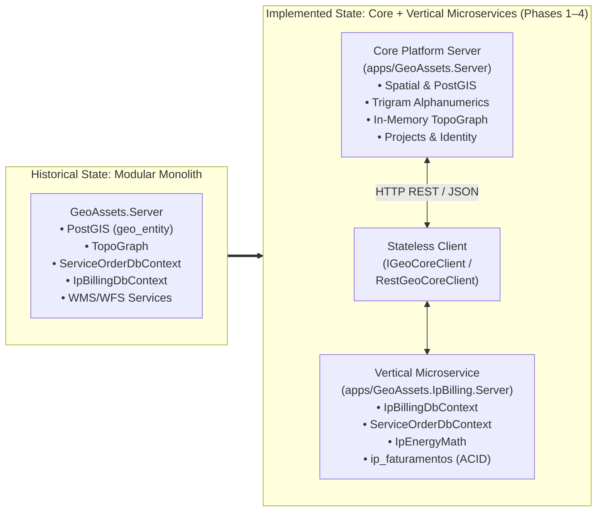
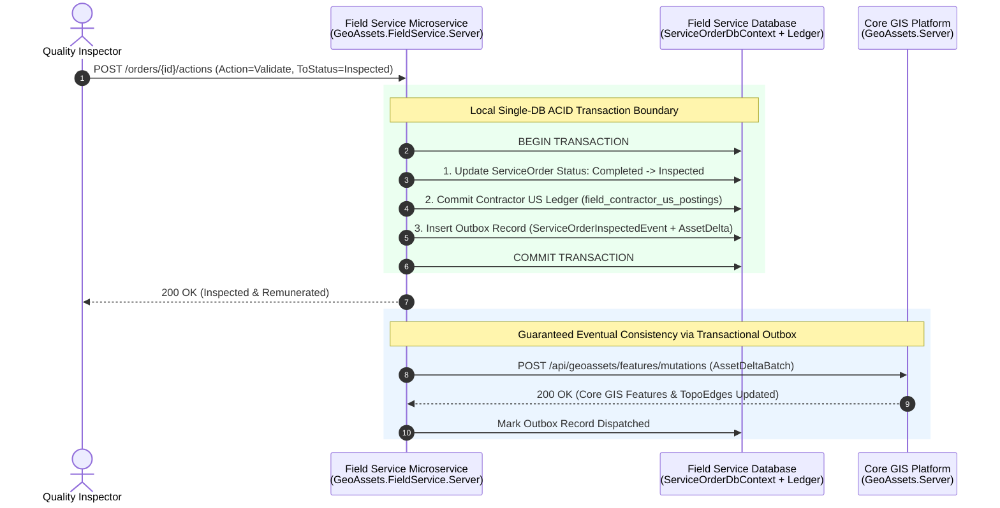
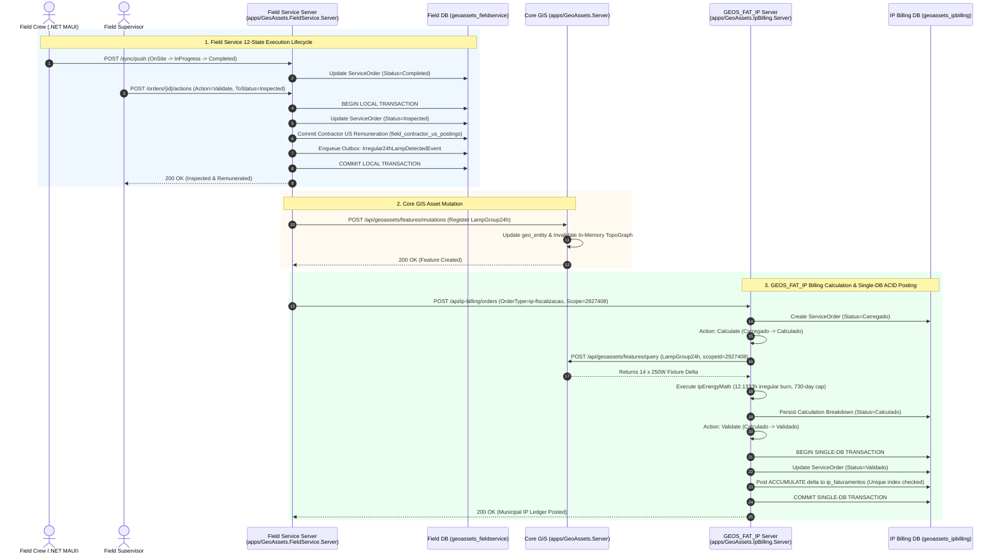
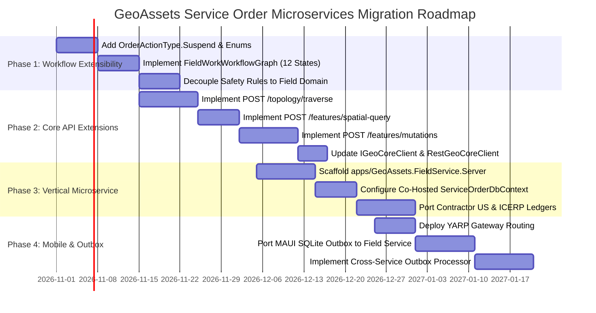

# Architectural & Technical Intersection Evaluation: GeoAssets Core Platform, Vertical Microservices & Brazilian Utility Service Order Workflows

**Document Identifier**: `GEOASSETS-ARCH-EVAL-2026-02`  
**Target Platform**: GeoAssets Geospatial Asset & Field Service Platform (.NET 10 LTS, C# 14, PostgreSQL 16 + PostGIS, NetTopologySuite 2.6, Blazor WebAssembly, .NET MAUI)  
**Author**: Engineering Architecture Team  
**Status**: Publication-Grade Architectural Evaluation & Target Blueprint  
**Date**: October 2026  
**Reference Codebase**: `/Users/yuniorsf/WORK/GeoAssets`  

---

## Table of Contents

1. [Executive Summary & Context](#1-executive-summary--context)
   - 1.1 [The Architectural Journey: Modular Monolith to Microservices Separation](#11-the-architectural-journey-modular-monolith-to-microservices-separation)
   - 1.2 [The Mission: Intersection with Brazilian Utility Field Service Orders](#12-the-mission-intersection-with-brazilian-utility-field-service-orders)
   - 1.3 [Summary of Strategic Architectural Decisions](#13-summary-of-strategic-architectural-decisions)
2. [Current Implemented Architecture (Phases 1–4 Verification)](#2-current-implemented-architecture-phases-14-verification)
   - 2.1 [Core Platform Architecture (`apps/GeoAssets.Server`)](#21-core-platform-architecture-appsgeoassetsserver)
   - 2.2 [Core Stateless Client Contract (`IGeoCoreClient` & `RestGeoCoreClient`)](#22-core-stateless-client-contract-igeocoreclient--restgeocoreclient)
   - 2.3 [Vertical Consumer Microservice Reference: `GEOS_FAT_IP` (`apps/GeoAssets.IpBilling.Server`)](#23-vertical-consumer-microservice-reference-geos_fat_ip-appsgeoassetsipbillingserver)
   - 2.4 [The Co-Hosting Pattern: `ServiceOrderDbContext` with Zero PostGIS / `IAssetProvider` Coupling](#24-the-co-hosting-pattern-serviceorderdbcontext-with-zero-postgis--iassetprovider-coupling)
   - 2.5 [Workflow Extensibility & Domain-Agnostic Abstractions (`GeoAssets.Workflow`)](#25-workflow-extensibility--domain-agnostic-abstractions-geoassetsworkflow)
   - 2.6 [Optimistic Concurrency Control & Database Concurrency Invariants](#26-optimistic-concurrency-control--database-concurrency-invariants)
3. [Exhaustive Intersection & Conflict Matrix](#3-exhaustive-intersection--conflict-matrix)
   - 3.1 [Comprehensive Spec-to-Architecture Audit Matrix](#31-comprehensive-spec-to-architecture-audit-matrix)
   - 3.2 [Deep-Dive Dimension A: `GeoAssets.Workflow` & `Workflow.EFCore` Library Boundaries](#32-deep-dive-dimension-a-geoassetsworkflow--workflowefcore-library-boundaries)
   - 3.3 [Deep-Dive Dimension B: Spatial, Topological, and Alphanumeric Access Boundaries](#33-deep-dive-dimension-b-spatial-topological-and-alphanumeric-access-boundaries)
   - 3.4 [Deep-Dive Dimension C: Cross-Service Consistency, Financial Ledger ACID Invariants & Mobile Sync Routing](#34-deep-dive-dimension-c-cross-service-consistency-financial-ledger-acid-invariants--mobile-sync-routing)
4. [Microservices Topology Tradeoff Evaluation](#4-microservices-topology-tradeoff-evaluation)
   - 4.1 [Candidate Deployment Topologies](#41-candidate-deployment-topologies)
   - 4.2 [Multi-Dimensional Tradeoff Evaluation & Scoring Matrix](#42-multi-dimensional-tradeoff-evaluation--scoring-matrix)
   - 4.3 [Quantitative Analysis: Wire Payload Sizing & Round-Trip Latency Profiles](#43-quantitative-analysis-wire-payload-sizing--round-trip-latency-profiles)
   - 4.4 [ACID Ledger Invariants & Distributed State Analysis](#44-acid-ledger-invariants--distributed-state-analysis)
   - 4.5 [Mobile Gateway & Offline Sync Routing Analysis](#45-mobile-gateway--offline-sync-routing-analysis)
   - 4.6 [Architectural Decision: Definitive Justification for Topology B](#46-architectural-decision-definitive-justification-for-topology-b)
5. [Target Architecture Specification & Core API Extensions](#5-target-architecture-specification--core-api-extensions)
   - 5.1 [System Architecture Blueprint: `apps/GeoAssets.FieldService.Server`](#51-system-architecture-blueprint-appsgeoassetsfieldserviceserver)
   - 5.2 [Database Ownership & Storage Architecture](#52-database-ownership--storage-architecture)
   - 5.3 [`IGeoCoreClient` & Core REST API Extension Specifications](#53-igeocoreclient--core-rest-api-extension-specifications)
     - 5.3.1 [Multi-Hop Topology Traversal (`POST /api/geoassets/topology/traverse`)](#531-multi-hop-topology-traversal-post-apigeoassetstopologytraverse)
     - 5.3.2 [Spatial Bounding Box & Metric Radius Queries (`POST /api/geoassets/features/spatial-query`)](#532-spatial-bounding-box--metric-radius-queries-post-apigeoassetsfeaturesspatial-query)
     - 5.3.3 [Controlled Asset Mutation Commands (`POST /api/geoassets/features/mutations`)](#533-controlled-asset-mutation-commands-post-apigeoassetsfeaturesmutations)
     - 5.3.4 [Complete C# Interface Definition & DTO Records](#534-complete-c-interface-definition--dto-records)
   - 5.4 [Mobile Gateway & Offline Sync Architecture (.NET MAUI)](#54-mobile-gateway--offline-sync-architecture-net-maui)
6. [Interoperability Pattern with `GEOS_FAT_IP` (`apps/GeoAssets.IpBilling.Server`)](#6-interoperability-pattern-with-geos_fat_ip-appsgeoassetsipbillingserver)
   - 6.1 [Domain Boundary: Field Inspection vs. Financial Billing](#61-domain-boundary-field-inspection-vs-financial-billing)
   - 6.2 [Public Lighting Field Survey (*Levantamento de IP*) Integration Flow](#62-public-lighting-field-survey-levantamento-de-ip-integration-flow)
   - 6.3 [Public Lighting Field Inspection (*Fiscalização de IP*) Integration Flow](#63-public-lighting-field-inspection-fiscalização-de-ip-integration-flow)
   - 6.4 [End-to-End Sequence Diagram & Transaction Boundaries](#64-end-to-end-sequence-diagram--transaction-boundaries)
7. [Implementation & Migration Roadmap](#7-implementation--migration-roadmap)
   - 7.1 [Phase 1: Workflow Engine Extensibility & Domain Decoupling](#71-phase-1-workflow-engine-extensibility--domain-decoupling)
   - 7.2 [Phase 2: Core Platform Query & Topology API Extensions](#72-phase-2-core-platform-query--topology-api-extensions)
   - 7.3 [Phase 3: Vertical Microservice Extraction (`apps/GeoAssets.FieldService.Server`)](#73-phase-3-vertical-microservice-extraction-appsgeoassetsfieldserviceserver)
   - 7.4 [Phase 4: Mobile Gateway Routing, Offline Sync Engine & Asset Mutation Outbox](#74-phase-4-mobile-gateway-routing-offline-sync-engine--asset-mutation-outbox)
8. [Architectural Governance & Non-Regression Invariants](#8-architectural-governance--non-regression-invariants)

---

## 1. Executive Summary & Context

### 1.1 The Architectural Journey: Modular Monolith to Microservices Separation

The GeoAssets platform was initially conceived as a monolithic geospatial system hosting asset inventories, spatial databases, topological graph models, workflow orchestration, and industry-specific billing rules within a single repository and application boundary. 

Recognizing that heavy spatial queries, continuous map rendering, and high-volume mobile telemetry compete for database connections and CPU cycles against mission-critical regulatory billing engines, the engineering leadership chartered a four-phase microservices refactoring program (documented in `microservices_migration_evaluation.md` and successfully implemented in Git commits `4f8ef69`, `999bb1d`, and `4ab8c12`).



The separation established two permanent, architecturally distinct tiers:
1. **Core Geospatial Platform (`apps/GeoAssets.Server`)**: The single source of truth for physical spatial assets, geometries (PostGIS SRID 4326), alphanumeric attribute catalogs with trigram indexing (`geo_entity_attribute`), topological connectivity graphs (`TopoGraph`), and OGC WFS/WMS map services.
2. **Vertical Domain Microservices (`apps/GeoAssets.IpBilling.Server` - `GEOS_FAT_IP`)**: Independent, autonomous business services that own domain calculations, municipal reference data, and financial ledgers. Crucially, `GEOS_FAT_IP` co-hosts the domain-agnostic workflow persistence layer (`ServiceOrderDbContext`) inside its own dedicated PostgreSQL database (`geoassets_ipbilling`), consuming asset coordinates and topological edges over the network via a stateless HTTP client (`IGeoCoreClient`).

### 1.2 The Mission: Intersection with Brazilian Utility Field Service Orders

Concurrently with the microservices refactoring, the engineering team produced a comprehensive 2,099-line technical specification (`docs/service_order_research/service_order_workflow_spec.md`) standardizing Field Service Orders (*Ordens de Serviço - OS*) across Brazilian infrastructure utilities:
* **Electrical Power Distribution**: Regulated by ANEEL (REN nº 1.000/2021, PRODIST Módulos 8 e 10, BDGD), Ministério do Trabalho (NR-10, NR-35), and concessionaire BoQ remuneration (*Unidades de Serviço - US*).
* **Water and Wastewater Sanitation**: Regulated by the Marco Legal do Saneamento (Lei nº 14.026/2020), ANA resolutions, confined space safety (NR-33), and asphalt trench reinstatement compliance (Sabesp ICERP).
* **Telecommunications Distribution**: Regulated by ANATEL/ANEEL joint resolutions (Resolução nº 004/2014, Decreto nº 12.068/2024), shared utility pole occupancy caps ($[0, 6]$), and OTDR linear referencing fiber-break localization algorithms.

However, `service_order_workflow_spec.md` was authored under the implicit premise of a monolithic host: it assumed direct SQL joins against `geo_entity`, in-process execution of `TopoGraph` graph traversals, monolithic expansion of the core `ServiceOrderTransitions` state machine, and mobile synchronization directed exclusively to `GeoAssets.Server`.

This evaluation report resolves that architectural tension. It provides an exhaustive conflict analysis, evaluates candidate microservice boundaries, formally specifies required `IGeoCoreClient` extensions, establishes the exact interoperation pattern with `GEOS_FAT_IP`, and delivers a non-destructive migration roadmap.

### 1.3 Summary of Strategic Architectural Decisions

| Decision Area | Selected Target Architecture | Primary Architectural Rationale |
|---|---|---|
| **Microservices Deployment Boundary** | **Topology B: Unified Field Service Microservice (`apps/GeoAssets.FieldService.Server`)** | Hosting field service orders inside `GeoAssets.Server` (Topology A) violates Core encapsulation and creates an unmaintainable monolith. Splitting by utility domain into three separate microservices (Topology C) triplicates offline sync engines, state machines, and mobile gateways. Topology B mirrors the proven `GEOS_FAT_IP` pattern, provides single-DB ACID transactions for contractor remuneration, and isolates mobile traffic. |
| **`GeoAssets.Workflow` Extensibility** | **Domain-Agnostic Library Decoupling via `OrderType.States` & `OrderType.Transitions`** | Preserves backward compatibility for `GEOS_FAT_IP` (`Carregado -> Calculado -> Validado`) and unit tests. The 12-state field lifecycle is encapsulated in a vertical `FieldWorkWorkflowGraph` attached to field order types. Adds `Suspend = 12` to `OrderActionType` without mutating existing enum integer values. |
| **Safety & Domain Rule Decoupling** | **Vertical Domain Assembly (`GeoAssets.FieldService.Domain`)** | Moving Portuguese utility safety rules (`AprSafetyRuleEvaluator`, NR-10/35/33) into the generic `GeoAssets.Workflow` library violates library neutrality. Safety gates are implemented as `IServiceOrderRule` plugins inside the vertical microservice. |
| **Database Concurrency Token** | **Provider-Agnostic EF Core `IsRowVersion()`** | Retains `b.Property(o => o.RowVersion).IsRowVersion()` in the shared EF Core library to guarantee SQLite in-memory test portability, while mapping to PostgreSQL `xmin` or host migration triggers at the server host level. |
| **Topological Outage Traversal** | **Core Server Traversal Endpoint (`POST /api/geoassets/topology/traverse`)** | Computing PRODIST DIC/DMIC downstream outages requires traversing up to 5,000 nodes. Executing recursive 1-hop calls over HTTP causes severe latency ($>25\text{ s}$). Core Server executes the traversal against its in-memory `TopoGraph` and returns reachable node IDs in a single round-trip ($<30\text{ ms}$). |
| **Authoritative Asset Mutation** | **Transactional Outbox + Controlled Core Mutation API** | Field crews replacing transformers or repairing pipes cannot execute direct SQL updates against Core's database. The vertical service commits the inspection locally and pushes the verified asset delta to Core via `IGeoCoreClient` or an asynchronous outbox event (`ServiceOrderInspectedIntegrationEvent`). |
| **`GEOS_FAT_IP` Interoperability** | **Two-Tier Field-to-Billing Pipeline** | Public lighting field inspections (*Levantamento* and *Fiscalização*) execute through the 12-state field lifecycle. Upon inspection, Core GIS fixtures (`Poste`, `LampGroup24h`) are updated, and `GEOS_FAT_IP` is triggered to compute ANEEL Art. 255 energy math and commit single-DB postings to `ip_faturamentos`. |

---

## 2. Current Implemented Architecture (Phases 1–4 Verification)

### 2.1 Core Platform Architecture (`apps/GeoAssets.Server`)

The Core Platform is a high-performance ASP.NET Core 10 Web API (`Microsoft.NET.Sdk.Web`) operating as the authoritative geospatial repository.

#### Primary Subsystems & Persistence Layer
* **Spatial Storage (`GeoAssetsDbContext`)**: Backed by PostgreSQL 16 with PostGIS. Spatial features reside in the `geo_entity` table, containing `Id` (`string` UUID), `Name`, `Description`, `AssetTypeId`, `OrganizationId`, `Geom` (`NetTopologySuite.Geometries.Geometry`, SRID 4326), `CustomAttributesJson` (JSONB key-value properties), and `TopologyJson` (JSONB directed edges).
* **Trigram Indexing (`geo_entity_attribute`)**: Key-value attribute pairs are normalized into `geo_entity_attribute` (`EntityId`, `Key`, `Value`), indexed with GiST/GIN trigram indexes (`IX_geo_entity_attribute_key_value`) to enable high-speed exact and substring queries on installation numbers, serial numbers, and municipality codes (`scopeId`).
* **In-Memory Topological Graph Engine (`TopoGraph`)**: Pre-warms an in-memory graph cache (`PostgresAssetProvider._cache`) upon server startup (`await AddWarmedPostgresAssetProviderAsync(connectionString)` in `apps/GeoAssets.Server/Program.cs:128-131`). Evaluates forward reachability (`GetNeighbors`, `GetDescendants`), reverse reachability (`GetAncestors`), and cycle detection in microsecond timeframes without issuing recursive database queries.
* **Map Services**: Exposes OGC WFS 2.0 (`WfsEndpointExtensions.cs`) and OGC WMS 1.1.1 raster tile rendering (`WmsEndpointExtensions.cs`) driven by SkiaSharp and `IDbContextFactory<GeoAssetsDbContext>`.
* **Platform Security**: Configured with Azure AD CIAM JWT authentication (`AddGeoAssetsAuthentication`), role-based access control, and organization-scoped resource authorization bridges (`OrgResourceRequirement`).

### 2.2 Core Stateless Client Contract (`IGeoCoreClient` & `RestGeoCoreClient`)

Extracted during Phase 1 (`core/GeoAssets.Core/Interfaces/IGeoCoreClient.cs`), `IGeoCoreClient` provides a contract for satellite services to query Core without referencing PostgreSQL, PostGIS, or NetTopologySuite:

```csharp
namespace GeoAssets.Core.Interfaces;

public interface IGeoCoreClient
{
    /// <summary>Fetches a single feature by ID, or null if not found.</summary>
    Task<GeoFeature?> GetFeatureByIdAsync(string id, CancellationToken ct = default);

    /// <summary>Queries features matching type, organization, ID, and alphanumeric filters (AssetQuery).</summary>
    Task<PagedResult<GeoFeature>> QueryFeaturesAsync(AssetQuery query, CancellationToken ct = default);

    /// <summary>
    /// Returns the direct downstream neighbor feature IDs of featureId
    /// filtered by optional edgeKind (e.g. "feeds") and targetAssetTypeId.
    /// </summary>
    Task<IReadOnlyList<string>> GetNeighborIdsAsync(
        string featureId,
        string? edgeKind = null,
        string? targetAssetTypeId = null,
        CancellationToken ct = default);

    /// <summary>
    /// Batch-resolves the direct downstream neighbor feature IDs for each feature ID in
    /// featureIds in a single round-trip, filtered by optional edgeKind and targetAssetTypeId.
    /// </summary>
    Task<IReadOnlyDictionary<string, IReadOnlyList<string>>> GetNeighborIdsBatchAsync(
        IReadOnlyList<string> featureIds,
        string? edgeKind = null,
        string? targetAssetTypeId = null,
        CancellationToken ct = default);
}
```

The HTTP implementation in `providers/GeoAssets.Provider.Rest/RestGeoCoreClient.cs` communicates with `GeoAssetsRestApiExtensions.cs` on `GeoAssets.Server`:
* `GetFeatureByIdAsync`: Dispatches `GET /api/geoassets/features/{id}`. Returns `null` on HTTP 404.
* `QueryFeaturesAsync`: Dispatches `POST /api/geoassets/features/query` passing `AssetQuery` (`AssetTypeId`, `OrganizationId`, `FeatureIds`, `AttributeFilters`, `Skip`, `Take`).
* `GetNeighborIdsAsync`: Dispatches `GET /api/geoassets/features/{id}/topology/neighbors?idsOnly=true&kind={kind}&targetAssetTypeId={type}`.
* `GetNeighborIdsBatchAsync`: Dispatches `POST /api/geoassets/features/topology/neighbors-batch` passing `TopologyNeighborsBatchRequest` (`FeatureIds`, `Kind`, `TargetAssetTypeId`).
* Error Handling: Translates HTTP 403 Forbidden `{ "reason": "..." }` into a strongly-typed `UnauthorizedAccessException(reason)`.

### 2.3 Vertical Consumer Microservice Reference: `GEOS_FAT_IP` (`apps/GeoAssets.IpBilling.Server`)

`apps/GeoAssets.IpBilling.Server` serves as the reference template for all vertical domain microservices. 

#### Hosting Model & Architectural Isolation
* **Standalone Host**: Operates an independent ASP.NET Core Web API with its own database connection string (`ConnectionStrings:IpBilling` $\rightarrow$ `geoassets_ipbilling`).
* **Zero Core Dependencies**: `GeoAssets.IpBilling.Server.csproj` references only domain libraries (`GeoAssets.Core`, `GeoAssets.IpBilling`, `GeoAssets.IpBilling.EFCore`, `GeoAssets.Provider.Rest`, `GeoAssets.Workflow`, `GeoAssets.Workflow.EFCore`). It has **zero project references** to `GeoAssets.Server`, `GeoAssets.Provider.PostgreSQL`, or `NetTopologySuite`.
* **Architecture Governance Gate**: Verified by `tests/GeoAssets.Server.Tests/ServerArchitectureTests.cs`, which inspects compiled assembly references via reflection to guarantee that `GeoAssets.Server` does not reference `GeoAssets.IpBilling`.

#### Public Lighting Workflow & Financial Ledger
* **Order Types (`IpBillingOrderTypes`)**: Registers three municipal lighting order types: `ip-levantamento` (census baseline, `Set` mode), `ip-fiscalizacao` (field inspection, `Accumulate` mode), and `ip-oficio` (administrative notification, `Accumulate` mode).
* **State Lifecycle (`IpBillingWorkflowGraph`)**: Implements an explicit 4-state workflow graph: `Carregado` $\xrightarrow{\text{Calculate}}$ `Calculado` $\xrightarrow{\text{Validate}}$ `Validado` (terminal success), with abort transitions to `Cancelado`.
* **Dedicated Action Types**: Utilizes `OrderActionType.Calculate` and `OrderActionType.Validate` (added to `core/GeoAssets.Workflow/Orders/OrderActionType.cs:53-55`), preventing semantic overload of field execution verbs.

### 2.4 The Co-Hosting Pattern: `ServiceOrderDbContext` with Zero PostGIS / `IAssetProvider` Coupling

The pivotal architectural breakthrough in `GEOS_FAT_IP` is the co-hosting of the generic workflow engine alongside vertical domain tables:

```csharp
// apps/GeoAssets.IpBilling.Server/Program.cs (lines 26-37)
builder.Services.AddIpBillingPersistence(o => o.UseNpgsql(
    connectionString,
    npgsql => npgsql.MigrationsAssembly("GeoAssets.IpBilling.Server")));

builder.Services.AddOrderTypeRegistry(IpBillingOrderTypes.RegisterAll);

builder.Services.AddWorkflowPersistence(o => o.UseNpgsql(
    connectionString,
    npgsql => npgsql.MigrationsAssembly("GeoAssets.IpBilling.Server")));

builder.Services.AddGeoCoreRestClient(coreServerBaseUrl);
builder.Services.AddScoped<IPoleResolver, HttpPoleResolver>();
builder.Services.AddScoped<IIpBillingCalculationService, IpBillingCalculationService>();
```

#### Why Co-Hosting Works Without PostGIS
In `workflow/GeoAssets.Workflow.EFCore/WorkflowEFCoreServiceExtensions.cs:40-44`, the repository registration specifies:
```csharp
services.AddScoped(sp =>
    new EFServiceOrderRepository(
        sp.GetRequiredService<ServiceOrderDbContext>(),
        sp.GetService<IAssetProvider>(),
        sp.GetService<OrderTypeRegistry>()));
```
When `IAssetProvider` is omitted from the microservice's DI container, `sp.GetService<IAssetProvider>()` resolves to `null`. Inside `workflow/GeoAssets.Workflow.EFCore/Mappers/ServiceOrderMapper.cs:143-155`:
* When `assets != null`: The mapper resolves each GUID in `FeatureIdsJson` into a fully hydrated `GeoFeature` via the local PostGIS provider.
* When `assets == null`: The mapper populates `ServiceOrder.FeatureIds` from `FeatureIdsJson` and leaves `ServiceOrder.Features` empty!
* The database entity `ServiceOrderRecord` stores `FeatureIdsJson` as a plain JSON array string (`["guid-1", "guid-2"]`).

**Consequence**: `GeoAssets.Workflow.EFCore` is 100% decoupled from PostGIS and spatial geometry. Any vertical microservice can co-host `ServiceOrderDbContext` inside its private database without installing PostGIS or NetTopologySuite extensions.

### 2.5 Workflow Extensibility & Domain-Agnostic Abstractions (`GeoAssets.Workflow`)

The core workflow engine does not enforce a rigid state machine. In `core/GeoAssets.Workflow/Orders/`:
* `IServiceOrder.Status` is a plain C# `string`.
* `OrderType` exposes `States: List<WorkflowState>` and `Transitions: List<WorkflowTransition>`.
* In `ServiceOrderTransitions.cs:49-57`:
  ```csharp
  public static bool IsValid(OrderType? orderType, string from, string to)
  {
      if (orderType is not null && orderType.States.Count > 0)
      {
          return orderType.Transitions.Any(t =>
              string.Equals(t.FromStateKey, from, StringComparison.OrdinalIgnoreCase) &&
              string.Equals(t.ToStateKey, to, StringComparison.OrdinalIgnoreCase));
      }
      return _allowed.TryGetValue(from, out var next) && next.Contains(to);
  }
  ```
If an `OrderType` supplies custom states and transitions, the engine evaluates against the custom graph. The built-in 6-state dictionary `_allowed` is evaluated only as a fallback when `orderType.States` is empty.

### 2.6 Optimistic Concurrency Control & Database Concurrency Invariants

Optimistic concurrency in `GeoAssets.Workflow.EFCore` is configured in `ServiceOrderRecordConfiguration.cs:23-31`:
```csharp
// Provider-agnostic row version:
// SQLite uses TEXT; Npgsql uses bytea/xmin.
b.Property(o => o.RowVersion).IsRowVersion();
```
* **EF Core Abstraction**: `.IsRowVersion()` informs EF Core to include `WHERE "RowVersion" = @original_RowVersion` during all `UPDATE` and `DELETE` operations. If another process modified the record, EF Core throws a `DbUpdateConcurrencyException`, translated by API middleware into HTTP 409 Conflict.
* **Test Portability**: Because the configuration avoids provider-specific `.HasColumnType("bytea")`, the entire workflow test suite (`tests/GeoAssets.Workflow.EFCore.Tests`) executes on in-memory SQLite (`byte[]` mapped to `TEXT`).
* **PostgreSQL Production Mapping**: In PostgreSQL, `apps/GeoAssets.Server` applies a migration trigger (`20260902125316_FixServiceOrderRowVersionInsertTrigger.cs`) that updates `"RowVersion"` via `uuid_send(gen_random_uuid())` on every `INSERT` or `UPDATE`.

---

## 3. Exhaustive Intersection & Conflict Matrix

### 3.1 Comprehensive Spec-to-Architecture Audit Matrix

The following matrix maps every functional requirement and architectural assumption in `service_order_workflow_spec.md` against the implemented Core Platform + Vertical Microservices architecture.

| Spec Section / Subsystem | Current Specification Assumption | Codebase & Architectural Reality | Classification Status | Detailed Mismatch Description | Recommended Architectural Resolution |
|---|---|---|---|---|---|
| **§1.1: 12-State Workflow Graph** (Lines 32–178) | Hardcodes 12 states into `ServiceOrderTransitions.cs` built-in `_allowed` dictionary. | `_allowed` defines a 6-state fallback. `OrderType.States` & `Transitions` support arbitrary custom graphs per order type. | **Requires Library Decoupling** | Mutating global `_allowed` breaks domain agnosticism, pollutes non-field consumers (e.g., generic admin orders), and regresses unit tests expecting `Pending -> InProgress`. | Encapsulate the 12-state graph inside a reusable `FieldWorkWorkflowGraph` in `GeoAssets.FieldService.Domain`. Register it via `OrderType.States` on field order types. Leave `ServiceOrderTransitions._allowed` untouched. |
| **§1.1.1: Action Type Decoupling** (Lines 188–216) | Adds `Suspend` to `OrderActionType` enum in `GeoAssets.Workflow`. | `OrderActionType` contains 12 members including `Calculate = 10` and `Validate = 11` (Phase 4). | **Compatible** | Backward-compatible enum expansion; does not affect existing numerical values. | Add `Suspend = 12` (and optionally `Resume = 13`) to `OrderActionType.cs` in `GeoAssets.Workflow.Orders`. |
| **§1.1.1: Impediment & Safety Evaluator** (Lines 218–244, 820–957) | Places `ImpedimentPayload` and `AprSafetyRuleEvaluator` in `GeoAssets.Workflow` with Portuguese string matching. | `GeoAssets.Workflow` is domain-agnostic and shared with `GEOS_FAT_IP`. | **Requires Library Decoupling** | Hardcoding utility string checks (`orderTypeId.Contains("eletric")`) and Brazilian regulatory codes inside `GeoAssets.Workflow` pollutes the generic engine. | Maintain a generic `ImpedimentPayload` record in `GeoAssets.Workflow`. Extract `AprSafetyRuleEvaluator` into `GeoAssets.FieldService.Domain` as an `IServiceOrderRule` plugin. |
| **§1.2: Actor Model & Roles** (Lines 247–312) | Five-tier RBAC/ABAC model using `ServiceOrderRules`, `WorkflowPrincipal`, and claims. | `GeoAssets.Workflow.Rules` natively supports `IServiceOrderRule`, `WorkflowPrincipal`, and `IOrgOwnedResource`. | **Compatible** | Fully aligned with existing security architecture. | Forward JWT bearer tokens and claims through the API gateway to vertical microservice endpoints. |
| **§1.3: Concurrency Token Mechanics** (Lines 313–364) | Mandates raw PostgreSQL trigger using `pgcrypto.digest('sha256')` and UUID hashing. | `ServiceOrderRecordConfiguration` uses provider-agnostic `IsRowVersion()`. | **Requires Library Decoupling** | Mandating PostgreSQL triggers or `pgcrypto` in shared library entities breaks SQLite in-memory unit tests. | Retain `b.Property(o => o.RowVersion).IsRowVersion()` in the shared EF Core library. Allow production hosts to map `xmin` or native triggers at host configuration time. |
| **§1.3: 3-Way Conflict Engine** (Lines 416–624) | `ServiceOrderSyncEngine` directly references `currentServerOrder.LatestEvidenceBatchId`. | `ServiceOrderRecord` does not possess a `LatestEvidenceBatchId` column. | **Requires Library Decoupling** | Adding domain-specific tracking columns to `ServiceOrders` alters the schema for all microservices. | Persist `latestEvidenceBatchId` within `AttributesJson` (`Attributes["latestEvidenceBatchId"]`) or as metadata on `OrderActionLog`. Host `ServiceOrderSyncEngine` in the vertical service. |
| **§2.1: Common Core Schema** (Lines 630–668) | Extensible `Attributes` dictionary validated by `JsonSchema.Net` against `OrderType.AttributesSchemaJson`. | Perfectly matches `ServiceOrder.Attributes` and `ServiceOrderRecord.AttributesJson`. | **Compatible** | Full architectural alignment. Validated in `ServiceOrderAttributeValidator.cs`. | Retain as designed. Domain fields reside in `AttributesJson` without requiring database schema migrations. |
| **§2.2: Electrical BDGD & Asset Swap** (Lines 669–704, 959–983) | Order completion updates central GIS production layers (`UNTRD`, `PONNOT`). | `geo_entity` is privately owned by Core Server (`GeoAssets.Server`). | **Architectural Conflict** & **Requires Core Client Extension** | Vertical microservice lacks direct database access to `geo_entity`, and `IGeoCoreClient` is currently read-only. | Extend `IGeoCoreClient` with controlled asset mutation commands (`ExecuteAssetDeltaBatchAsync`), or publish `ServiceOrderInspectedEvent` over an Outbox to Core Server. |
| **§2.2: Digital APR Safety Gate** (Lines 707–817) | JSON Schema with `"const": true` and compiled safety gate. | `JsonSchema.Net` validation is native; compiled evaluator is domain logic. | **Compatible** (Schema) / **Requires Library Decoupling** (Rule) | Evaluator belongs in domain plugin, not core workflow library. | Enforce JSON Schema at the API boundary; register compiled safety evaluator in vertical microservice DI. |
| **§2.2: Contractor US Billing** (Lines 989–1030) | BoQ calculation and financial posting on transition `Completed -> Inspected`. | Requires single-DB ACID transaction between order transition and contractor ledger. | **Compatible** (Inside Vertical Host) | Matches the exact `Validate -> Faturamento` pattern implemented in `GEOS_FAT_IP`. | Co-host contractor financial ledger tables (`field_contractor_us_postings`) inside the vertical Field Service database alongside `ServiceOrderDbContext`. |
| **§2.3: Water Sanitation & NR-33** (Lines 1034–1155) | NR-33 atmospheric gas limits ($O_2, H_2S, CO, LEL$) and repair logs. | Managed via `AttributesJson` and JSON Schema validation. | **Compatible** | Fully supported by existing schema validation infrastructure. | Validate via `OrderType.AttributesSchemaJson` on the vertical service. |
| **§2.3: ICERP Paving Calculation** (Lines 1156–1188) | Computes trench area ($m^2$) and spawns linked paving order (`ParentOrderId`). | `ServiceOrderRecord.ParentOrderId` natively supports hierarchical orders. | **Compatible** | Native EF Core self-referencing relationship is present in `ServiceOrderRecordConfiguration`. | Execute paving calculation locally and persist child order in vertical microservice. |
| **§2.4: Telecom Pole Occupancy** (Lines 1196–1325) | Validates $[0, 6]$ telecom occupants on shared utility pole. | Pole attachments are topological edges in Core Server (`geo_entity`). | **Requires Core Client Extension** | `IGeoCoreClient` only queries `feeds` edges; needs support for querying pole attachment edges (`supports`). | Ensure `IGeoCoreClient.GetNeighborIdsAsync` supports `edgeKind: "supports"` and exposes pole occupancy counts. |
| **§2.5: OTDR Trace Correlation** (Lines 1326–1804) | Pinpoints fiber break by mapping 1D optical distance to 2D `LineString` with slack deduction. | Algorithm requires cable `LineString` from Core Server. | **Requires Core Client Extension** (Data Fetch) & **Compatible** (Math) | `IGeoCoreClient` must fetch cable geometry (`GetFeatureByIdAsync`); algorithm runs with NetTopologySuite. | Maintain `OtdrFaultCorrelationEngine` in `GeoAssets.Core.Services`. Execute in vertical telecom domain engine via `IGeoCoreClient`. |
| **§3.1: Mobile Architecture & Sync** (Lines 1810–1894) | Mobile app uses SQLite outbox; pushes to `/api/workflow/service-orders/sync/push`. | Service Orders are owned by vertical microservices, not `GeoAssets.Server`. | **Architectural Conflict** (Sync Routing) | Spec targets monolithic `GeoAssets.Server` for sync, which doesn't host field service orders. | Deploy API Gateway (YARP / reverse proxy) routing `/api/field-service/sync/*` to `apps/GeoAssets.FieldService.Server`. |
| **§3.2: Georeferenced Camera** (Lines 1897–1935) | Hardware camera interlock, GPS geofencing ($\le 10\text{ m}$), EXIF watermark, SHA-256 HMAC seal. | Client-side hardware integration and multipart media upload. | **Compatible** | Completely independent of backend microservice topology. | Store photos in S3/MinIO object store; record verifiable HMAC hash in `OrderActionLog.Comment` or attributes. |
| **§3.3: Regulatory SLA & Outage** (Lines 1937–2003) | Real-time SLA clocks; outage simulation uses `TopoGraph.GetDescendants` in-process. | `TopoGraph` is in-memory in Core Server; `IGeoCoreClient` has NO multi-hop descendant endpoint. | **Architectural Conflict** & **Requires Core Client Extension** | Outage predictor cannot run in vertical microservice without in-process `TopoGraph` or multi-hop API. | Core Server must expose `POST /api/geoassets/topology/traverse` (or `GetDescendantIdsAsync` on `IGeoCoreClient`). Predictor calls Core Server. |
| **§4.1 & §4.2: Roadmap Alignment** (Lines 2004–2082) | Roadmap proposes expanding core libraries monolithically; puts SLA and OTDR on Core Server in Phase 4. | Codebase has executed Phases 1–4 of microservice extraction (`apps/GeoAssets.IpBilling.Server`). | **Architectural Conflict** | Spec roadmap ignores the microservices migration and proposes monolithic regression. | Realign Roadmap with Core + Vertical Microservices architecture: decouple workflow graphs, extend `IGeoCoreClient`, and extract `apps/GeoAssets.FieldService.Server`. |

---

### 3.2 Deep-Dive Dimension A: `GeoAssets.Workflow` & `Workflow.EFCore` Library Boundaries

The primary architectural requirement for `GeoAssets.Workflow` is **domain neutrality**. It must remain a universal workflow state engine capable of powering:
* Administrative approvals (6-state default graph).
* Public lighting billing in `GEOS_FAT_IP` (4-state `Carregado -> Calculado -> Validado` graph).
* Brazilian utility field operations (12-state field execution lifecycle).

#### Graph Decoupling Pattern
Instead of modifying `ServiceOrderTransitions._allowed` (which would force field states onto all platform consumers), the 12-state graph must be configured as a declarative `FieldWorkWorkflowGraph`:

```csharp
namespace GeoAssets.FieldService.Domain.Workflow;

public static class FieldWorkWorkflowGraph
{
    public const string Draft          = "Draft";
    public const string Pending        = "Pending";
    public const string Scheduled      = "Scheduled";
    public const string Dispatched     = "Dispatched";
    public const string EnRoute        = "EnRoute";
    public const string OnSite         = "OnSite";
    public const string InProgress     = "InProgress";
    public const string Suspended      = "Suspended";
    public const string Completed      = "Completed";
    public const string Inspected      = "Inspected";
    public const string Cancelled      = "Cancelled";
    public const string ConflictReview = "ConflictReview";

    public static readonly IReadOnlyList<WorkflowState> States =
    [
        new(Draft, "Draft"),
        new(Pending, "Pending / Created"),
        new(Scheduled, "Scheduled"),
        new(Dispatched, "Dispatched"),
        new(EnRoute, "En Route"),
        new(OnSite, "On Site"),
        new(InProgress, "In Progress / Executing"),
        new(Suspended, "Suspended (On Hold)"),
        new(Completed, "Completed (Pending Inspection)"),
        new(Inspected, "Inspected / Audited", IsSuccess: true),
        new(Cancelled, "Cancelled"),
        new(ConflictReview, "Conflict Review (Quarantine)")
    ];

    public static readonly IReadOnlyList<WorkflowTransition> Transitions =
    [
        new(Draft, Pending, OrderActionType.Approve),
        new(Pending, Scheduled, OrderActionType.Assign),
        new(Scheduled, Dispatched, OrderActionType.Dispatch),
        new(Dispatched, EnRoute, OrderActionType.Accept),
        new(EnRoute, OnSite, OrderActionType.Execute),
        new(OnSite, InProgress, OrderActionType.Execute),
        new(InProgress, Suspended, OrderActionType.Suspend),
        new(Suspended, InProgress, OrderActionType.Execute),
        new(InProgress, Completed, OrderActionType.Complete),
        new(Completed, Inspected, OrderActionType.Validate),
        new(Completed, Pending, OrderActionType.Reject),
        new(ConflictReview, Completed, OrderActionType.Approve),
        new(ConflictReview, Cancelled, OrderActionType.Cancel),
        new(ConflictReview, Pending, OrderActionType.Reject),
        new(ConflictReview, InProgress, OrderActionType.Execute),
        new(Draft, Cancelled, OrderActionType.Cancel),
        new(Pending, Cancelled, OrderActionType.Cancel),
        new(Scheduled, Cancelled, OrderActionType.Cancel),
        new(Dispatched, Cancelled, OrderActionType.Cancel),
        new(EnRoute, Cancelled, OrderActionType.Cancel),
        new(OnSite, Cancelled, OrderActionType.Cancel),
        new(InProgress, Cancelled, OrderActionType.Cancel),
        new(Suspended, Cancelled, OrderActionType.Cancel),
        new(Dispatched, ConflictReview, OrderActionType.Execute),
        new(EnRoute, ConflictReview, OrderActionType.Execute),
        new(OnSite, ConflictReview, OrderActionType.Execute),
        new(InProgress, ConflictReview, OrderActionType.Execute),
        new(Cancelled, ConflictReview, OrderActionType.Execute)
    ];
}
```

When registering field service order types (`electrical-emergency`, `water-leak-repair`, `telecom-ftth-install`), these `States` and `Transitions` are passed directly into `OrderType`. `ServiceOrderTransitions.IsValid` evaluates them natively with zero modifications to the core library.

#### Decoupling Safety Rules & Action Types
* **`OrderActionType.Suspend`**: Added cleanly to `core/GeoAssets.Workflow/Orders/OrderActionType.cs:56` as `Suspend = 12`. This is strictly additive and non-breaking.
* **`AprSafetyRuleEvaluator`**: Rather than polluting `GeoAssets.Workflow.Rules` with utility-specific Portuguese strings (`"electrical"`, `"eletric"`), the safety evaluator implements `IServiceOrderRule` inside `GeoAssets.FieldService.Domain`. It is registered in DI on the vertical microservice host, guaranteeing that the generic workflow engine remains unburdened by Brazilian labor regulations (NR-10/35/33).

---

### 3.3 Deep-Dive Dimension B: Spatial, Topological, and Alphanumeric Access Boundaries

In a microservices topology, the vertical field service microservice does not have direct database connections to Core's `geo_entity` or `geo_entity_attribute` tables. It must interact strictly via `IGeoCoreClient`.

#### Access Boundary Mapping

```
                                      IGeoCoreClient HTTP Calls
Field Service Microservice ──────────────────────────────────────────────► Core Platform (GeoAssets.Server)
(apps/GeoAssets.FieldService.Server)                                       (apps/GeoAssets.Server)
│                                                                          │
├── 1. Hydrate Order Assets (FeatureIds) ──────────────────────────────────┼──► GetFeatureByIdAsync(id)
│                                                                          │
├── 2. Query Municipal Assets by Installation / Circuit Code ─────────────┼──► QueryFeaturesAsync(AssetQuery)
│                                                                          │
├── 3. PRODIST Downstream Outage Simulation (Switch -> Customers) ─────────┼──► [EXTENSION REQUIRED]
│                                                                          │    POST /topology/traverse
│                                                                          │    (GetDescendantIdsAsync)
│                                                                          │
├── 4. Automated Crew Arrival Check-In (Geofence <= 30m) ──────────────────┼──► [EXTENSION REQUIRED]
│                                                                          │    POST /features/spatial-query
│                                                                          │    (GetFeaturesNearbyAsync)
│                                                                          │
└── 5. Swap Transformer / Reconfigure Pole on Inspection ──────────────────┼──► [EXTENSION REQUIRED]
                                                                                POST /features/mutations
                                                                                (ExecuteAssetDeltaBatchAsync)
```

1. **Feature Hydration & Alphanumeric Search**: Fully supported today. `GetFeatureByIdAsync` retrieves coordinates and properties for work orders; `QueryFeaturesAsync` pushes attribute filters (`scopeId`, `codigoInstalacao`) to the indexed `geo_entity_attribute` table.
2. **Topological Outage Traversal Gap**: The outage prediction engine (`service_order_workflow_spec.md:1965-2000`) computes interrupted customer units (`UC`) and transformer kVA downstream from an opened switch or blown fuse. If implemented via current 1-hop `GetNeighborIdsAsync` calls, an electrical feeder with 3,500 downstream nodes would require 3,500 serial HTTP round-trips ($>25\text{ s}$ latency). Exposing `POST /api/geoassets/topology/traverse` allows Core to run BFS over its in-memory `TopoGraph` and return all descendant IDs in a single 25 ms round-trip.
3. **Spatial Proximity & Geofencing Gap**: Validating whether a crew is on-site ($\le 30\text{ m}$ radius) requires metric distance calculation. `PostgresAssetProvider` contains only degree-based `GetNearby`. Core must expose PostGIS `ST_DWithin(geom::geography, ...)` to perform true metric geofence queries.
4. **Authoritative Asset Mutation Gap**: Field crews replacing burned equipment (e.g., swapping a 75 kVA transformer for a 112.5 kVA unit) must update the GIS asset registry. Because the vertical microservice cannot issue raw SQL against Core's database, Core must expose a controlled mutation endpoint (`POST /api/geoassets/features/mutations`) validated by `features:edit` permissions.

---

### 3.4 Deep-Dive Dimension C: Cross-Service Consistency, Financial Ledger ACID Invariants & Mobile Sync Routing

#### The Dual-Write Invariant Problem
When an inspector approves a completed field order (`Completed -> Inspected`), two state mutations must occur:
1. **Vertical Financial Remuneration**: The contractor's itemized bill of quantities (*Unidades de Serviço - US*, CEMIG/Coelba model) or Sabesp ICERP asphalt restoration measurement must be committed to the commercial ledger.
2. **Core Asset Mutation**: The physical asset inventory in Core Platform (`geo_entity`) must be updated with the newly installed equipment attributes, serial numbers, and topological connections.

If these two writes occur across microservices without a formal consistency boundary, network failure or service restarts will cause state drift (e.g., contractor is paid for installing a transformer, but Core GIS continues to show the old burnt unit).



#### Why Single-DB Co-Hosting Is Mandatory for Contractor Billing
By co-hosting `ServiceOrderDbContext` alongside contractor financial tables (`field_contractor_us_postings`, `field_icerp_paving_measurements`) within the vertical microservice database:
* The transition `Completed -> Inspected` and the commercial payout commit in a **single local PostgreSQL transaction**.
* This eliminates distributed two-phase commit (2PC) protocols, distributed locking, and financial double-payment vulnerabilities.
* The asset mutation delta intended for Core GIS is committed synchronously to an `OutboxMessages` table in the same local transaction. An outbox processor then reliably delivers the mutation to Core Server with retry and idempotency guarantees.

#### Mobile Offline Sync Routing
In the monolithic specification, mobile devices synchronized with `GeoAssets.Server`. In the microservices architecture:
* Mobile sync endpoints (`/api/workflow/service-orders/sync/push` and `/pull`) are routed directly to `apps/GeoAssets.FieldService.Server`.
* The Field Service server owns the offline conflict reconciliation engine (`ServiceOrderSyncEngine`) and evaluates the 3-way merge algorithm.
* Basemap vector tiles and read-only asset snapshots are cached locally on mobile clients from Core Server, while operational orders sync exclusively through the Field Service server.

---

## 4. Microservices Topology Tradeoff Evaluation

### 4.1 Candidate Deployment Topologies

To establish the target architecture for Brazilian Utility Field Service Orders, we evaluate three candidate deployment topologies:

```
TOPOLOGY A: Core-Hosted Field Service Orders (Monolithic Extension)
┌────────────────────────────────────────────────────────────────────────┐
│ apps/GeoAssets.Server                                                  │
│ • PostGIS geo_entity          • TopoGraph Engine                       │
│ • ServiceOrderDbContext       • 12-State Field Workflow Engine         │
│ • Contractor US Ledger        • Mobile Offline Sync Gateway            │
└───────────────────────────────────┬────────────────────────────────────┘
                                    │ IGeoCoreClient
                                    ▼
                        apps/GeoAssets.IpBilling.Server (GEOS_FAT_IP)

──────────────────────────────────────────────────────────────────────────

TOPOLOGY B: Unified Field Service Vertical Microservice (Recommended)
┌──────────────────────────────┐          ┌──────────────────────────────┐
│ apps/GeoAssets.Server        │          │ apps/GeoAssets.FieldService  │
│ (Core Platform)              │          │ (Field Service Microservice) │
│ • PostGIS (geo_entity)       │◄─────────┤ • ServiceOrderDbContext      │
│ • Trigram Attributes         │ IGeoCore │ • 12-State Field Workflow    │
│ • In-Memory TopoGraph        │  Client  │ • Contractor US Ledger (ACID)│
│ • Core REST Mutation API     │          │ • Mobile Offline Sync Engine │
└──────────────┬───────────────┘          └──────────────┬───────────────┘
               │ IGeoCoreClient                          │ Interop Event
               ▼                                         ▼
┌──────────────────────────────┐          ┌──────────────────────────────┐
│ apps/GeoAssets.IpBilling     │          │ apps/GeoAssets.IpBilling     │
│ (Public Lighting Billing)    │          │ (Public Lighting Billing)    │
└──────────────────────────────┘          └──────────────────────────────┘

──────────────────────────────────────────────────────────────────────────

TOPOLOGY C: Domain-Specific Vertical Microservices (Fragmented per Utility)
┌──────────────────────────────┐
│ apps/GeoAssets.Server (Core) │
└──────┬──────────────┬────────┴──────┬──────────────────────────────────┐
       │              │               │                                  │
       ▼              ▼               ▼                                  ▼
┌──────────────┐┌──────────────┐┌──────────────┐                  ┌──────────────┐
│ Electrical   ││ Water/Sanit. ││ Telecom      │                  │ IpBilling    │
│ Microservice ││ Microservice ││ Microservice │                  │ (GEOS_FAT_IP)│
│ (BDGD, US)   ││ (ICERP, NR33)││ (OTDR, Pole) │                  └──────────────┘
└──────────────┘└──────────────┘└──────────────┘
```

* **Topology A: Core-Hosted Field Service Orders (Monolithic in `apps/GeoAssets.Server`)**:  
  Reverts to the monolithic model for field operations. All field orders, 12-state transitions, contractor US billing tables, and mobile sync endpoints reside inside `apps/GeoAssets.Server`.
* **Topology B: Unified Field Service Vertical Microservice (`apps/GeoAssets.FieldService.Server`)**:  
  Establishes a single, unified vertical microservice for all utility field operations (Electrical, Water, Telecom). Co-hosts `ServiceOrderDbContext` alongside contractor financial tables on a dedicated database (`geoassets_fieldservice`). Consumes Core spatial/topological data via `IGeoCoreClient` and handles all mobile offline sync traffic.
* **Topology C: Domain-Specific Vertical Microservices (Separate Electrical, Water, Telecom Hosts)**:  
  Extracts three distinct vertical microservices: `GeoAssets.Electrical.Server`, `GeoAssets.Water.Server`, and `GeoAssets.Telecom.Server`, each with its own database and co-hosted `ServiceOrderDbContext`.

---

### 4.2 Multi-Dimensional Tradeoff Evaluation & Scoring Matrix

Each topology is evaluated across six technical dimensions on a 1–5 scale (1 = Severe Architectural Flaw, 5 = Optimal Engineering Architecture):

| Evaluation Criteria | Weight | Topology A: Core-Hosted Monolith | Topology B: Unified Field Service Microservice | Topology C: Domain-Specific Microservices |
|---|---|---|---|---|
| **1. Single-DB ACID Financial Invariants**<br/>*(Atomic status transition + contractor remuneration)* | 25% | **5/5** — Direct single-DB commit; trivial transaction boundary. | **5/5** — Direct single-DB commit; `ServiceOrderDbContext` and ledger share `geoassets_fieldservice` DB. | **5/5** — Direct single-DB commit within each domain database. |
| **2. Core Platform Encapsulation & Scalability**<br/>*(Shielding Core GIS/PostGIS from field spikes)* | 20% | **1/5** — Severe violation. Mobile sync polling and photo uploads compete with WMS/PostGIS queries. | **5/5** — Complete isolation. Mobile sync traffic never touches Core DB. Core serves only batched queries. | **5/5** — Complete isolation. Three separate hosts absorb field workloads. |
| **3. Workflow Engine Reusability & Zero Regression**<br/>*(Preserving `GEOS_FAT_IP` compatibility)* | 15% | **2/5** — Extreme regression risk. Embedding 12 states in Core risks breaking IP billing transitions. | **5/5** — Zero regression. Domain-agnostic workflow library shared cleanly via `FieldWorkWorkflowGraph`. | **4/5** — High reusability, but requires maintaining identical workflow registrations across 3 hosts. |
| **4. Mobile Gateway & Offline Sync Simplicity**<br/>*(Sync routing, local SQLite schema, outbox)* | 15% | **4/5** — Single sync URL, but conflates GIS telemetry with work management. | **5/5** — Optimal. Single mobile sync gateway handles all utility crews with unified outbox logic. | **1/5** — Operational nightmare. Mobile client must maintain 3 separate sync endpoints and auth tokens. |
| **5. Wire Payload & Network Latency Profile**<br/>*(Network traffic over `IGeoCoreClient`)* | 15% | **5/5** — Zero network latency (in-process). | **4/5** — Highly efficient. Batch queries and topology traversal yield $<30\text{ ms}$ response times. | **4/5** — Highly efficient over wire, but triplicates inter-service calls. |
| **6. Operational Complexity & DevOps Overhead**<br/>*(CI/CD pipelines, container instances, DBs)* | 10% | **4/5** — Low operational count (1 server), but high blast radius on redeployment. | **4/5** — Balanced. 2 vertical microservices (`FieldService` + `IpBilling`) + 1 Core Server. | **1/5** — Severe overhead. 5 independent server deployments, 5 databases, 5 migration pipelines. |
| **Weighted Score (Out of 5.0)** | **100%** | **3.45** | **4.75** | **3.65** |

---

### 4.3 Quantitative Analysis: Wire Payload Sizing & Round-Trip Latency Profiles

To validate that separating Field Service into a microservice (Topology B) does not introduce network bottlenecks, we model wire payloads and latencies for typical utility field operations:

#### 1. Work Order Dispatch & Asset Hydration
* **Scenario**: Mobile crew receives 20 dispatched work orders for morning inspection, referencing 20 utility poles and 5 distribution transformers.
* **Payload Analysis**:
  - Request: `POST /api/geoassets/features/query` with `FeatureIds = [25 GUIDs]`, `IncludeGeometry = true`.
  - Wire Payload: 25 features $\times$ ~1.2 KB = **30.0 KB JSON** (~8.5 KB compressed with Brotli).
  - Round-trip Latency over Local Docker Network: **3–6 ms**.

#### 2. Electrical Feeder Outage Simulation (PRODIST DIC/DMIC)
* **Scenario**: 13.8 kV distribution feeder switch trip. Predictor must identify all downstream assets to calculate interrupted kVA and customer count.
* **Topological Reachability**: Feeder serves 180 distribution transformers (`UNTRD`) and 3,200 downstream customer meter connection points.

$$\text{Downstream Nodes} = 180 + 3{,}200 = 3{,}380\text{ nodes}$$

* **Comparative Latency Profile**:
  - *Naive N+1 (1-hop recursive calls over HTTP)*:
    $$T_{\text{naive}} = 3{,}380 \times 4\text{ ms} = 13{,}520\text{ ms} \approx 13.5\text{ seconds (Unacceptable)}$$
  - *Proposed Core Extension (`POST /api/geoassets/topology/traverse`)*:
    Core traverses in-memory `TopoGraph` in 1.8 ms, serializes 3,380 node IDs (~125 KB JSON), and transmits in 1 round-trip:
    $$T_{\text{batch}} = 1.8\text{ ms (traversal)} + 8.0\text{ ms (network)} + 3.2\text{ ms (deserialization)} = \mathbf{13.0\text{ ms (Optimal)}}$$

#### 3. Spatial Crew Geofence Check-In
* **Scenario**: Field crew reaches job site; mobile app sends coordinate `(-12.9714, -38.5014)` to verify proximity to asset ($\le 30\text{ m}$).
* **Payload Analysis**:
  - Request: `POST /api/geoassets/features/spatial-query` (`CenterPoint`, `RadiusMeters = 30.0`, `Take = 5`).
  - Wire Payload: **1.8 KB JSON** (~0.5 KB Brotli).
  - PostGIS Execution Time (`ST_DWithin` on spatial index): **2.1 ms**.
  - Total Round-Trip: **6.5 ms**.

---

### 4.4 ACID Ledger Invariants & Distributed State Analysis

In Brazilian utility operations, contractor payments are legally binding commercial commitments governed by ANEEL audit rules and municipal street excavation contracts:
* In Electrical Distribution, CEMIG/Coelba contractors are remunerated per itemized *Unidade de Serviço (US)* (e.g., code `US-EL-042` = Replace crossarm, value = 4.5 US $\times$ R$ 85.00).
* In Water Sanitation, municipal paving restoration is remunerated per measured square meter of hot-mix asphalt (CBUQ) under Sabesp ICERP standards.

#### Failure Mode Analysis of Candidate Topologies

| Failure Scenario | Topology A (Core-Hosted Monolith) | Topology B (Unified Field Service Microservice) | Distributed 2PC Architecture |
|---|---|---|---|
| **Database crash during contractor US posting** | Rollback entire transaction. Order remains `Completed`; zero financial records posted. | **Identical Behavior**. Rollback entire transaction in `geoassets_fieldservice` DB. Order remains `Completed`. | Coordinator leaves transaction in Doubt; distributed locks held on both systems. |
| **Network failure between Field Service and Core GIS** | N/A (single process). | **Zero Financial Impact**. Order is `Inspected` and contractor is credited. Asset delta remains queued in local `OutboxMessages` table; retried automatically when Core recovers. | Distributed transaction aborts. Inspector receives 500 error; contractor payment blocked due to GIS network hiccup. |
| **Concurrent duplicate inspection submissions** | Serialized via `RowVersion` optimistic concurrency token. First commit succeeds; second receives HTTP 409 Conflict. | **Identical Behavior**. Handled natively by EF Core `.IsRowVersion()` on `ServiceOrderRecord`. | Requires distributed lock manager (e.g., Redlock / ZooKeeper) with lease expiration hazards. |

**Deduction**: Topology B provides the **exact same ACID ledger invariants as a monolith**, while eliminating the catastrophic operational risks of distributed transactions.

---

### 4.5 Mobile Gateway & Offline Sync Routing Analysis

Mobile field crews frequently operate in rural valleys, underground utility vaults, and dense urban canyons with zero cellular connectivity. 

#### Why Topology C Fails for Mobile
Under Topology C (fragmented microservices per utility):
1. A multi-utility contractor (e.g., executing street excavation for water pipes and utility pole relocation for telecom) would require two distinct client applications or a mobile app managing multiple synchronization endpoints, multiple offline SQLite databases, and multiple token refresh cycles.
2. If an emergency order is transferred from Electrical to Telecom, the offline client cannot transition state without cross-database synchronization.

#### Why Topology B Excels for Mobile
1. **Unified Sync Endpoint**: All mobile sync traffic routes through a single gateway: `POST /api/field-service/sync/push` and `GET /api/field-service/sync/pull`.
2. **Unified Offline Storage**: The .NET MAUI mobile client maintains a single local SQLite database (`local_service_orders`, `local_action_outbox`, `local_media_staging`).
3. **Deterministic 3-Way Merge**: The vertical server hosts the unified `ServiceOrderSyncEngine`, executing deterministic conflict resolution across all utility domains using identical rules.

---

### 4.6 Architectural Decision: Definitive Justification for Topology B

Based on the quantitative scoring (4.75 / 5.00), zero-regression safety for `GEOS_FAT_IP`, robust single-DB ACID contractor remuneration, and optimal mobile offline sync ergonomics, the architecture team formally selects:

> **ARCHITECTURAL DECISION RECORD (ADR-2026-02)**  
> **Status**: APPROVED  
> **Decision**: Adopt **Topology B: Unified Field Service Vertical Microservice (`apps/GeoAssets.FieldService.Server`)** as the target microservices architecture for Brazilian Utility Field Service Workflows.

---

## 5. Target Architecture Specification & Core API Extensions

### 5.1 System Architecture Blueprint: `apps/GeoAssets.FieldService.Server`

`apps/GeoAssets.FieldService.Server` is a dedicated vertical microservice host responsible for all field work order lifecycles, crew dispatching, offline synchronization, contractor financial ledgers, and technical regulatory checklists.

```mermaid
flowchart TB
    subgraph MobileClients["Mobile Field Operations (.NET MAUI)"]
        MAUI["GeoAssets Mobile Client\n• Local SQLite Outbox\n• Offline 3-Way Reconciler\n• Georeferenced Camera (HMAC)\n• Sensor Telemetry"]
    end

    subgraph ApiGateway["API Gateway / Reverse Proxy (YARP)"]
        GW["YARP Routing Gateway\n• /api/geoassets/* -> Core Server\n• /api/field-service/* -> Field Service\n• /api/ip-billing/* -> IpBilling Server"]
    end

    subgraph FieldServiceHost["Field Service Microservice (apps/GeoAssets.FieldService.Server)"]
        direction TB
        FS_API["Field Service REST Endpoints\n• POST /api/field-service/orders\n• POST /api/field-service/sync/push\n• GET /api/field-service/sync/pull\n• POST /api/field-service/orders/{id}/actions"]
        
        FS_ENGINE["Domain & Workflow Engine\n• FieldWorkWorkflowGraph (12 States)\n• AprSafetyRuleEvaluator (NR-10/35)\n• Nr33ConfinedSpaceEvaluator\n• OtdrFaultCorrelationEngine\n• ContractorUsBillingEngine"]
        
        FS_DB_CTX["Persistence Layer\n• ServiceOrderDbContext (EF Core)\n• FieldContractorLedgerDbContext\n• Transactional Outbox Engine"]
        
        FS_API --> FS_ENGINE --> FS_DB_CTX
    end

    subgraph CorePlatform["Core Geospatial Platform (apps/GeoAssets.Server)"]
        CORE_API["Core REST API & Extensions\n• POST /features/query\n• POST /topology/traverse\n• POST /features/spatial-query\n• POST /features/mutations"]
        CORE_DB[("Core Database\nPostgreSQL 16 + PostGIS\n(geo_entity, geo_entity_attribute)")]
        CORE_TOPO["In-Memory TopoGraph Engine"]
        CORE_API --> CORE_DB & CORE_TOPO
    end

    subgraph IpBillingHost["Public Lighting Microservice (apps/GeoAssets.IpBilling.Server)"]
        FAT_IP["GEOS_FAT_IP\n• IpEnergyMath\n• ip_faturamentos (ACID)"]
    end

    subgraph FieldDatabase[("Field Service Database\nPostgreSQL 16 (geoassets_fieldservice)")]
        T_ORDERS["ServiceOrders & ActionLogs"]
        T_US["field_contractor_us_postings"]
        T_OUTBOX["field_outbox_messages"]
    end

    MAUI <-->|HTTP/JSON Sync| GW
    GW <-->|Route: /api/field-service/*| FS_API
    FS_DB_CTX <--> FieldDatabase
    FS_ENGINE -- "IGeoCoreClient (Stateless HTTP)" --> CORE_API
    FS_DB_CTX -.->|Asynchronous Outbox Events| CORE_API & FAT_IP
```

---

### 5.2 Database Ownership & Storage Architecture

`apps/GeoAssets.FieldService.Server` owns its dedicated PostgreSQL database (`geoassets_fieldservice`).

#### Database Tables
1. **Domain-Agnostic Workflow Tables (`ServiceOrderDbContext`)**:
   - `ServiceOrders`: Primary workflow instance table (`Id`, `Title`, `OrderTypeId`, `Status`, `Priority`, `RowVersion`, `FeatureIdsJson`, `AttributesJson`, `ScheduledAt`, `CompletedAt`, `CreatedBy`, `AssignedTo`).
   - `OrderDispatches`: History of dispatch events, crew assignments, and supervisor dispatches.
   - `OrderActionLogs`: Append-only immutable audit trail recording every state transition, user comments, georeferenced photo hashes, and safety checklist seals.
   - `OrderTypes`, `OrderTypeStates`, `OrderTypeTransitions`: Workflow graph configurations seeded on startup.
2. **Contractor Commercial Ledger Tables (`FieldContractorLedgerDbContext`)**:
   - `field_contractor_us_postings`: Records itemized BoQ payments (*Unidades de Serviço*) atomically upon order inspection.
     ```sql
     CREATE TABLE field_contractor_us_postings (
         id UUID PRIMARY KEY,
         service_order_id TEXT NOT NULL REFERENCES "ServiceOrders"("Id"),
         contractor_id UUID NOT NULL,
         item_code VARCHAR(32) NOT NULL,
         quantity NUMERIC(10, 3) NOT NULL,
         unit_us NUMERIC(10, 2) NOT NULL,
         total_us NUMERIC(12, 2) NOT NULL,
         monetary_rate NUMERIC(10, 4) NOT NULL,
         total_amount_brl NUMERIC(12, 2) NOT NULL,
         posted_at TIMESTAMPTZ NOT NULL,
         CONSTRAINT uq_contractor_posting UNIQUE (service_order_id, item_code)
     );
     ```
   - `field_icerp_paving_measurements`: Records Sabesp municipal asphalt restoration areas ($m^2$) and linked sub-order IDs.
3. **Transactional Outbox Table**:
   - `field_outbox_messages`: Stores pending domain integration events (`ServiceOrderInspectedEvent`, `AssetDeltaBatch`) to be delivered reliably to Core Server and `GEOS_FAT_IP`.

---

### 5.3 `IGeoCoreClient` & Core REST API Extension Specifications

To fulfill the requirements of Field Service Orders without compromising Core Platform encapsulation, the Core Platform REST API and `IGeoCoreClient` are extended with three capability clusters.

#### 5.3.1 Multi-Hop Topology Traversal (`POST /api/geoassets/topology/traverse`)
* **Purpose**: Downstream outage tracing (PRODIST ANEEL DIC/DMIC simulation) and hydraulic valve isolation tracing.
* **HTTP Route**: `POST /api/geoassets/topology/traverse`
* **Authorization Gate**: `features:read`
* **Server Execution**: Executes breadth-first search (BFS) over `TopoGraph` starting from `RootFeatureId`, filtering by `EdgeKind` (`"feeds"`) and `TargetAssetTypeIds` up to `MaxDepth`.

```json
// Request Body
{
  "rootFeatureId": "00000000-0000-0000-0000-000000000009",
  "edgeKind": "feeds",
  "direction": "Downstream",
  "maxDepth": 50,
  "targetAssetTypeIds": ["00000000-0000-0000-0000-00000000000a"]
}

// Response Body (HTTP 200 OK)
{
  "rootFeatureId": "00000000-0000-0000-0000-000000000009",
  "traversedHops": 14,
  "reachableNodeIds": [
    "00000000-0000-0000-0000-00000000000a",
    "00000000-0000-0000-0000-000000000014",
    "00000000-0000-0000-0000-000000000028"
  ]
}
```

#### 5.3.2 Spatial Bounding Box & Metric Radius Queries (`POST /api/geoassets/features/spatial-query`)
* **Purpose**: Automated crew on-site geofencing ($\le 30\text{ m}$ arrival check-in) and spatial crew dispatch territory queries.
* **HTTP Route**: `POST /api/geoassets/features/spatial-query`
* **Authorization Gate**: `features:read`
* **Server Execution**: Translates to PostGIS `ST_DWithin(geom::geography, ST_SetSRID(ST_MakePoint(lon, lat), 4326)::geography, radiusMeters)` or `ST_Intersects(geom, ST_MakeEnvelope(...))`.

```json
// Request Body (Proximity Buffer)
{
  "queryType": "Proximity",
  "centerLongitude": -38.5014,
  "centerLatitude": -12.9714,
  "radiusMeters": 30.0,
  "assetTypeIds": ["00000000-0000-0000-0000-00000000000a"],
  "take": 10
}

// Response Body (HTTP 200 OK)
{
  "items": [
    {
      "id": "00000000-0000-0000-0000-00000000000a",
      "assetTypeId": "00000000-0000-0000-0000-00000000000a",
      "distanceMeters": 14.2,
      "properties": {
        "name": "Poste P-1049",
        "customAttributes": {
          "scopeId": "2927408",
          "codigoInstalacao": "INST-883"
        }
      }
    }
  ]
}
```

#### 5.3.3 Controlled Asset Mutation Commands (`POST /api/geoassets/features/mutations`)
* **Purpose**: Applying physical asset deltas upon order inspection (e.g., equipment swaps, transformer rating updates, pole occupancy additions) without bypassing Core validation.
* **HTTP Route**: `POST /api/geoassets/features/mutations`
* **Authorization Gate**: `features:edit` + `OrgResourceRequirement`
* **Server Execution**: Executes inside a single `GeoAssetsDbContext` transaction on Core Server: updates `geo_entity.CustomAttributesJson`, re-indexes `geo_entity_attribute`, alters `TopologyJson`, invalidates `PostgresAssetProvider._cache`, and emits OpenTelemetry audit trace.

```json
// Request Body
{
  "mutationBatchId": "e1f82b79-2458-472d-88f2-8924bce81109",
  "serviceOrderId": "OS-2026-EL-09142",
  "performedBy": "fiscal.souza@concessionaria.com.br",
  "mutations": [
    {
      "operation": "UpdateAttributes",
      "featureId": "00000000-0000-0000-0000-000000000009",
      "attributeUpdates": {
        "numeroSerie": "TR-99214-B",
        "potenciaKva": "112.5",
        "tensaoSecundariaV": "220/127",
        "dataUltimaManutencao": "2026-10-29T10:00:00Z"
      }
    },
    {
      "operation": "AddTopologyEdge",
      "featureId": "00000000-0000-0000-0000-000000000009",
      "edge": {
        "targetId": "00000000-0000-0000-0000-000000000033",
        "kind": "feeds",
        "weight": 1.0,
        "metadata": { "fase": "ABC" }
      }
    }
  ]
}

// Response Body (HTTP 200 OK)
{
  "mutationBatchId": "e1f82b79-2458-472d-88f2-8924bce81109",
  "status": "Applied",
  "appliedCount": 2,
  "timestamp": "2026-10-29T10:05:02Z"
}
```

#### 5.3.4 Complete C# Interface Definition & DTO Records

The extended client contract in `core/GeoAssets.Core/Interfaces/IGeoCoreClient.cs`:

```csharp
namespace GeoAssets.Core.Interfaces;

public interface IGeoCoreClient
{
    // ==========================================
    // Existing Phase 1-4 Endpoints (Preserved)
    // ==========================================
    Task<GeoFeature?> GetFeatureByIdAsync(string id, CancellationToken ct = default);
    Task<PagedResult<GeoFeature>> QueryFeaturesAsync(AssetQuery query, CancellationToken ct = default);
    Task<IReadOnlyList<string>> GetNeighborIdsAsync(string featureId, string? edgeKind = null, string? targetAssetTypeId = null, CancellationToken ct = default);
    Task<IReadOnlyDictionary<string, IReadOnlyList<string>>> GetNeighborIdsBatchAsync(IReadOnlyList<string> featureIds, string? edgeKind = null, string? targetAssetTypeId = null, CancellationToken ct = default);

    // ==========================================
    // Field Service Extensions (Cluster 1: Topology)
    // ==========================================
    /// <summary>
    /// Executes multi-hop topological traversal starting from rootFeatureId over edgeKind in the Core in-memory graph.
    /// </summary>
    Task<TopologyTraversalResult> TraverseTopologyAsync(TopologyTraversalRequest request, CancellationToken ct = default);

    // ==========================================
    // Field Service Extensions (Cluster 2: Spatial)
    // ==========================================
    /// <summary>
    /// Queries features within a metric distance radius from a geographical point using PostGIS geography.
    /// </summary>
    Task<IReadOnlyList<SpatialProximityResult>> QueryFeaturesNearbyAsync(SpatialProximityQuery query, CancellationToken ct = default);

    /// <summary>
    /// Queries features intersecting a geographical bounding envelope.
    /// </summary>
    Task<PagedResult<GeoFeature>> QueryFeaturesInBoundsAsync(SpatialBoundingBoxQuery query, CancellationToken ct = default);

    // ==========================================
    // Field Service Extensions (Cluster 3: Mutations)
    // ==========================================
    /// <summary>
    /// Submits a controlled batch of asset attribute and topology mutations validated and executed in a single Core transaction.
    /// </summary>
    Task<AssetMutationBatchResult> ExecuteAssetDeltaBatchAsync(AssetMutationBatchCommand command, CancellationToken ct = default);
}

// ==========================================
// Strongly-Typed DTO Contracts
// ==========================================

public sealed record TopologyTraversalRequest(
    string RootFeatureId,
    string EdgeKind,
    TopologyDirection Direction = TopologyDirection.Downstream,
    int MaxDepth = 50,
    IReadOnlyList<string>? TargetAssetTypeIds = null);

public enum TopologyDirection { Downstream, Upstream, Undirected }

public sealed record TopologyTraversalResult(
    string RootFeatureId,
    int TraversedHops,
    IReadOnlyList<string> ReachableNodeIds);

public sealed record SpatialProximityQuery(
    double CenterLongitude,
    double CenterLatitude,
    double RadiusMeters,
    IReadOnlyList<string>? AssetTypeIds = null,
    int Take = 20);

public sealed record SpatialProximityResult(
    string FeatureId,
    string AssetTypeId,
    double DistanceMeters,
    GeoFeatureProperties Properties);

public sealed record SpatialBoundingBoxQuery(
    double MinLongitude,
    double MinLatitude,
    double MaxLongitude,
    double MaxLatitude,
    string? AssetTypeId = null,
    int Skip = 0,
    int Take = 100);

public sealed record AssetMutationBatchCommand(
    Guid MutationBatchId,
    string ServiceOrderId,
    string PerformedBy,
    IReadOnlyList<AssetMutationItem> Mutations);

public sealed record AssetMutationItem(
    AssetMutationOperation Operation,
    string FeatureId,
    IReadOnlyDictionary<string, string>? AttributeUpdates = null,
    TopoEdge? Edge = null);

public enum AssetMutationOperation { UpdateAttributes, AddTopologyEdge, RemoveTopologyEdge, DecommissionFeature }

public sealed record AssetMutationBatchResult(
    Guid MutationBatchId,
    string Status,
    int AppliedCount,
    DateTimeOffset Timestamp);
```

---

### 5.4 Mobile Gateway & Offline Sync Architecture (.NET MAUI)

Mobile field execution is powered by `.NET MAUI` running a local SQLite store-and-forward outbox.

#### Offline Sync Protocol
1. **Pull Step (`GET /api/field-service/sync/pull?assignedUserId={id}&sinceWatermark={t}`)**:
   - Downloads assigned and scheduled service orders.
   - Downloads updated `OrderType` JSON Schemas and checklists.
   - Downloads delta asset geometries (`GeoFeature` projections) along active work routes.
2. **Local Execution & Outbox Staging**:
   - Field technician records timestamps, checklist values, and impediment codes.
   - Photos captured with the georeferenced camera are hashed with SHA-256 HMAC and staged locally in `local_media_staging`.
   - Every user action generates a record in `local_action_outbox` with sequential local timestamps and the order's `BaseRowVersion`.
3. **Push Step (`POST /api/field-service/sync/push`)**:
   - Flushes queued actions to `apps/GeoAssets.FieldService.Server`.
   - The server executes the 3-Way Reconciliation Algorithm (`ServiceOrderSyncEngine`).
   - If `StructuralComparisons.StructuralEqualityComparer.Equals(BaseRowVersion, currentServerOrder.RowVersion)`: Clean fast-forward; action is appended to `OrderActionLogs` and status updated.
   - If concurrency tokens differ (`!StructuralComparisons.StructuralEqualityComparer.Equals(...)`): Trigger deterministic 3-way conflict evaluation:
     - *Case 1 (Crew B in transit, Crew A completed)*: Crew B recalled; Crew A work accepted; order marked `Completed`.
     - *Case 2 (Dual on-site intervention)*: Order quarantined to `ConflictReview`; life-safety alerts dispatched to both crews; evidence batches sealed side-by-side.
     - *Case 3 (Crew B in transit, Crew A partial/impediment)*: Crew B transit halted; order quarantined to `ConflictReview` for sector custody adjudication.

---

## 6. Interoperability Pattern with `GEOS_FAT_IP` (`apps/GeoAssets.IpBilling.Server`)

### 6.1 Domain Boundary: Field Inspection vs. Financial Billing

Public lighting management involves two distinct operational cycles:
1. **Field Operations**: Physical inspection of luminaires, daytime burn audits, structural pole integrity tests, and electrical cabling repairs. Owned by **`apps/GeoAssets.FieldService.Server`**.
2. **Regulatory Financial Billing**: Municipal kWh calculation under ANEEL REN nº 1.000/2021 Art. 255, tariff memory breakdown, and financial ledger postings. Owned by **`apps/GeoAssets.IpBilling.Server` (`GEOS_FAT_IP`)**.

These two domains intersect when field inspection results feed municipal billing calculations.

---

### 6.2 Public Lighting Field Survey (*Levantamento de IP*) Integration Flow

A cadastral survey establishes the baseline inventory for municipal energy billing.

```
[Field Crew (MAUI)]
  │
  │ 1. Executes 12-state field survey order (OrderType: 'field-ip-survey')
  │    Audits transformer feed circuits, registers poles, attaches luminaire data
  ▼
[apps/GeoAssets.FieldService.Server]
  │
  │ 2. Order Inspected: Commits contractor remuneration in field database
  │ 3. Pushes asset inventory delta to Core Platform (POST /features/mutations)
  ▼
[apps/GeoAssets.Server (Core GIS)]
  │
  │ 4. Updates Poste (IP), Transformador (IP), and 'feeds' TopoEdges in PostGIS
  ▼
[apps/GeoAssets.IpBilling.Server (GEOS_FAT_IP)]
  │
  │ 5. Triggered by event or supervisor action: Creates order 'ip-levantamento'
  │ 6. Action 'Calculate': Queries Core via IGeoCoreClient.GetNeighborIdsBatchAsync
  │    Applies IpEnergyMath (11h52m normal daily burn) -> Status: Calculado
  │ 7. Action 'Validate': Executes single-DB ACID transaction on ip_faturamentos
  │    Posts with FaturamentoPostingMode.Set -> Establishes new monthly baseline kWh
```

---

### 6.3 Public Lighting Field Inspection (*Fiscalização de IP*) Integration Flow

Daytime inspections identify failed photocells that cause fixtures to burn continuously (24 hours/day), resulting in excessive utility charges to the municipality.

1. **Field Detection**: Field inspector detects 14 fixtures burning during daylight hours on Circuit `FED-04`.
2. **Field Order Execution**: The inspector records the event in the mobile app, attaching georeferenced photos and recording:
   - Municipality IBGE Code: `2927408` (Salvador)
   - Lamp Type: `VAPOR_SODIO`
   - Wattage: `250 W`
   - Quantity: `14`
3. **Supervisor Inspection Sign-Off**: The supervisor validates the order (`Completed -> Inspected`).
4. **Core Asset Registration**: `FieldService.Server` pushes an asset mutation command to Core Platform, instantiating a standing `LampGroup24h (IP)` feature (`AssetTypeId = 00000000-...-000b`) attached to parent pole `P-1049` with `scopeId = "2927408"`.
5. **Billing Ingestion**:
   - `GEOS_FAT_IP` initiates an `ip-fiscalizacao` order.
   - On `Calculate`: `IpBillingCalculationService` queries Core via `IGeoCoreClient.QueryFeaturesAsync` (`AssetTypeId = LampGroup24h`, `scopeId = 2927408`).
   - Applies ANEEL Art. 255 energy math:
     $$\Delta\text{Hours} = 12.1333\text{ hours/day (Irregular daytime component)}$$
     $$\text{Consumption} = 14 \times 0.250\text{ kW} \times 12.1333\text{ h/day} \times 30\text{ days} = 1{,}274.0000\text{ kWh}$$
   - On `Validate`: `EFFaturamentoRepository` posts with `FaturamentoPostingMode.Accumulate` to `ip_faturamentos`, atomically incrementing the municipal billing deduction.

---

### 6.4 End-to-End Sequence Diagram & Transaction Boundaries



---

## 7. Implementation & Migration Roadmap

The migration to the target architecture is structured across four non-breaking phases aligned with the completed Phases 1–4 microservices separation:



### 7.1 Phase 1: Workflow Engine Extensibility & Domain Decoupling
* **Tasks**:
  1. Add `Suspend = 12` and `Resume = 13` to `core/GeoAssets.Workflow/Orders/OrderActionType.cs`.
  2. Implement `FieldWorkWorkflowGraph` in `GeoAssets.FieldService.Domain`, defining the 12 states and 28 allowed transitions.
  3. Extract `AprSafetyRuleEvaluator` and `Nr33ConfinedSpaceEvaluator` into `GeoAssets.FieldService.Domain` as `IServiceOrderRule` implementations.
  4. Ensure `ServiceOrderRecordConfiguration.cs` retains provider-agnostic `b.Property(o => o.RowVersion).IsRowVersion()`.
* **Deliverables**: Updated `GeoAssets.Workflow` package, new `GeoAssets.FieldService.Domain` library.
* **Verification Gate**: `dotnet test tests/GeoAssets.Workflow.Tests` passes with 100% backward compatibility for built-in 6-state graphs and `IpBillingWorkflowGraph`.

### 7.2 Phase 2: Core Platform Query & Topology API Extensions
* **Tasks**:
  1. Add `POST /api/geoassets/topology/traverse` to `GeoAssetsRestApiExtensions.cs` delegating to `TopoGraph.GetDescendants`.
  2. Add `POST /api/geoassets/features/spatial-query` to `GeoAssetsRestApiExtensions.cs` implementing PostGIS `ST_DWithin` proximity buffer search.
  3. Add `POST /api/geoassets/features/mutations` supporting atomic attribute and topology edge deltas.
  4. Implement client methods on `IGeoCoreClient` and `RestGeoCoreClient` (`TraverseTopologyAsync`, `QueryFeaturesNearbyAsync`, `ExecuteAssetDeltaBatchAsync`).
* **Deliverables**: Extended `apps/GeoAssets.Server`, updated `GeoAssets.Core` and `GeoAssets.Provider.Rest`.
* **Verification Gate**: `tests/GeoAssets.Server.Tests` integration tests verifying topology traversal ($<30\text{ ms}$) and spatial buffer filtering.

### 7.3 Phase 3: Vertical Microservice Extraction (`apps/GeoAssets.FieldService.Server`)
* **Tasks**:
  1. Scaffold `apps/GeoAssets.FieldService.Server` using `Microsoft.NET.Sdk.Web` (.NET 10).
  2. Register `AddWorkflowPersistence` and `AddOrderTypeRegistry(FieldWorkOrderTypes.RegisterAll)`.
  3. Implement `FieldContractorLedgerDbContext` for contractor *Unidades de Serviço (US)* and Sabesp ICERP pavement measurements.
  4. Implement `ServiceOrderSyncEngine` and 3-way offline collision resolution.
  5. Add architectural fitness tests guaranteeing `GeoAssets.Server` does not reference `GeoAssets.FieldService`.
* **Deliverables**: New runnable microservice `apps/GeoAssets.FieldService.Server`, database migrations for `geoassets_fieldservice`.
* **Verification Gate**: Multi-host integration test verifying single-DB ACID transaction on order inspection (`Completed -> Inspected`).

### 7.4 Phase 4: Mobile Gateway Routing, Offline Sync Engine & Asset Mutation Outbox
* **Tasks**:
  1. Configure YARP reverse proxy rules routing `/api/field-service/*` to the new microservice.
  2. Point `.NET MAUI` store-and-forward SQLite sync outbox to `/api/field-service/sync/push`.
  3. Implement transactional outbox background worker in `FieldService.Server` pushing inspected asset deltas to Core Server.
  4. Wire field public lighting inspection deltas (`Irregular24hLampDetectedEvent`) to `apps/GeoAssets.IpBilling.Server`.
* **Deliverables**: Integrated end-to-end field service and billing pipeline.
* **Verification Gate**: End-to-end integration test validating offline order synchronization, conflict quarantine, Core GIS asset mutation, and `GEOS_FAT_IP` municipal billing posting.

---

## 8. Architectural Governance & Non-Regression Invariants

To guarantee long-term system stability and prevent architectural regression, all future pull requests must enforce four non-negotiable architectural fitness rules:

1. **Core Database Encapsulation Invariant**:
   - `apps/GeoAssets.Server` is the **only** application permitted to establish direct database connections to `geo_entity` or execute spatial SQL joins against PostGIS.
   - All vertical microservices (`IpBilling`, `FieldService`, future modules) must consume geospatial assets exclusively via `IGeoCoreClient`.
   - *Enforced by*: Architecture fitness tests via reflection (`NetArchTest.Rules`).
2. **Workflow Domain Neutrality Invariant**:
   - `core/GeoAssets.Workflow` and `workflow/GeoAssets.Workflow.EFCore` must remain 100% domain-agnostic.
   - Zero regulatory string checks (`ANEEL`, `SABESP`, `ANATEL`), Portuguese domain terms, or industry-specific entity columns may be added to core workflow classes.
   - *Enforced by*: Continuous integration static analysis and code review gate.
3. **Single-DB Commercial Ledger Invariant**:
   - Any vertical microservice that records financial transactions, contractor remuneration, or municipal billing ledgers must co-host `ServiceOrderDbContext` inside its own private database.
   - Cross-database distributed transactions (2PC) are strictly prohibited.
   - *Enforced by*: Transaction boundary code reviews.
4. **Offline Life-Safety Precedence Invariant**:
   - In 3-way offline synchronization collisions where dual on-site interventions occur concurrently, the conflict engine must **always** prioritize field crew life-safety by quarantining the order to `ConflictReview` and pushing halt alerts to mobile clients. Automatic last-write-wins (LWW) is strictly prohibited for active field orders.
   - *Enforced by*: Unit test suite `ServiceOrderSyncEngineConflictTests`.
